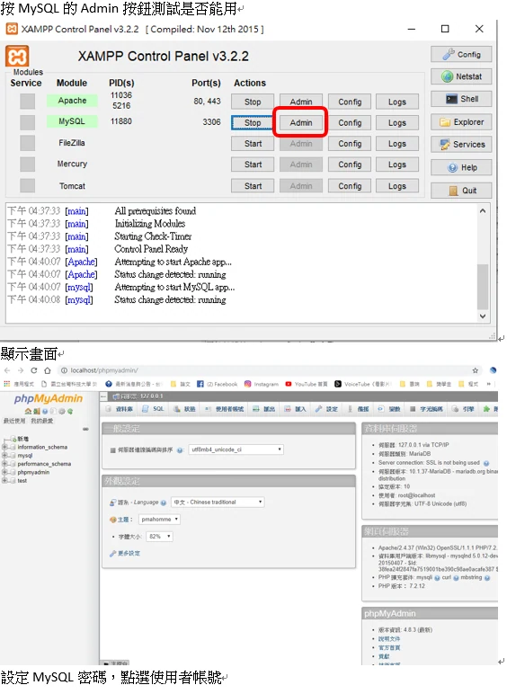

```csharp
using System.Collections;
using System.Collections.Generic;
using UnityEngine;

public class TrailColor : MonoBehaviour {

        //新增陣列放TrailRenderer這個物件進去
	public TrailRenderer[] myTrailRenderer;

        //把所有的TrailRenderer改變成綠色
	public void chageColorGreen () { 
		foreach(TrailRenderer i in myTrailRenderer)
		{
			i.startColor = Color.green;
			i.endColor = Color.white;
		}

	}
        //把所有的TrailRenderer改變成紅色
	public void chageColorRed () {
		foreach(TrailRenderer i in myTrailRenderer)
		{
			i.startColor = Color.red;
			i.endColor = Color.white;
		}

	}


}
```

以上軌跡會由設定的綠色或紅色漸變為白色；若要淡出透明度，需另外調整 alpha。  
startColor 是開始的顏色  

endColor 是結束時的顏色

勘誤參考：[TrailRenderer.colorGradient](https://docs.unity3d.com/ScriptReference/TrailRenderer-colorGradient.html)。
