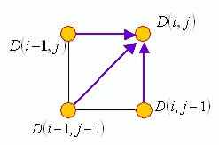
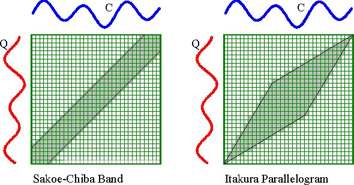

DTW 是 Dynamic Time Warping 的簡稱，中文可以翻譯成「動態時間扭曲」或是「動態時間校正」，這是一套根基於「動態規劃」（Dynamic Programming，簡稱 DP）的方法，可以有效地將搜尋比對的時間大幅降低。

假設有兩個向量 **t** 和 **r**，長度分別是 m 和 n，那麼 DTW 的目標，就是要找到一組路徑 (p<sub>1</sub>, q<sub>1</sub>), (p<sub>2</sub>, q<sub>2</sub>), ..., (p<sub>k</sub>, q<sub>k</sub>)}, 使得經由上述路徑的「點對點」對應距離和 S<sub>i=1</sub><sup>k</sup> ∣t(p<sub>i</sub>) - r(q<sub>i</sub>)∣ 為最小，而且，此路徑必須滿足下列條件：

- 端點關係：(p<sub>1</sub>, q<sub>1</sub>) = (1, 1), (p<sub>k</sub>, q<sub>k</sub>) = (m, n)。此端點關係代表這是「頭對頭、尾對尾」的比對。
- 局部關係：假設最佳路徑上任一點可以表示成 (i, j)，那麼其前一點路徑只有三種可能：(i-1, j), (i, j-1), (i-1, j-1)。此局部關係定義了路徑的連續性，而且也規定了 **t** 的任一個元素至少對應一個 **r** 的元素，反之亦然。

但是，我們要如何很快地找到這條最佳路徑呢？我們可以根據 DP 的原理，來將 DTW 描述成下列三個步驟：

1. 目標函數之定義：定義 D(i, j) 是 t(1:i) 和 r(1:j) 之間的 DTW 距離，對應的最佳路徑是由 (1, 1) 走到 (i, j)。
2. 目標函數之遞迴關係：D(i, j) = ∣t(i) - r(j)∣ + min{D(i-1, j), D(i-1, j-1), D(i, j-1)}，其端點條件為 D(1, 1) = ∣t(1) - r(1)∣
3. 最後答案：D(m,n)。



DTW wiki pseudocode




- 標準 DTW（未加全域視窗限制）

Sequence、Frames 與 distance 是專案自己的資料型別與局部距離函數，需自行提供。以下依前述三種移動方向計算，時間與空間複雜度皆為 O(mn)。

```csharp
double DTWDistance(Sequence input, Sequence template)
{
    int rows = input.Frames.Length, columns = template.Frames.Length;
    double[,] DTW = new double[rows + 1, columns + 1];
    for (int i = 0; i <= rows; i++)
        for (int j = 0; j <= columns; j++)
            DTW[i, j] = double.PositiveInfinity;
    DTW[0, 0] = 0;

    for (int i = 1; i <= rows; i++)
        for (int j = 1; j <= columns; j++)
        {
            double cost = distance(input.Frames[i - 1], template.Frames[j - 1]);
            DTW[i, j] = cost + Math.Min(DTW[i - 1, j],
                Math.Min(DTW[i, j - 1], DTW[i - 1, j - 1]));
        }
    return DTW[rows, columns];
}
```

- Sakoe–Chiba band（以 |i-j| ≤ w 限制搜尋範圍，並非 Itakura parallelogram；若最佳路徑落在視窗外，結果可能不同於不加限制的 DTW）

```csharp
float Pruning_DTWDistance(Sequence input, Sequence output)
{
    int rows = input.Frames.Length, columns = output.Frames.Length;
    float[,] DTW = new float[rows + 1, columns + 1];
    // 10 是示範視窗半寬，可依資料調整；至少包含長度差才能走到終點。
    int w = Math.Max(10, Math.Abs(columns - rows));
    for (int i = 0; i <= rows; i++)
        for (int j = 0; j <= columns; j++)
            DTW[i, j] = float.PositiveInfinity;
    DTW[0, 0] = 0;

    for (int i = 1; i <= rows; i++)
        for (int j = Math.Max(1, i - w); j <= Math.Min(columns, i + w); j++)
        {
            float cost = distance(input.Frames[i - 1], output.Frames[j - 1]);
            DTW[i, j] = cost + Math.Min(DTW[i - 1, j],
                Math.Min(DTW[i, j - 1], DTW[i - 1, j - 1]));
        }
    return DTW[rows, columns];
}
```

參考來源:  
1.[mirlab.org](http://mirlab.org/jang/books/dcpr/dpDtw.asp?title=8-4%20Dynamic%20Time%20Warping&language=chinese)  
2.[stackoverflow.com](https://stackoverflow.com/questions/34337005/how-do-i-implement-a-pruning-strategy-with-a-dtw-algorithm)  
3. Wiki DTW

勘誤參考：[AudioLabs：Dynamic Time Warping](https://www.audiolabs-erlangen.de/resources/MIR/FMP/C3/C3S2_DTWbasic.html)。
