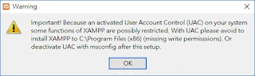
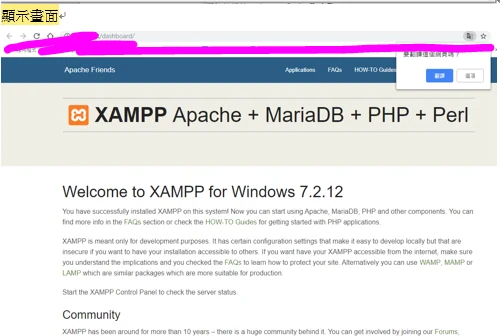
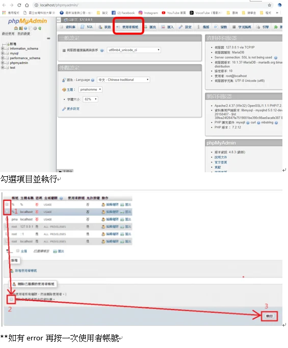
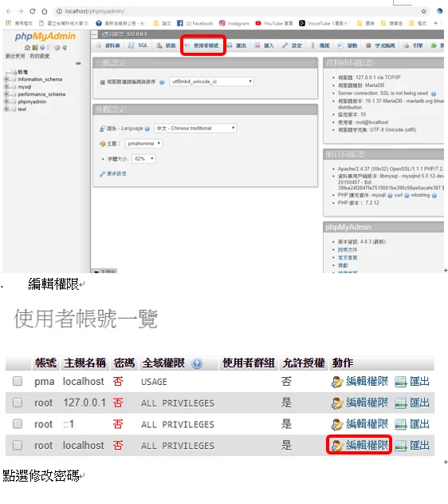
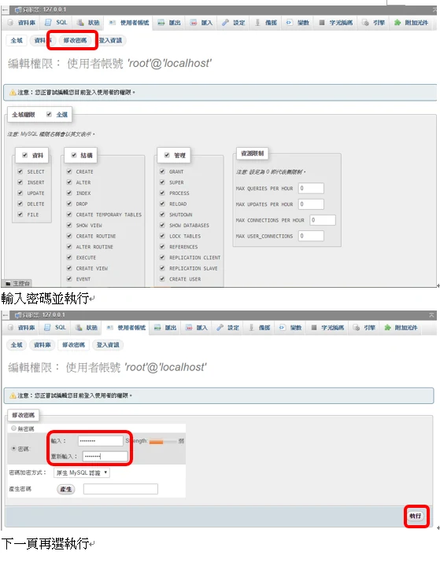
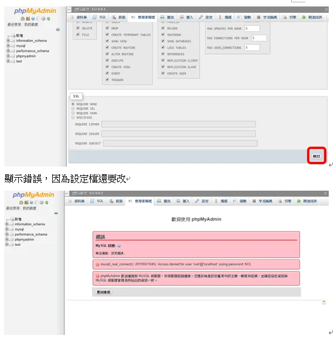
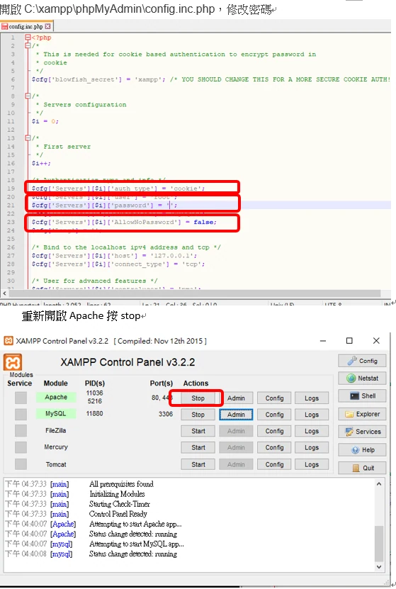
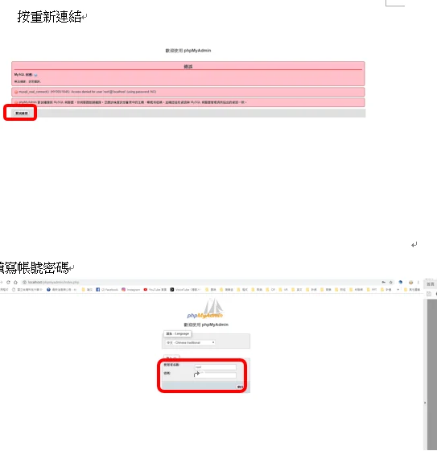

但是一開始安裝時候就出現了以下的視窗

Important! Because an activated User Account Control (UAC) on your system some functions of XAMPP are possibly restricted.With UAC please avoid to install XAMPP to C:\\Program Files(Missing Write permissions). Or Deactivate UAC with msconfig after this setup.  
只要先按**OK**在選擇 安裝在其他位置即可 ex:**C:\\XAMPP 為預設值**

解除 PHP 上傳大檔案限制

開啟C:\\xampp\\php\\php.ini檔，按ctrl+F分別搜尋並更改upload\_max\_filesize、post\_max\_size還有memory\_limit這三個參數，並儲存。

upload\_max\_filesize = 50M

post\_max\_size = 200M

memory\_limit = 512M

max\_execution\_time = 600

max\_input\_time = 600

default\_socket\_timeout = 600

舊的 mysql.connect_timeout 屬於已移除的 mysql 擴充套件，不適用 mysqli／PDO；請勿照填此項。

若需調整 phpMyAdmin 的匯入執行時間，在 `C:\xampp\phpMyAdmin\config.inc.php` 設定 `$cfg['ExecTimeLimit'] = 600;`（單位為秒），不要修改套件的 `libraries/config.default.php`。儲存 php.ini 後重新啟動 Apache；時間與容量依實際需求調整，並非愈大愈好。

著作權:陳昱文

勘誤參考：[phpMyAdmin Configuration](https://docs.phpmyadmin.net/en/latest/config.html#cfg_ExecTimeLimit)。
