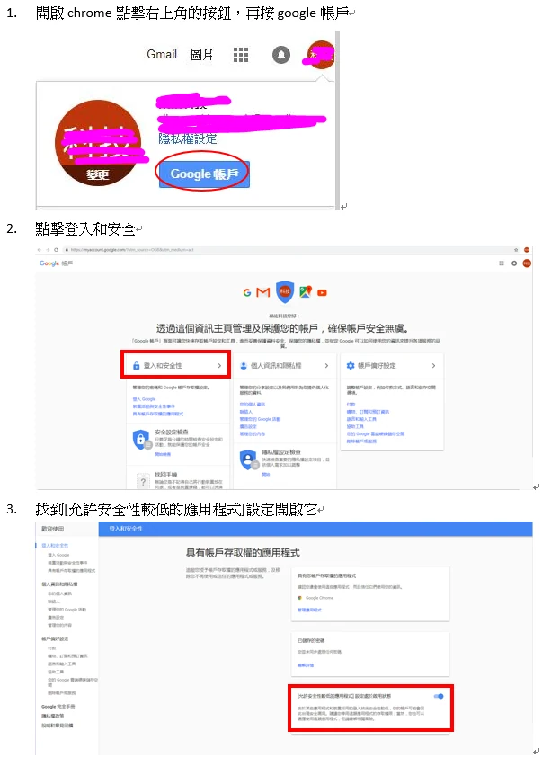
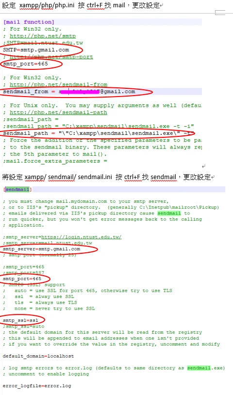
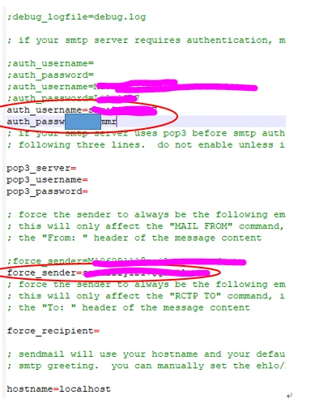

> 基本流程是先取得寄信服務商提供的 SMTP 主機、連接埠與 TLS／驗證方式，再設定寄信程式並寄測試信；XAMPP 本身不會替你建立可對外寄信的信箱。Windows 上若服務商要求 SMTP 驗證與 TLS，可使用 PHPMailer 的 SMTP 範例，參數請依該服務商文件填寫。

著作權:陳昱文

勘誤參考：[PHPMailer 官方使用範例](https://github.com/PHPMailer/PHPMailer)。
