> 文字步驟補充：先啟用 Windows 的 IIS、FTP Server 與 IIS 管理主控台，在 IIS 的 Sites 新增 FTP Site，指定資料夾與繫結，再設定驗證、授權及該資料夾的 Windows 權限。對外連線時採用憑證並要求 SSL（FTPS）；普通 FTP 的帳密與內容不會加密。本文是 Windows 10 時期的操作紀錄，介面與支援狀態請核對目前系統。

手把手教你如何架FTP，以windows 10為例子

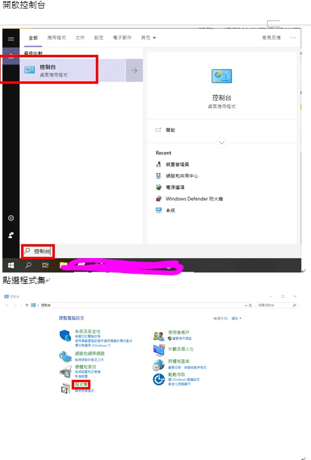

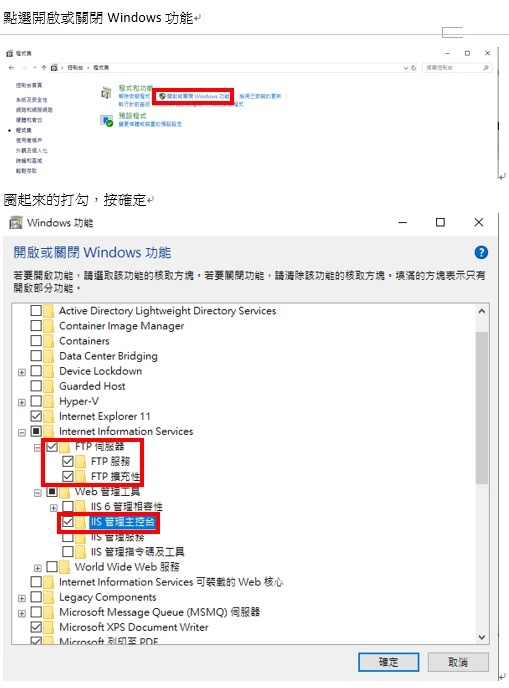

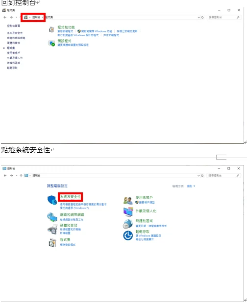

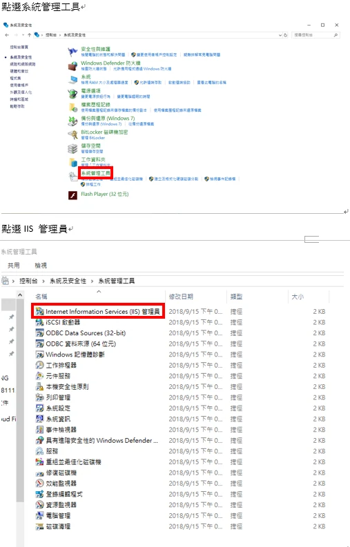

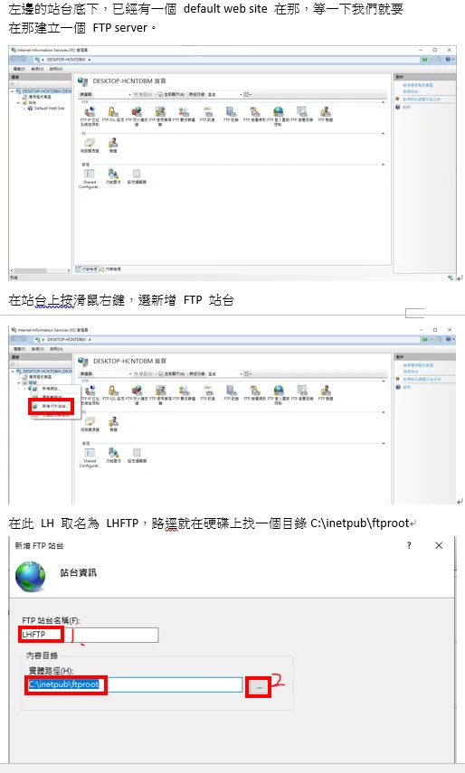

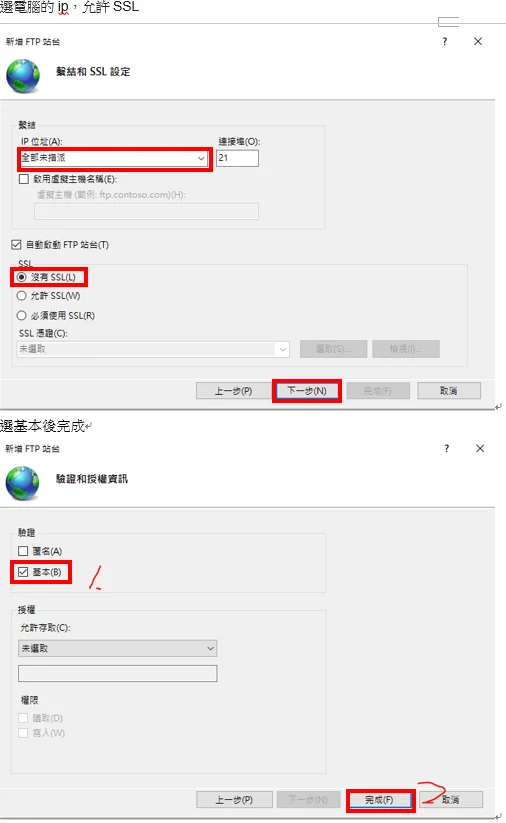

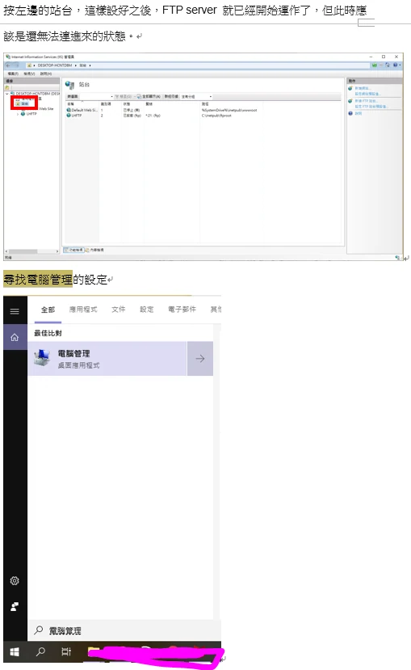

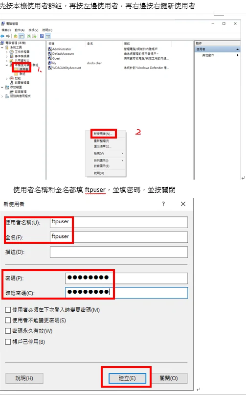

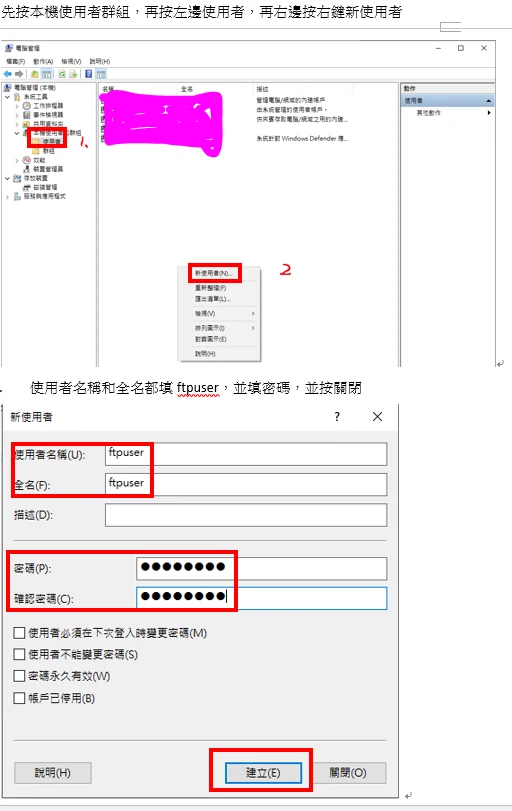

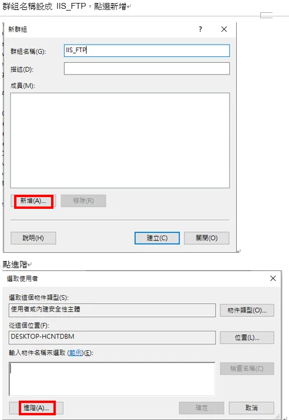

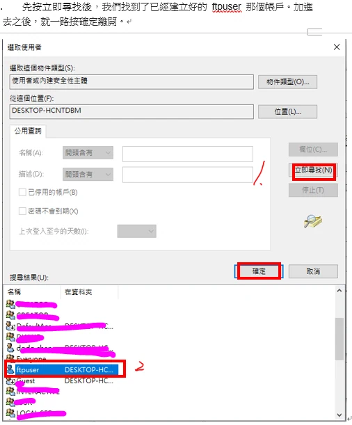

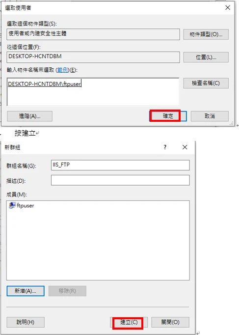

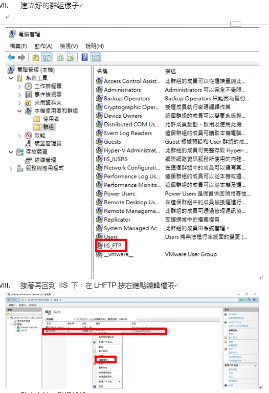

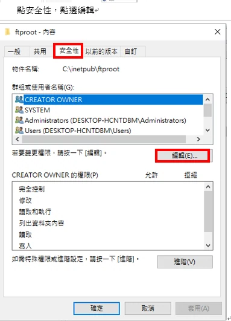

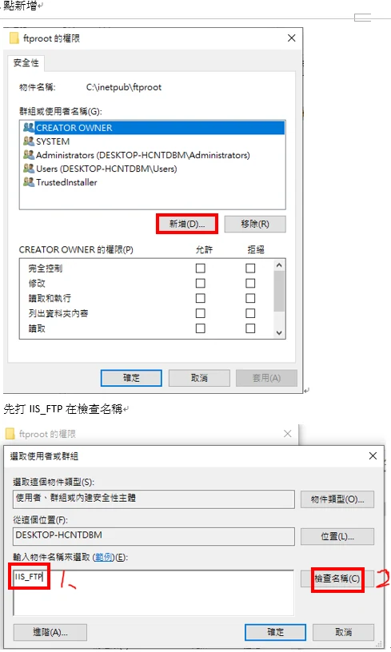

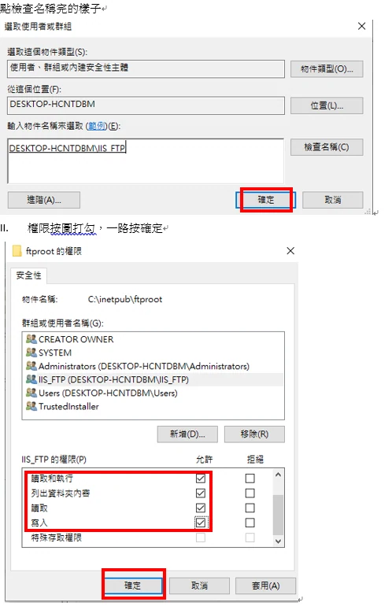

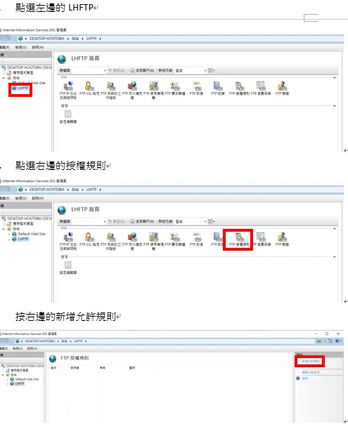

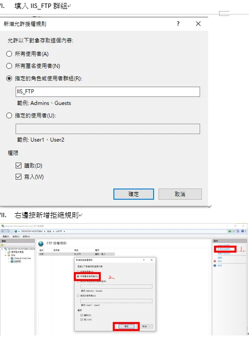

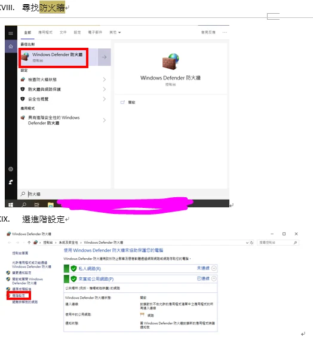

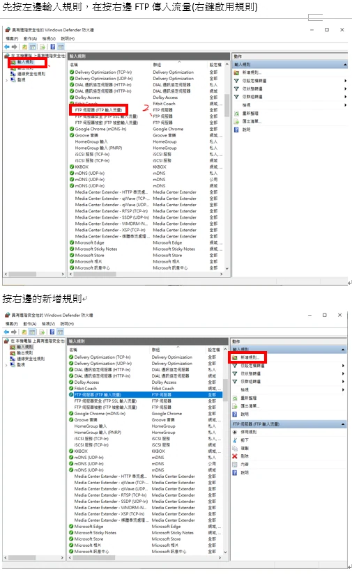

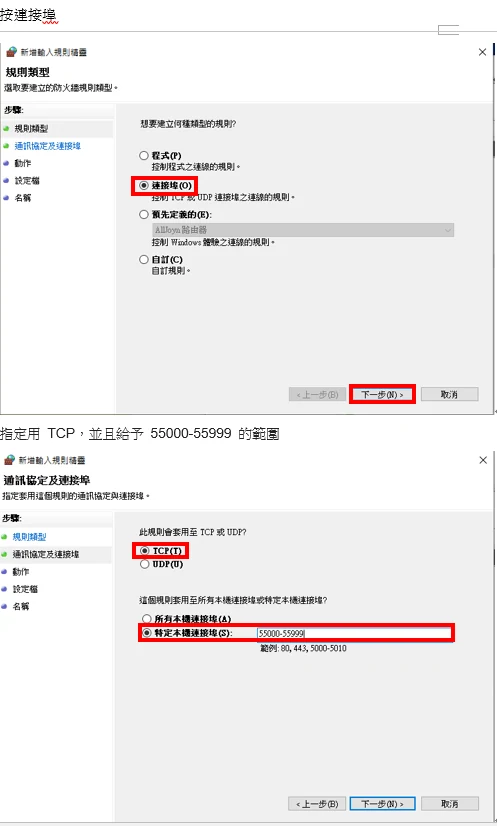

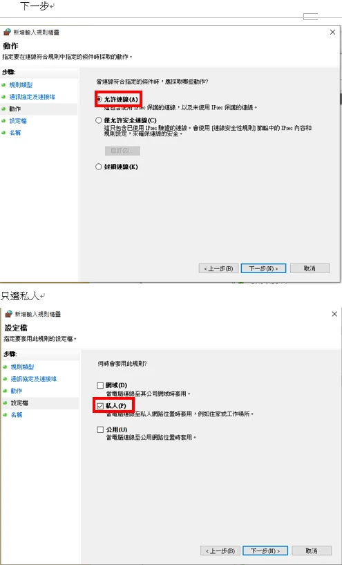

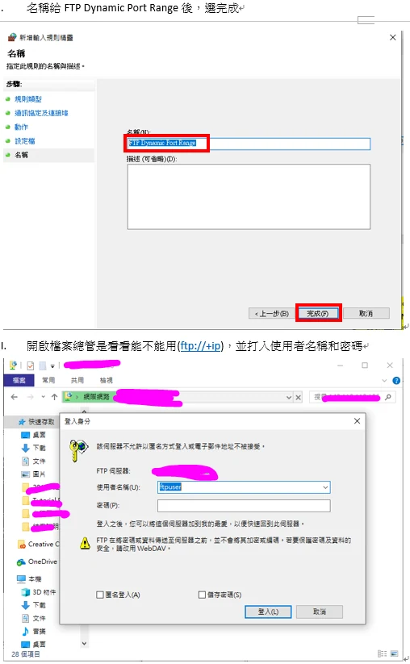

著作權:陳昱文

勘誤參考：[Microsoft：建立 IIS FTP 站台](https://learn.microsoft.com/en-us/iis/publish/using-the-ftp-service/creating-a-new-ftp-site-in-iis-7)。
