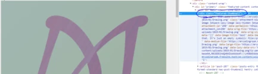
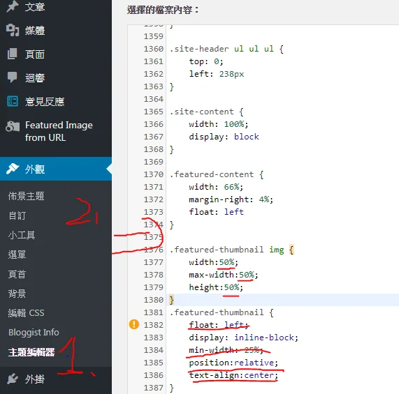

1. 使用Chrome 的「檢查」開發者工具查看class的名稱
2. 在 WordPress 的「額外 CSS」或子佈景主題加入覆寫樣式，避免直接修改母佈景主題而在更新時遺失。
3. 修改CSS語法 (如果你選用主題沒有的話就找不到 / 我用的是bloggist)
4. 有快取，所以要清除或用無痕視窗查看效果

勘誤參考：[WordPress：子佈景主題](https://developer.wordpress.org/themes/advanced-topics/child-themes/)。
