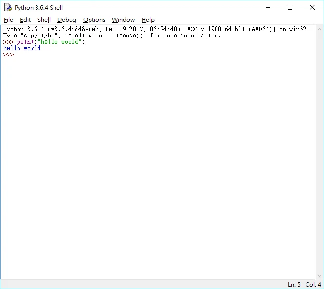

> 本文示範的是 Python 3.7 時期的 Windows 安裝畫面，並非目前建議安裝的版本；新安裝請到 Python 官方下載頁選擇仍受支援的版本。

1. [按此到官網去載安裝程式](https://www.python.org/downloads/release/python-372/)

2. Windows 64bit，就要下載Windows x86-64 executable installer

3. 勾取安裝程式中的 Add Python 3.x to PATH和Install launcher for all users(recommended)然後點擊Install Now (都要打勾)

4. 去安裝位置打開 Python IDLE (python shell)

5. 打上 print("hello world") 按下ENTER大功告成

輕鬆簡單又Easy ，我從 html 到 C++ 到 java VB C# 學習過程中少數跟html簡單易學的。我推薦從C開始學起，但如果對程式有畏懼感的可以從python開始學起，比較快有成就感，也好上手。

勘誤參考：[Python 官方下載](https://www.python.org/downloads/)。
