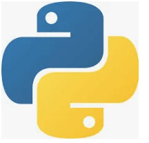
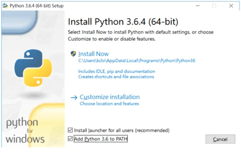
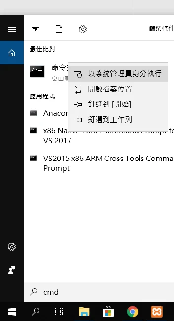
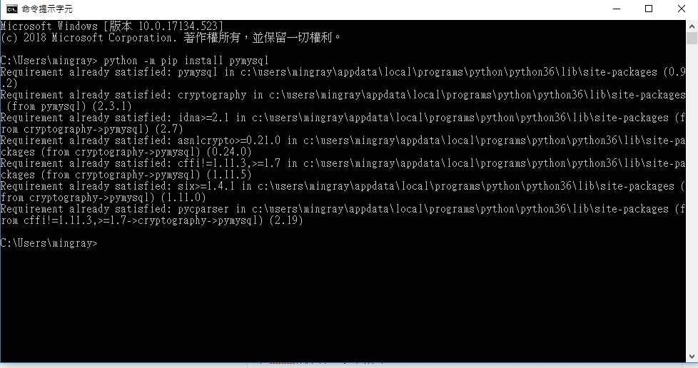
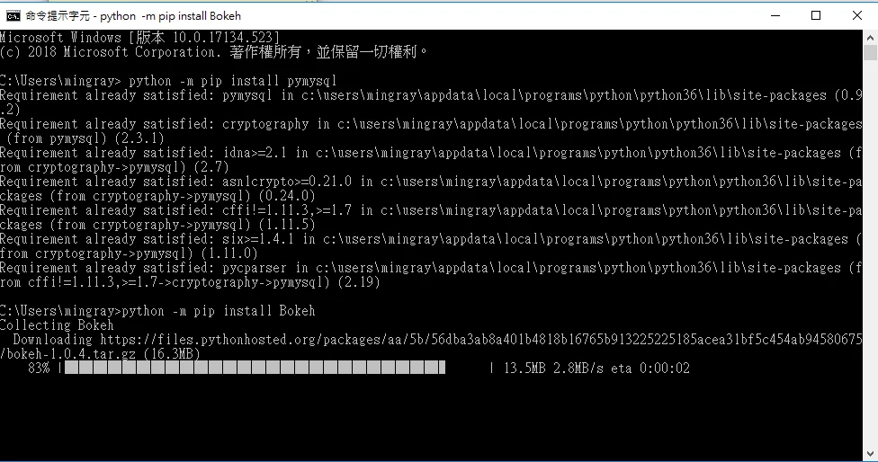

python 3.x

上篇只要你安裝有打勾path這個選項↑，就不用設定環境變數囉!  
而且這內建有幫你安裝pip這個套件，可以直接在CMD裡面下指令安裝套件  
以下為範例教學

1. 搜尋 CMD，以一般使用者開啟即可；建議先建立專案虛擬環境，啟用後再安裝套件，避免更動系統 Python。

在CMD依序打上以下指令:

python -m pip install 套件名字

例如我安裝python上面裝mysql套件：

python -m pip install pymysql

因為我安裝過python的mysql套件，所以才會出現already的字樣

下面的Bokeh是我沒安裝過的套件，所以會有進度條 Successfully install Bokeh 代表安裝成功且結束

勘誤參考：[Python：虛擬環境與套件](https://docs.python.org/3/tutorial/venv.html)。
