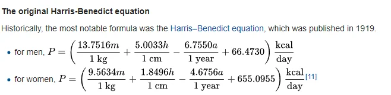
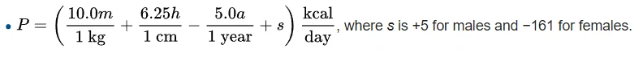
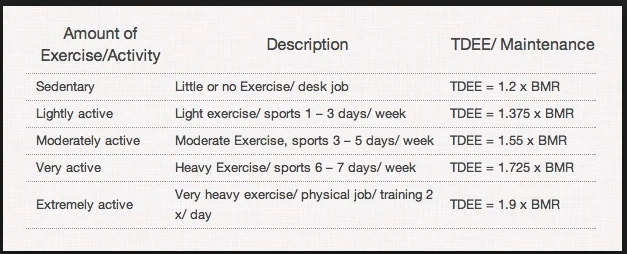
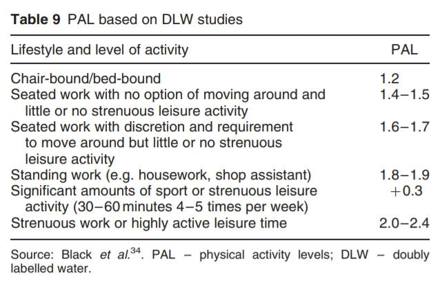
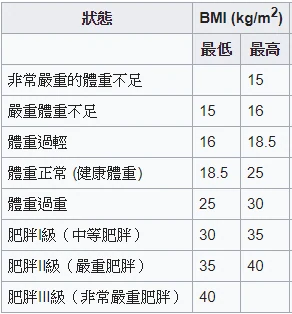

這篇用 Mifflin–St Jeor 公式示範靜息能量消耗估算。公式發表於 1990 年；下方引用的 2005 年文獻是比較預測公式的系統性回顧，不是 2005 年新發明的 BMR 公式。

下方 TDEE 的「運動天數 × 強度 + 工作型態」分數與分級倍率是這個程式的自訂示範，沒有經文中所附文獻驗證，不能宣稱比其他計算機更準確。

- BMR是指 **基礎代謝率**（英語：**basal metabolic rate**）是指在自然溫度環境中，恆溫動物（比如人）的身體在非劇烈活動的狀態下，處於非消化狀態，維持生命所需消耗的最低能量。

**意思就是你每天不動只要還活著，就會消耗的大卡**

- TDEE（**total daily energy expenditure**）是**每日總能量消耗**。活動係數 PAL 是總能量消耗與基礎代謝率的比值，不能把 TDEE 和 PAL 混為一談。

**就是結合BMR跟你每周運動量，來顯示你平均一天會消耗多少大卡**

而 BMI = 體重（kg）÷ 身高（m）的平方，即 `weight / (height * height)`。  
原程式另列出 TDEE 的 ±15% 作為算術示例，並非適合所有人的飲食建議。成人估算也不適用於兒童、青少年或孕期。  
以下是文獻區

1. 2005 年預測公式比較文獻 [wiki](https://en.wikipedia.org/wiki/Basal_metabolic_rate)、[paper](https://www.ncbi.nlm.nih.gov/pubmed/15883556)
2. ~~2017新TDEE文獻 [paper](http://nationalacademies.org/hmd/~/media/Files/Activity%20Files/Global/2017-sept-21-GlobalHarmonizationofMethod/3%20Measurement%20Activity%20and%20Variability%20in%20BMR.pdf?la=en)~~ (2020)連結失效

重要文獻區截圖：



舊BMR公式



Mifflin–St Jeor 估算公式



舊TDEE



原文引用的活動量表



下例採成人常見 BMI 分界（18.5、25、30、35、40），不等同台灣成人 BMI 分界。  
(BMI沒看你的脂肪跟肌肉含量，所以參考就好)

```html
<form name="form" id="form">請選擇性別:
<select id="gender">
　<option value="1">男性</option>
　<option value="2">女性</option>
</select>
  <br><br>年齡：
  <input type="number" id="age" min="20" max="99" required="required"> 
   <br><br>身高(cm)：
  <input type="number" id="height" min="120" max="240" required="required"> 
   <br><br>體重(kg)：
  <input type="number" id="weight" min="30" max="200" required="required"> 
<br><br>每周運動天數：
  <select id="days">  
　<option value="1">1天</option>
　<option value="2.5">2~3天</option>
  <option value="4.5">4~5天</option>
  <option value="7">天天</option>
  <option value="0.1">沒在運動</option>
</select>
<br><br>每次運動強度：
 <select id="strength">
　<option value="2">有氧運動</option>
　<option value="3">高強度有氧</option>
　<option value="3">有氧+重訓</option>
  <option value="3.5">高強度重訓</option>
  <option value="5">高強度有氧+高強度重訓</option>
  <option value="1">走路散步或沒有</option>
</select>
<br><br>工作型態：
  <select id="work">
　<option value="1">坐著居多</option>
  <option value="6">站著居多</option>
　<option value="3">坐跟站時間接近</option>
  <option value="14">勞力密集工作</option>
</select>
  <br><br><input type="submit" id="submit" value="計算">
</form>
<p id="demo"></p>
```

```html
<script>

document.getElementById("form").onsubmit = submit;

var bmr =0,tdee=0,tdee_index=0,bmi=0;
var bmi_result;

function submit(event) {
  
 var  gender= document.getElementById('gender').value;
 var  age= document.getElementById('age').value;
 var  height= document.getElementById('height').value;
 var  weight= document.getElementById('weight').value;
 var  days= document.getElementById('days').value;
 var  strength= document.getElementById('strength').value;
 var  work= document.getElementById('work').value;

if(gender==1)
bmr = 10*weight + 6.25*height -5*age+5 ;
else
bmr = 10*weight + 6.25*height -5*age -161;


bmi = weight/((height/100)*(height/100))

tdee_index =  days * strength + parseInt(work);


if(tdee_index <6)
tdee = 1.2*bmr;
else if(tdee_index <10)
tdee = 1.4*bmr;
else if(tdee_index <14)
tdee = 1.6*bmr;
else if(tdee_index <18)
tdee = 1.8*bmr;
else if(tdee_index <22)
tdee = 2.0*bmr;
else
tdee = 2.2*bmr;

if(bmi<18.5)
bmi_result = "體重過輕";
else if(bmi<25)
bmi_result = "體重正常";
else if(bmi<30)
bmi_result = "體重過重";
else if(bmi<35)
bmi_result = "第一級肥胖";
else if(bmi<40)
bmi_result = "第二級肥胖";
else if(bmi>=40)
bmi_result = "第三級肥胖";


  document.getElementById("demo").innerHTML = "靜息能量估算：　"+bmr.toFixed(1) +"大卡<br> BMI：　" +bmi.toFixed(0)+" <br>體態：　"+ bmi_result + "<br>TDEE：　" + tdee.toFixed(0) +"大卡<br><br>(---自訂活動係數的算術示例---)<br><br>減脂、減重：　"+(tdee*0.85).toFixed(0)+" 大卡 <br>維持住體重：　"+tdee.toFixed(0)+ " 大卡 <br>增肌、增重：　"+(tdee*1.15).toFixed(0)+" 大卡";
	event.preventDefault();
}

</script>
```

 

這裡呈現

最後跟**大家提醒**，我本人的BMR用儀器量出來約**1700**大卡，  
公式計算為**1810**大卡，雖然相近但還是有一定的誤差，  
大家需要**根據自身狀況來調整喔** !   
**公式跟數據可以當參考依據，但不要當唯一標準。**

勘誤參考：[Mifflin 等人，1990](https://pubmed.ncbi.nlm.nih.gov/2305711/?dopt=Abstract)。

勘誤參考：[FAO：成人能量需求與 PAL](https://www.fao.org/4/y5686e/y5686e07.htm)。

勘誤參考：[CDC：成人 BMI 分類](https://www.cdc.gov/bmi/adult-calculator/bmi-categories.html)。
