> 本文為 2019 年 GitHub Pages 與 Freenom 的舊版畫面。現在 GitHub Pages 在 Settings → Pages 設定來源及自訂網域；免費網域是否可申請與續用，請以註冊商當時方案為準。

1.申請 Github帳號

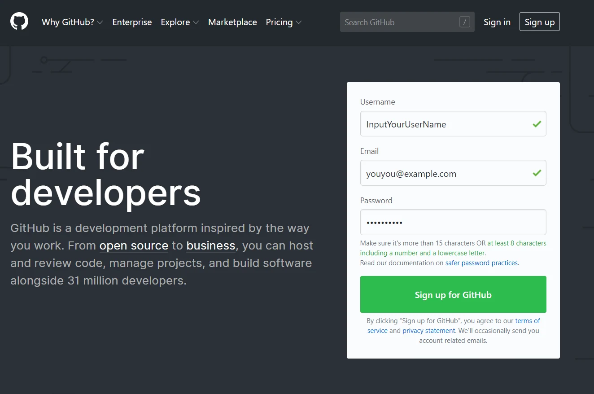

2.申請完之後開請新的專案

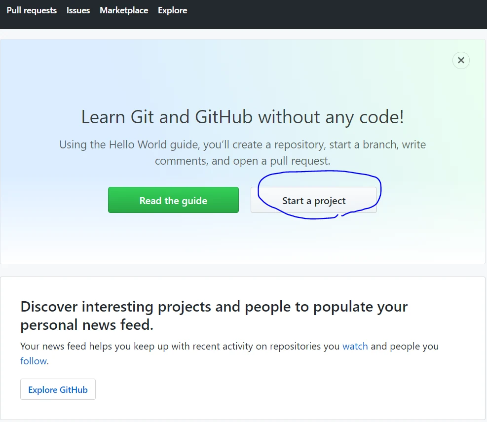

3. 輸入資訊，最後一像我都有打勾

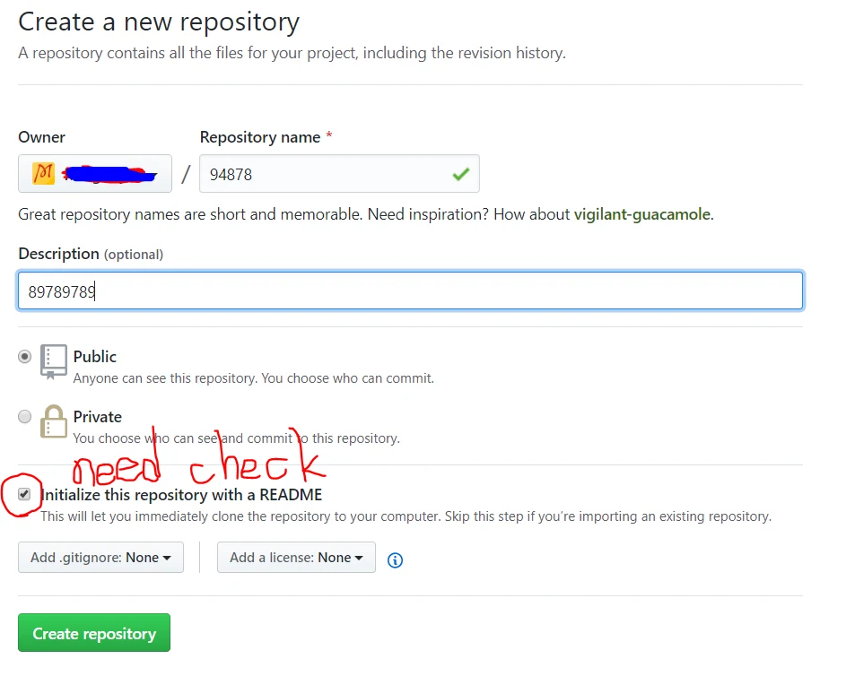

4. 之後選擇settings

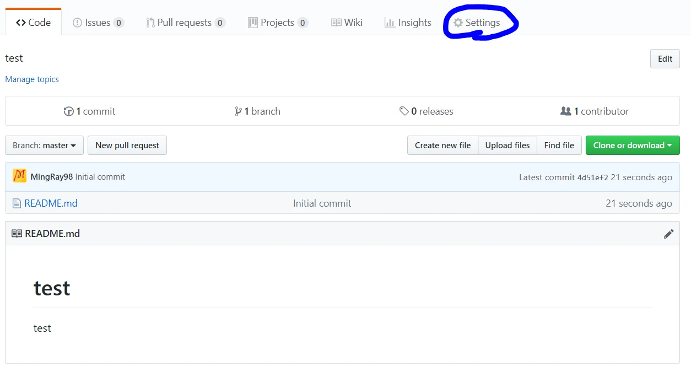

5.往下找選到主題

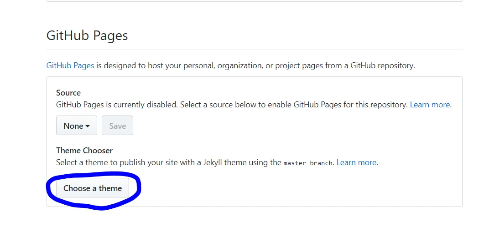

6. 新手常常忘記要按提交(對就是我)

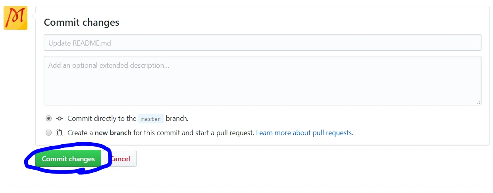

7. 已經有網址囉!

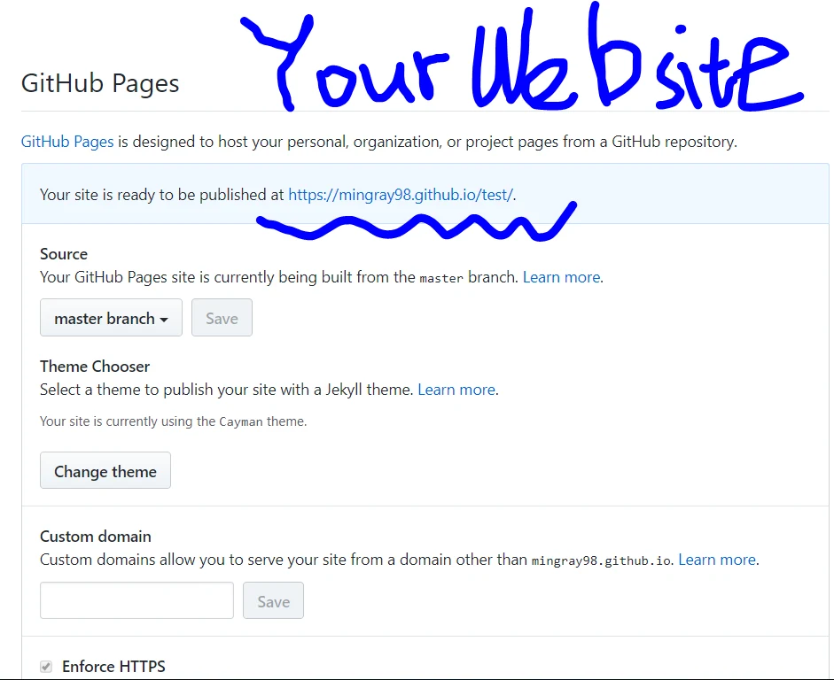

恭喜你完成第一像自建網站囉!!!

------------------------------以下開始申請免費Domain------------------------

1.Google freenom 找到他並且輸入你要的網址，檢查可用性

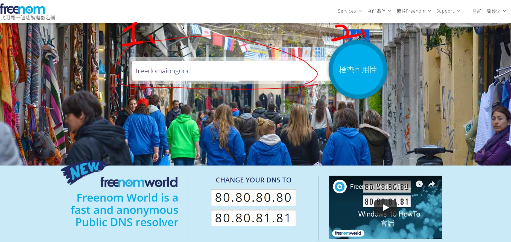

2. 選擇一個免費你要的網址

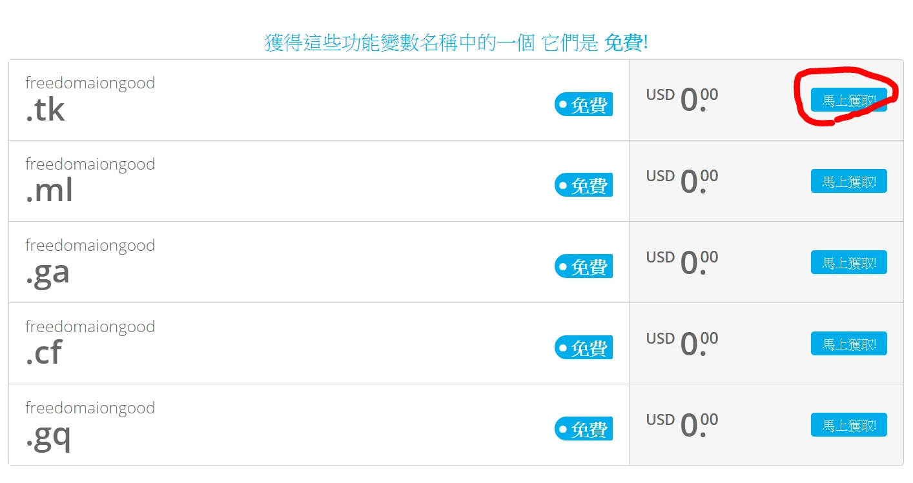

3. 超過12個月要付費，我都剛好選12個月

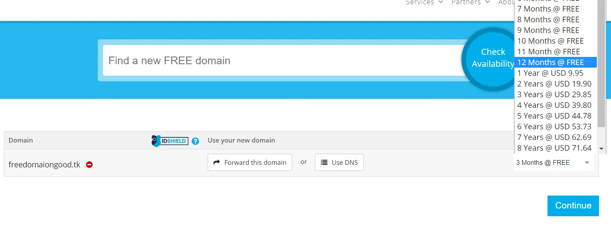

4. 申請好後會較你付款申請帳號，好了後右上角選擇Services選My Domains  
且選擇Manage Domain這個選項

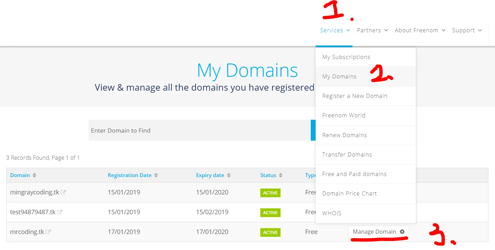

5. 選擇管理你的DNS

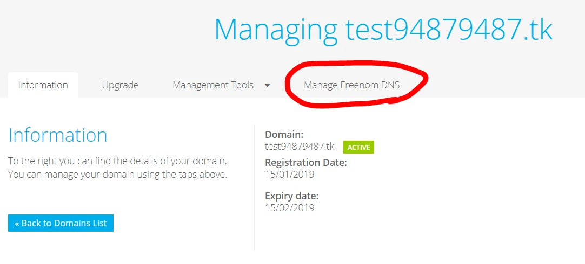

6. 依 GitHub Pages 官方文件設定 DNS；Pages 的 A 記錄 IP 是共用的，並非每個帳號都有獨有 IP。

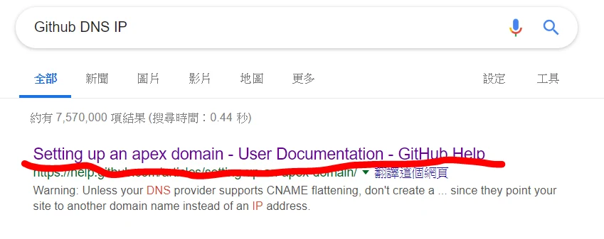

7. 看完之後去freenom設定

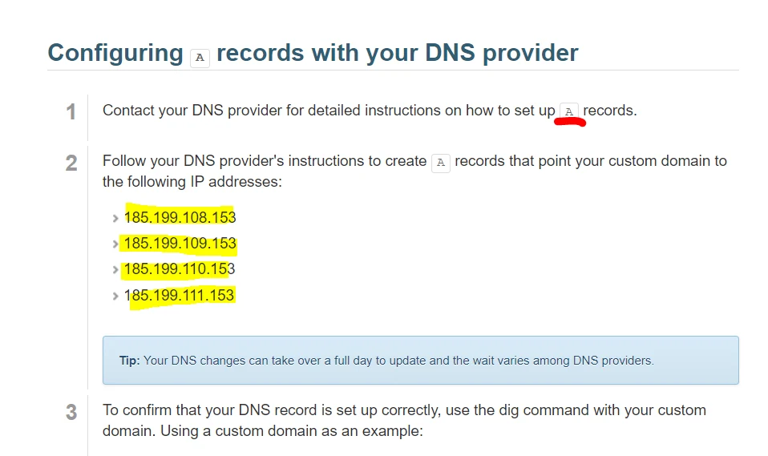

8. 根網域的 A 記錄指向官方列出的 GitHub Pages IP；`www` 子網域的 CNAME 建議直接指向 `<你的帳號>.github.io`，不要加 `https://` 或專案路徑。先在 Pages 綁定自訂網域，再新增 DNS 記錄。

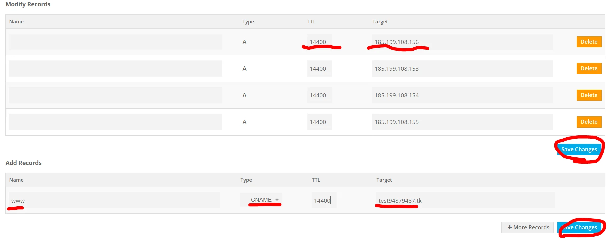

這邊的DNS IP我複製錯了哈哈哈哈，我很87，錯誤示範

9. 再來回來剛剛的專案，選擇code建立新檔案

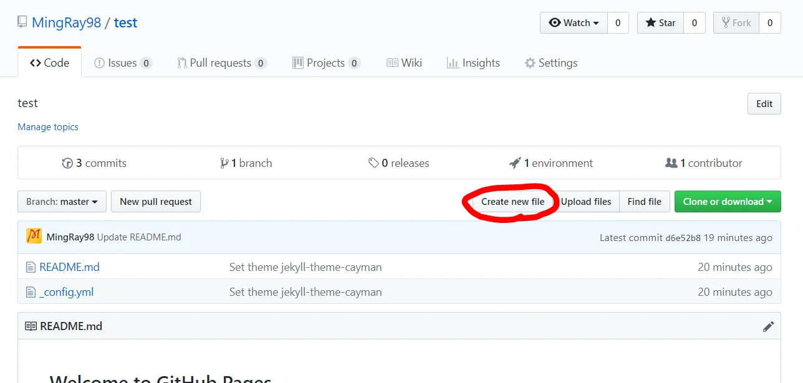

10. 以分支發布時，來源目錄中的檔名為 `CNAME`，內容是自訂網域，不含協定；使用自訂 GitHub Actions 工作流程時不需要此檔。

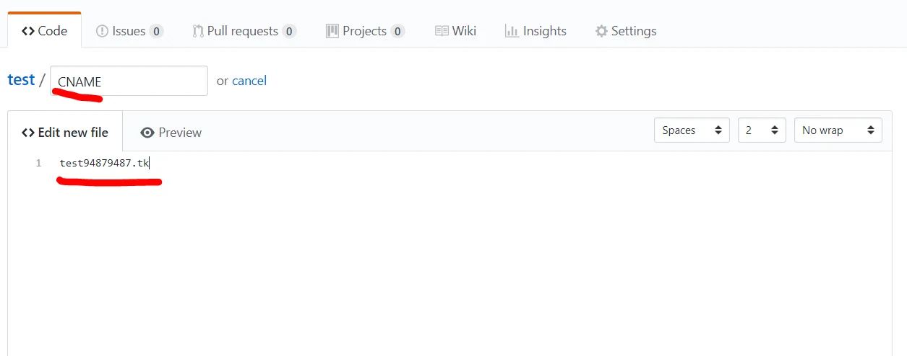

11. 建立好之後，回來settings 在custom domain輸入你要的網址且 Save

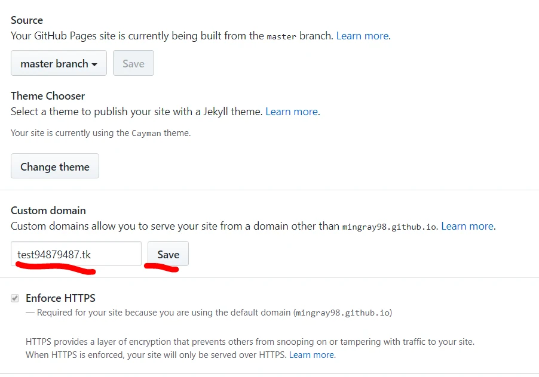

12. 成功囉!! 如果沒成功導向你的免費網址，github會跟你說喔!

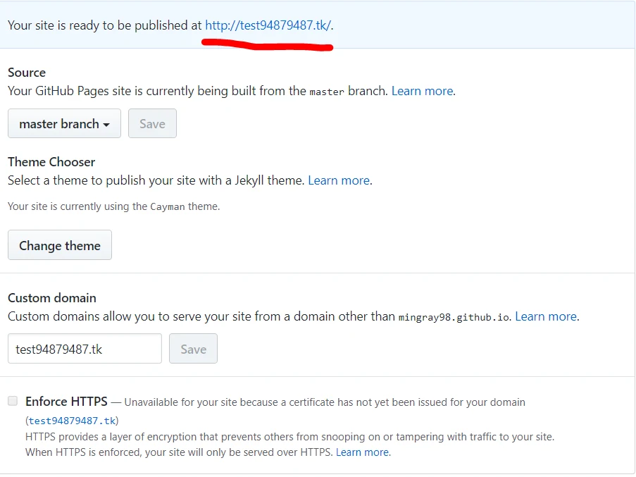

是不是很簡單呢? 建立一個網站+申請Domain不用10分鐘喔  
~~範例連結~~**tk結尾的連結過期後，**

**全部變成導向色情網站的連結，**

**母湯歐北亂點= =**

勘誤參考：[GitHub Pages 自訂網域設定](https://docs.github.com/en/pages/configuring-a-custom-domain-for-your-github-pages-site/managing-a-custom-domain-for-your-github-pages-site)。
