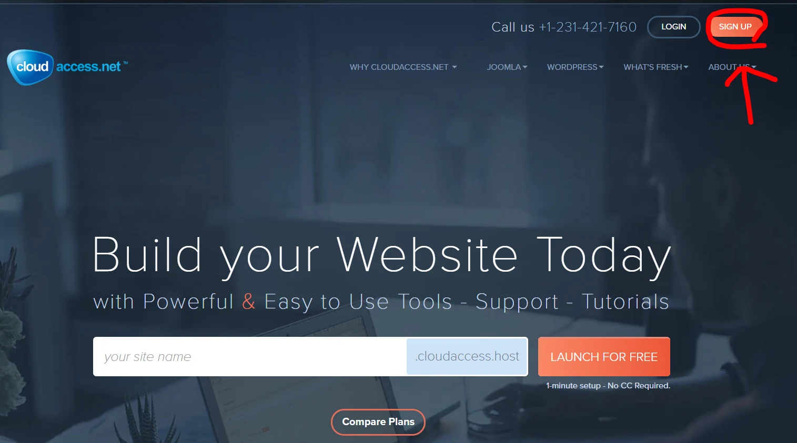
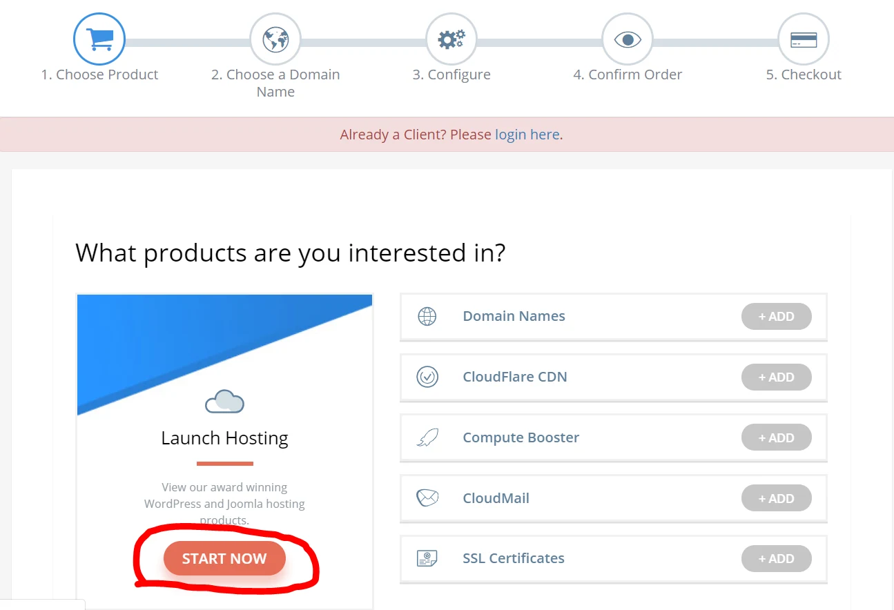
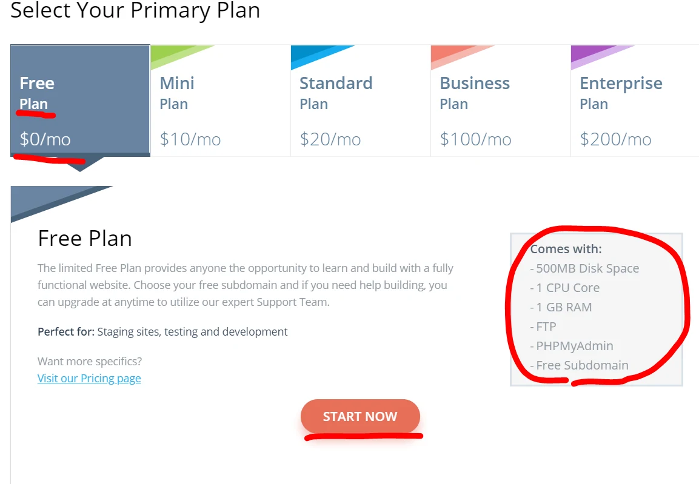
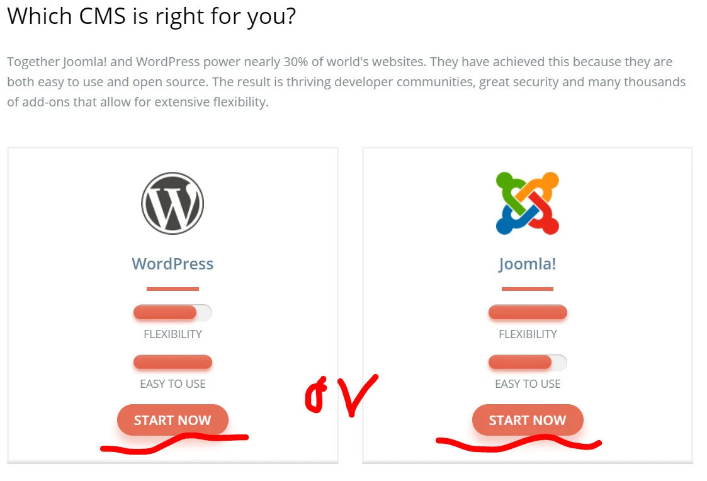
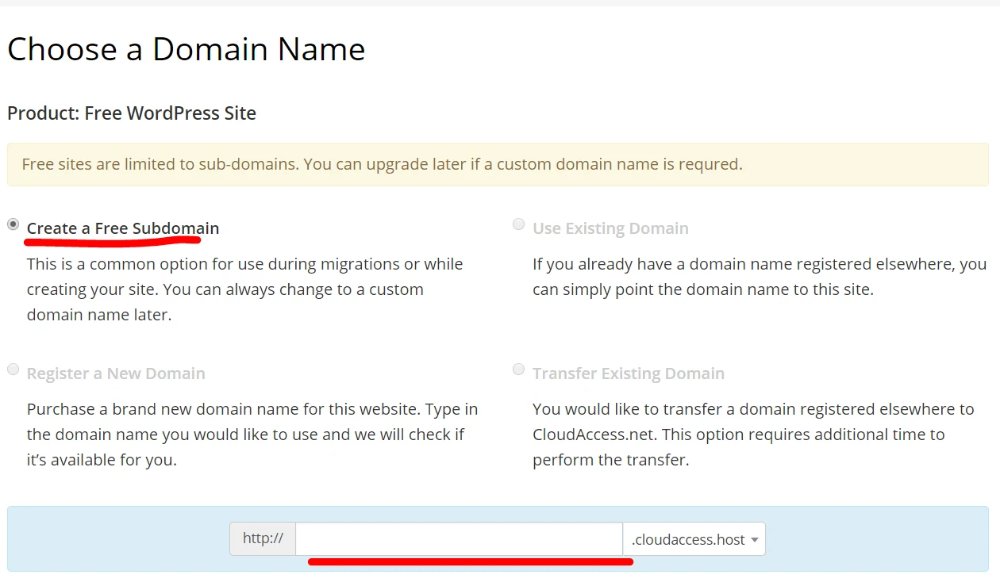
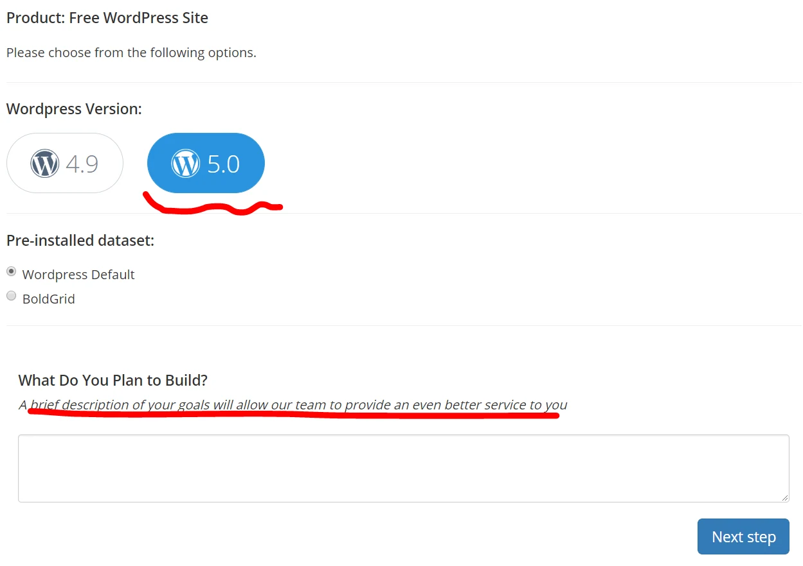
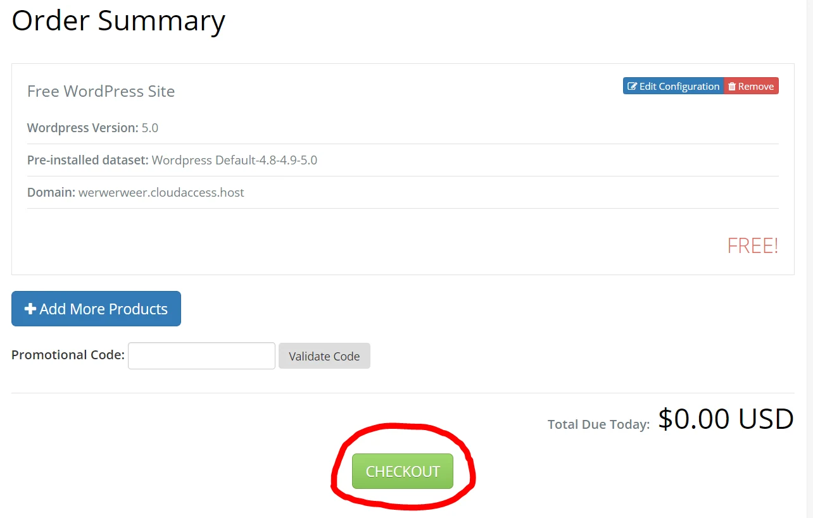
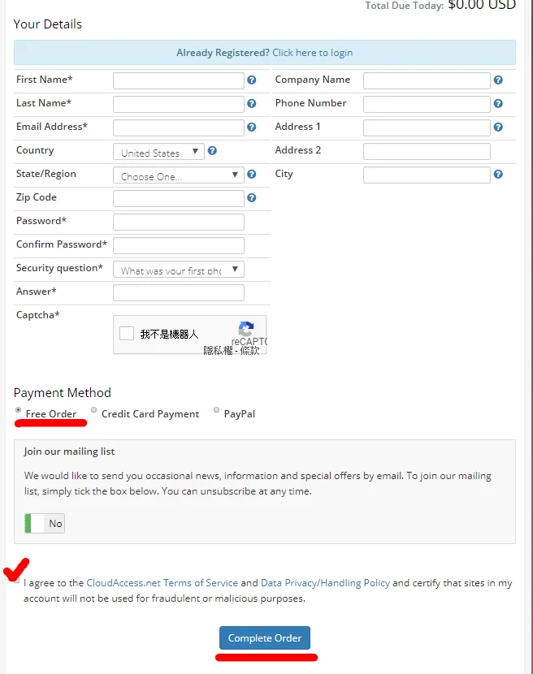
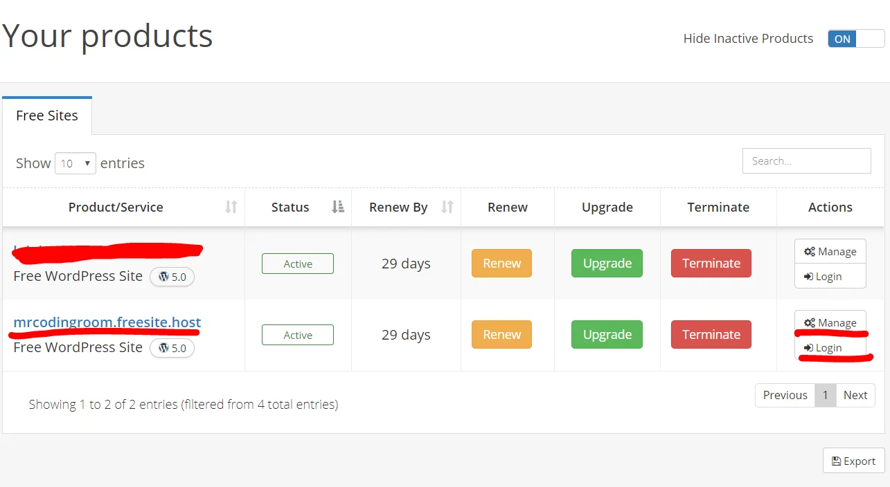

> 本文保留 2019 年的使用心得與操作畫面；方案、限制及介面請以服務商目前公告為準。

今天分享給大家，如何註冊不錯的host架blog ~ 以下是優缺點及教學  
[點我前往](https://www.cloudaccess.net/)

優點：

1. 專門給blog的Ｈost，很穩定值得信賴
2. 一鍵註冊安裝輕鬆方便
3. 免費

缺點：

1. 只能免費30天，不然要記得去Renew你的網站，不然會被刪掉
2. 免費版的不能給用免費申請的Domain有點QQ
3. 只有blog功能，其他的不能用
4. 你不能侵犯法律著作權、盜版、非法商用及色情用途，一但被發現就有權直接把你的帳號砍掉或停權
5. 免費的空間很小，但流量號稱沒有限制(通常流量衝高還是很高機率被鎖)

1.註冊帳號

2. 開始以下很簡單不需要步驟教學哈哈

這邊一定要解釋要用來幹嘛，如果是違法用途很可能被砍掉

藍色是你的網站網址、第一次登入要用Login右邊那個按鈕

看完以上分享，有沒有覺得很簡單呢? 大家如果有興趣就自己來架一個吧

之後會跟大家推薦有哪些好用的WP外掛跟如何改變成中文版

歡迎使用我的會員推薦碼，來註冊 **CloudAccess** 方便簡單的 虛擬主機喔  
[https://ccp.cloudaccess.net/aff.php?aff=12577](https://ccp.cloudaccess.net/aff.php?aff=12577)
