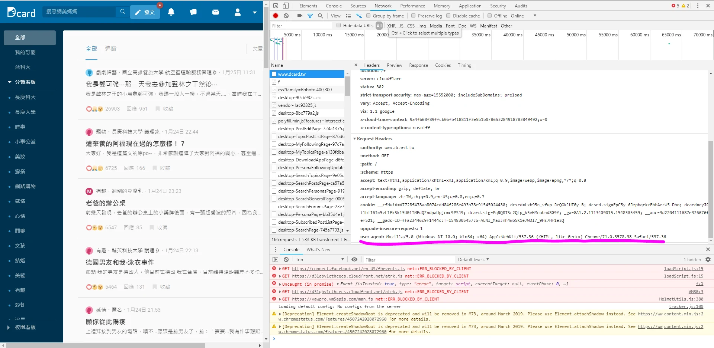

> 此文保留的是非官方 Dcard 端點與舊版 JSON schema 的解析範例；不能保證目前仍有 media 等相同欄位。

今天跟大家分享如何用狄卡API的json格式來爬圖片

先安裝 requests 與 wget；json 是 Python 標準函式庫，不用另外安裝。

```sh
python -m pip install requests wget
```  

Python 3 原始碼預設就是 UTF-8；請將檔案存成 UTF-8。`# -*- coding: utf-8 -*-` 是可選的原始碼編碼宣告，不會替 HTTP 回應或其他檔案自動轉碼。

接下來我來接紹DcardAPI

抓前30篇文章的標題:  
https://www.dcard.tw/\_api/forums/\[看板\]/posts  
個別文章:  
https://www.dcard.tw/\_api/posts/\[文章編號\]  
抓文章下面的前30篇留言  
https://www.dcard.tw/\_api/posts/\[文章編號\]/comments  
抓引用此篇文章的回覆連結(幾乎用不到)  
?popular=\[false:最新;true:熱門\]  
?before=\[文章就是ID,留言就是幾樓來看\]  
?after=\[ title-ID/comments-floor\]

多個條件或和要用& 第一個特殊條件要加?

這邊要注意的是文章跟留言Dcard呈現方式剛好相反  
文章愈新愈前面，留言是愈新愈後面，  
雖然before都是裝這個時間點以前的文章   
after是抓這個時間點以後的文章，但容易搞混  

以下為示範  
https://www.dcard.tw/\_api/forums/trending/posts?popular=true&before=230571655  
用熱門程度去排序抓在230571655這文章之前的  
https://www.dcard.tw/\_api/posts/230571655/comments?after=40  
抓這篇留言正常排序的狀況下抓40樓以後的留言

既然取得了API當然要知道如何解析他  
介紹一個好用的網站Json Parser Online  
[點此](http://json.parser.online.fr/)  
只要放進去json格式就會排排站  
這樣就很好解析到底要抓什麼欄位囉!  

基本上就是   
title   
media  
content  
這幾個欄位比較常用 標題 圖片 跟內文，懂了之後就開始解析囉!

這是 2019 年觀察到的非官方端點，不保證現在仍可用；回應可能是 403、429、503 或非 JSON，增加 User-Agent 也不保證成功。請遵守站方使用規範，若被拒絕便停止請求。



當年曾用 F12 觀察請求標頭；標頭不等於取得存取許可。

```python
# -*- coding: utf8 -*- 
import sys
import requests
import json
import os
import wget

#取代違法字源的方法
def text_cleanup(text):
    new =""
    for i in text:
        if i not in r'\/:*?"<>|':
            new += i
    return new.rstrip(" .") or "untitled"

print("開始爬蟲")

# 以下保留當年的 User-Agent 示範，不保證可存取目前端點。

header = {

    'user-agent': 'Mozilla/5.0 (Windows NT 10.0; Win64; x64) AppleWebKit/537.36 (KHTML, like Gecko) Chrome/70.0.3538.110 Safari/537.36'
}


# 利用get取得API資料  
url = "https://www.dcard.tw/_api/forums/pet/posts?popular=true"
reqs = requests.get(url, headers=header, timeout=30)
#print(reqs.status_code) #503 錯誤 // 200等於正常

if(int(reqs.status_code)==200):
    print("Dcard伺服器狀態:連線中")
else:
    print("Dcard伺服器狀態:拍謝失敗捏")
    os.system("pause")
    sys.exit(1)


# 利用json.loads()解碼JSON


reqsjson = json.loads(reqs.text)

total_num = len(reqsjson)

#print (total_num) #共30篇

for i in range(0,total_num):

    title = reqsjson[i]["title"] #取得每篇標題
    title = text_cleanup(title) #標題會有非法字原要幫她去掉

    media_num = len(reqsjson[i]['media']) #判斷這文章圖的數量
    print( title+"檢查有沒有圖檔")
    if media_num != 0:

        path =  title #資料夾名字用標題命名
        print("狀態:有圖喔!")
        if not os.path.isdir(path):  #檢查是否已經有了
            os.mkdir(path) #沒有的用標題建立資料夾

        for i_m in range(0, media_num):
            image_url = reqsjson[i]['media'][i_m]['url']

            filepath =  title + '/' + str(i_m) + '.jpg'
            if not os.path.isfile(filepath): #檢查是否下載過圖片，沒有就下載
                wget.download(image_url, filepath)
                #print(image_url)
    else:
        print("狀態:沒有圖QQ")


print("爬完收工")
#@copyright MRcoding筆記
```

勘誤參考：[Python：json 標準函式庫](https://docs.python.org/3/library/json.html)。

勘誤參考：[Python：原始碼編碼](https://docs.python.org/3/reference/lexical_analysis.html#encoding-declarations)。
