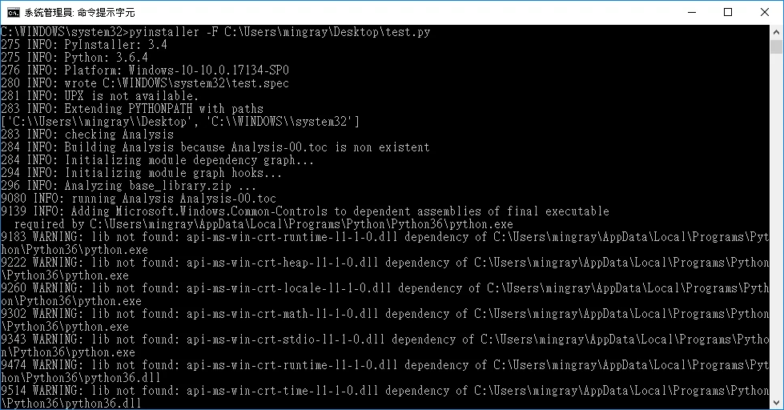
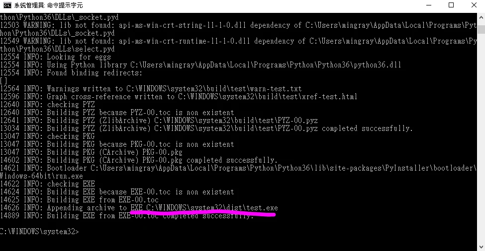
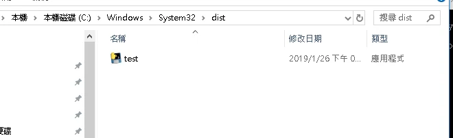
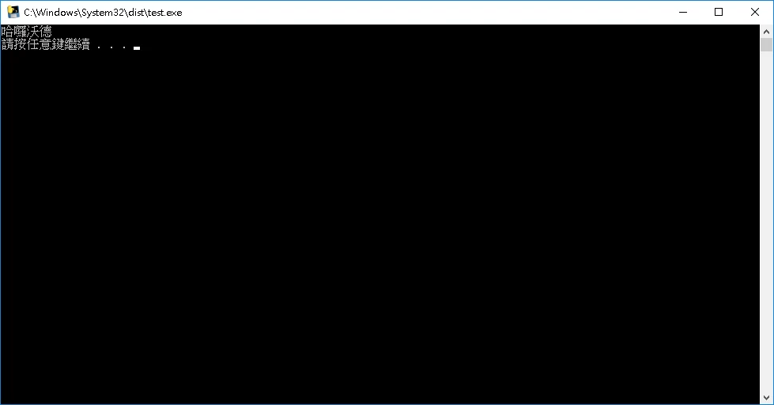

今天來分享如何將第一個 hello world 程式把包成exe  
先安裝 pyinstaller這個套件

python -m pip install pyinstaller  

安裝好後先在 CMD 切換到你的程式資料夾，再執行 `pyinstaller -F "檔名.py"`；`+` 不用輸入。

pyinstaller -F test.py

打包好就會告訴你在哪囉~  
以下為範例  
**新手要記得要加 os.system('pause') 不然開啟來會直接關掉，會讓你以為失敗  
exe 預設輸出到執行命令時目前工作目錄的 `dist`；System32 只是當時我開啟 CMD 的所在位置。**  
*(那個新手，對就是我)*





我畫線是預設好打包好的exe





```python
import os

print('哈囉沃德')
os.system('pause')
#優質原始碼
#@copyright MRcoding筆記
```

勘誤參考：[PyInstaller 使用說明](https://pyinstaller.org/en/stable/usage.html)。
