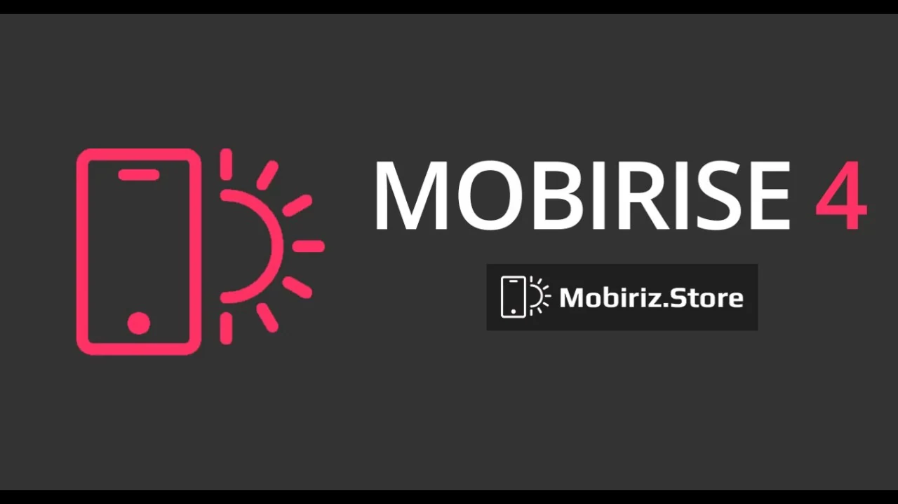
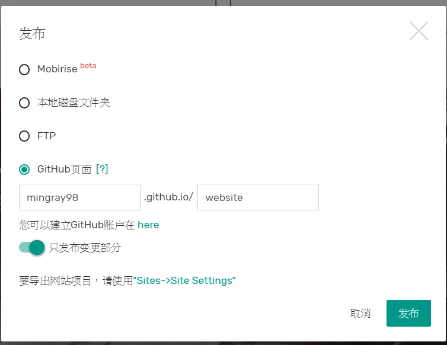
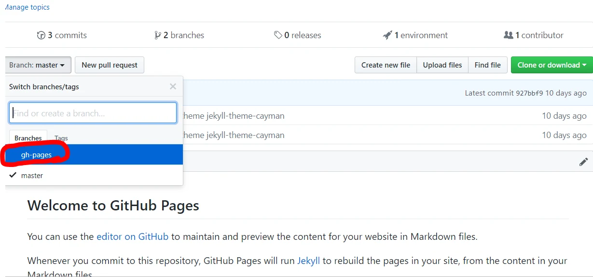
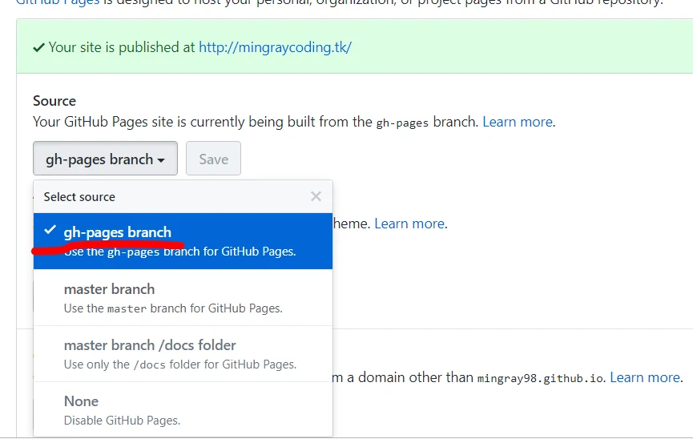

> 本文保留 2019 年的使用心得與操作畫面；方案、限制及介面請以服務商目前公告為準。

有了Mobirise 4，製作輕鬆漂亮好看的網頁根本輕而易舉，而且還是免費的喔 !  
他本身就是響應式網頁的版型，主要是套用bootstrap4的js而做的，雖然可調性不高，但他有一個超好用的功能就是可以直接上傳到github，快速方便好用，簡單到我不需要做教學了，大家有想要弄個美美的網站建議使用這個免費軟體喔!  
[點此到官網下載](https://mobirise.com/blocks/)

點右上角的發布!就可以選擇你要輸出到哪裡

**如果選擇github，發布後記得要來這邊調整分支喔**

**上述調整完後，還需要到setting改成要呈現哪個分支!**
