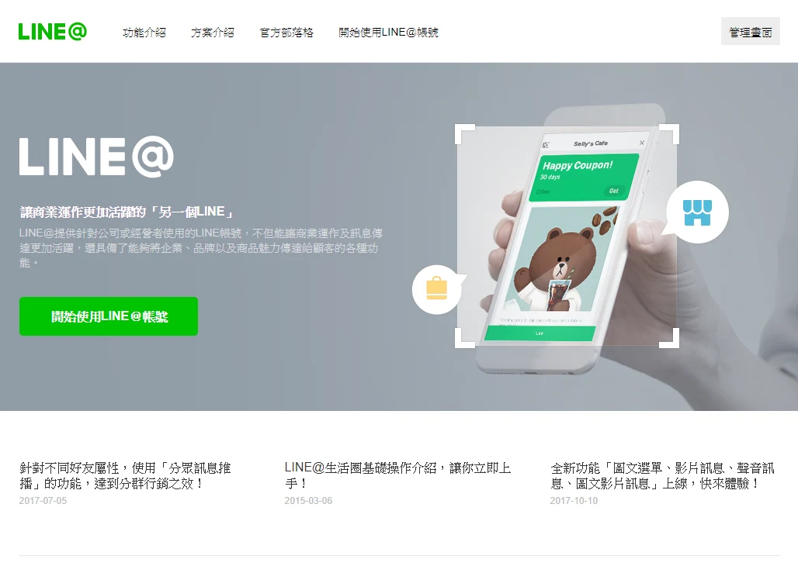
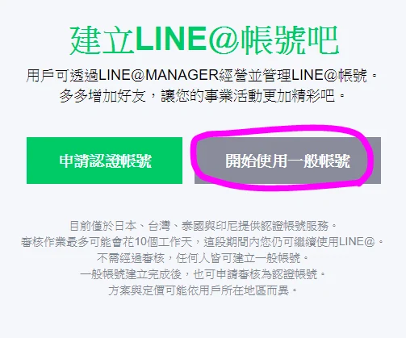
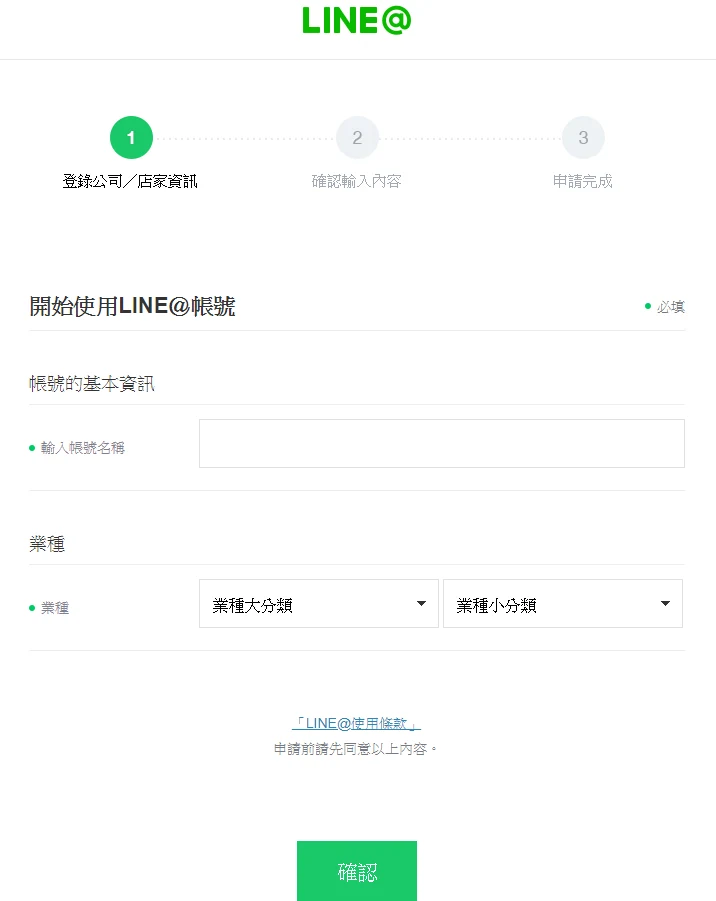
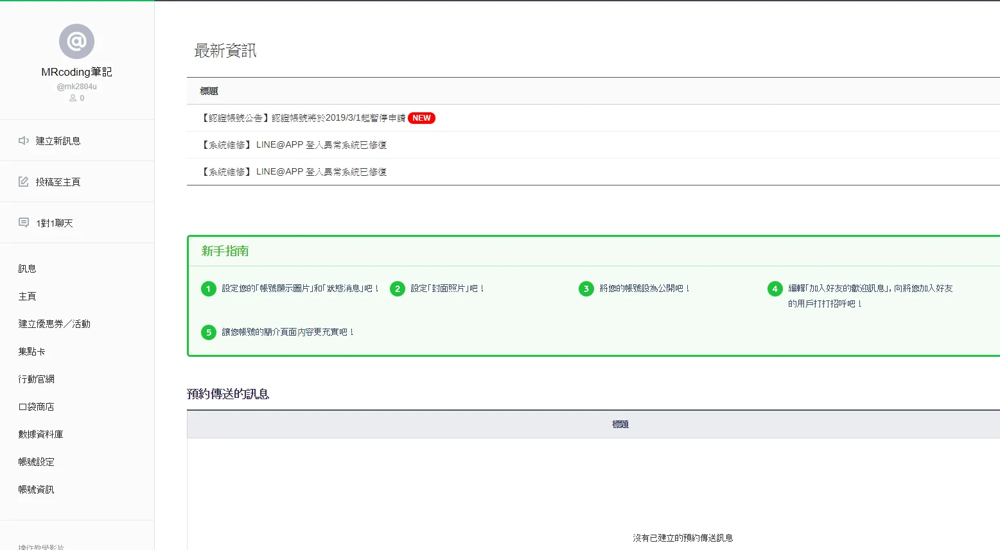
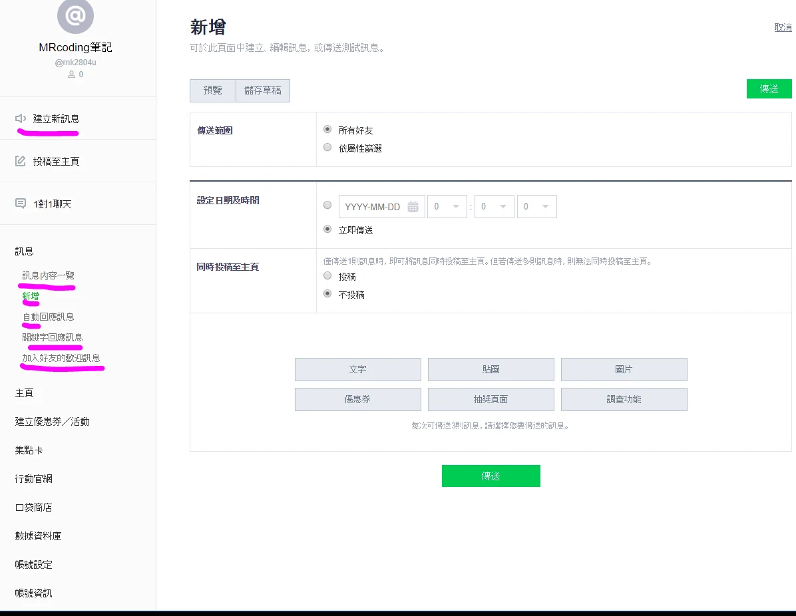

> 本文使用的是舊 LINE@ 介面與方案。LINE 於 2019 年 4 月起整合為 LINE Official Account；下文好友數、付費功能與模式互斥的限制不能套用到現行官方帳號。

申請[LINE 官方帳號](https://www.linebiz.com/tw/service/line-official-account/)  
今天跟大家分享完全不用coding就可以使用的LineBot教學喔!  
我的官方LineID：

@rnk2804u

下圖的訊息功能就是最簡單最常用到的部分，

1. 訊息內容一覽：看你用建立新訊息功能發過什麼樣的內容
2. 新增：立刻發訊息的功能（可調整使用族群，何時發布文字圖片或優惠券等功能）
3. 自動回覆訊息：可以設定何時回覆，跟隨回覆的功能（但不能設定機率）
4. 關鍵字回應訊息：比如說使用者打哈囉！，你可以設定 @ChatBot：安安你好
5. 加入好友的歡迎訊息：加入好友後的第一個訊息可以自己設定喔！

其他像是圖表選單功能或要加超過1000好友都需要付費喔!  
之後有空在介紹可以免費開啟圖表選單功能的，但是會消失  
・1對1聊天  
・LINE@應用程式  
這兩個功能喔

勘誤參考：[LINE：新版官方帳號平台公告](https://www.linecorp.com/en/pr/news/en/2019/2684)。
