> 本文保留 2019 年的使用心得與操作畫面；方案、限制及介面請以服務商目前公告為準。

今天跟大家分享完全不用coding就可以使用的FB聊天機器人教學喔!

[點此](https://manychat.com/)

我的官方[FB粉絲團](https://www.facebook.com/250003602395055)~~

1. 開始使用

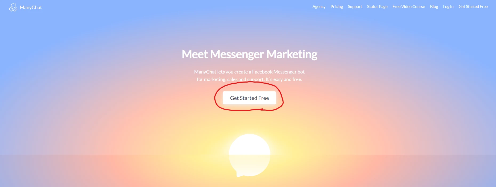

2.連結臉書帳號

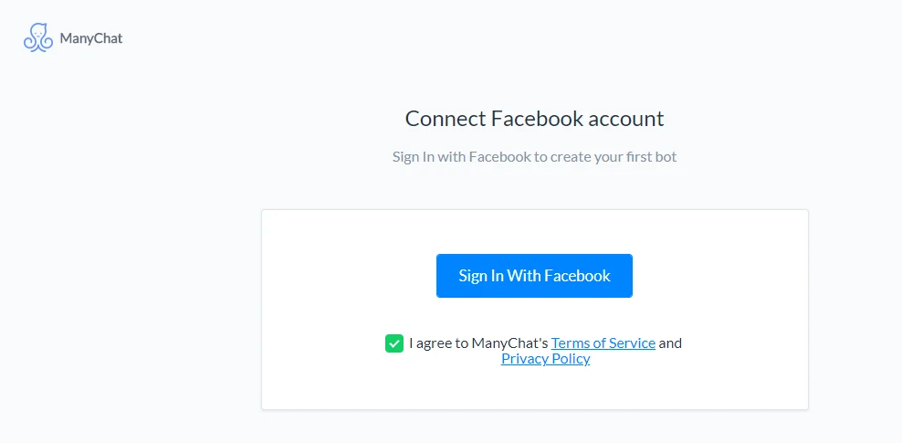

3.開始連結你已有粉專

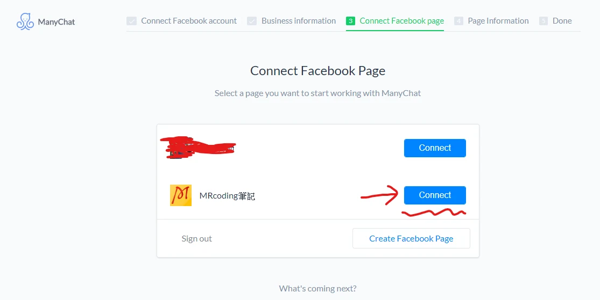

4.選擇商用或測試用

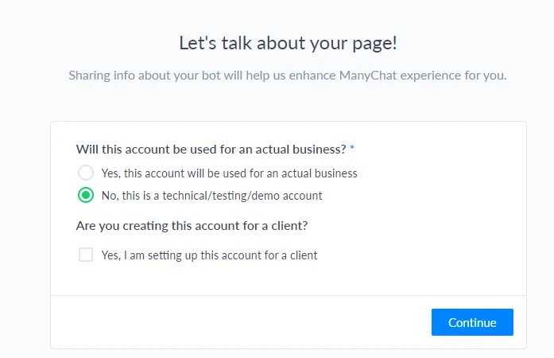

5.進入主畫面，點選Automation

- 有預設的自動回復功能
- 歡迎光臨的訊息
- 關鍵字(收到關鍵字就會說一些特定的話語唷！)
- sequences(這個我還沒用過 )
- 規格(這個我也沒用過， 知道怎麼用歡迎留言告訴我 )

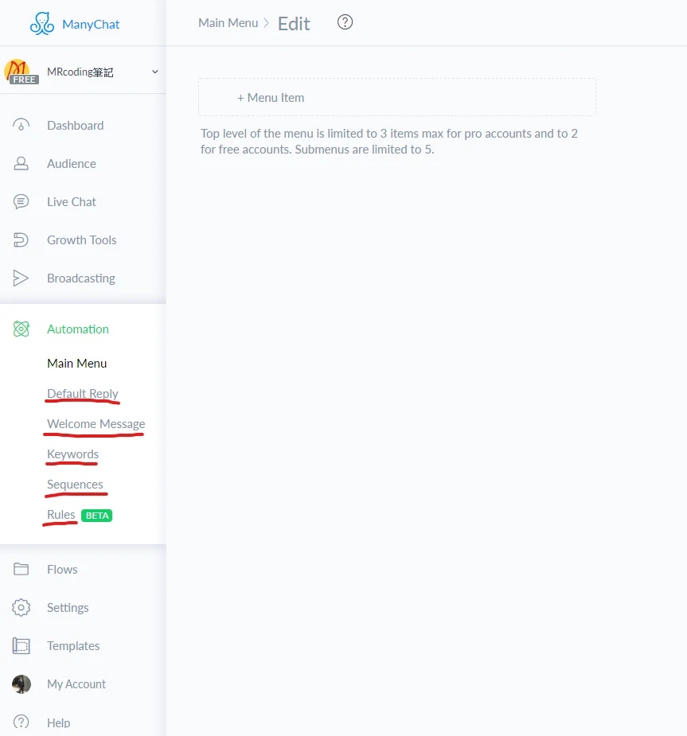

下圖為修改歡迎訊息的步驟  
記得第3部 要改成啟用喔沒啟用你發布也沒有(我之前就沒啟用QQ)

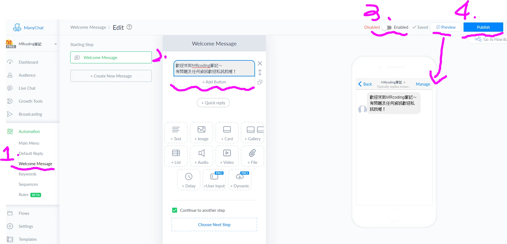

下圖為修改預設回復訊息步驟

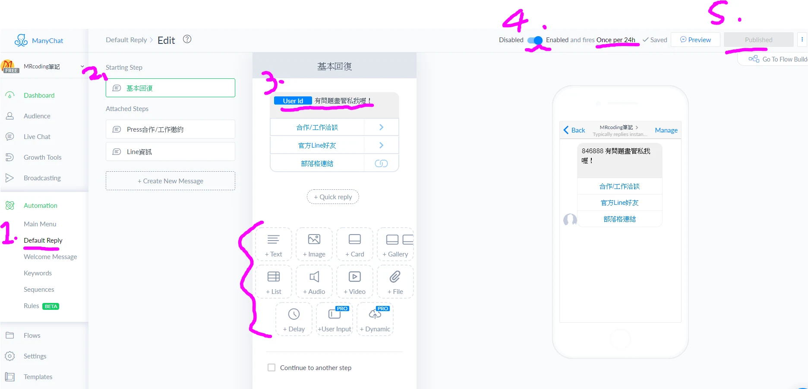

教大家如何設定自動回復文章，免費版的只能設定一篇的樣子  
先點選Growth tools 且在右上角選擇 新增一個

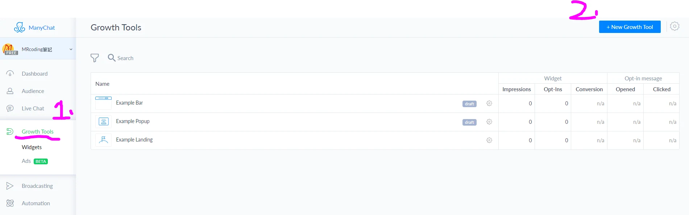

選擇我框框的那個，其他的功能大家可以自己試試看喔!

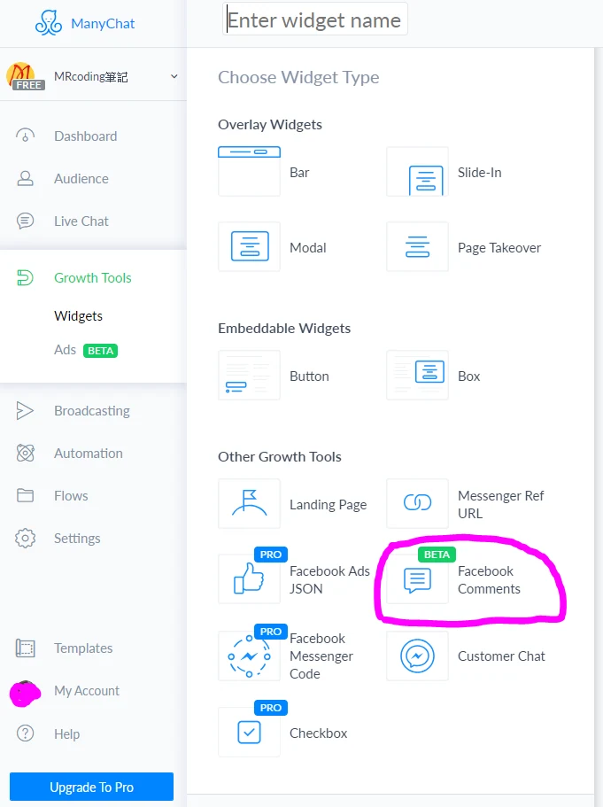

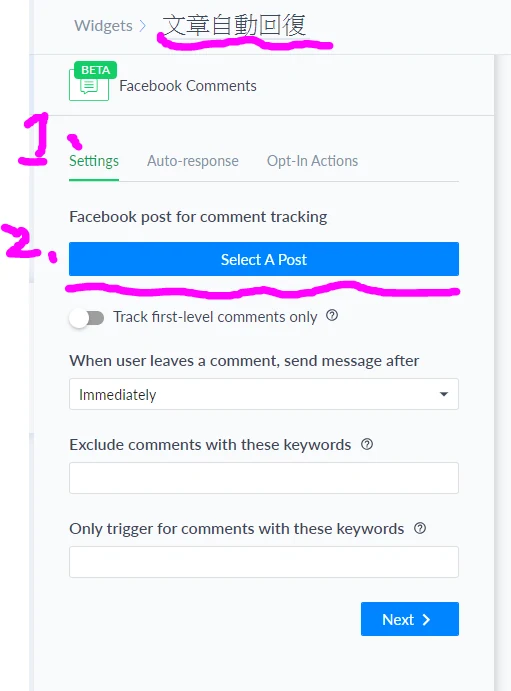

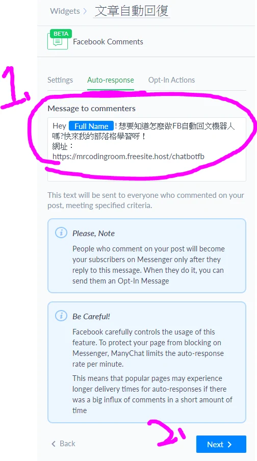

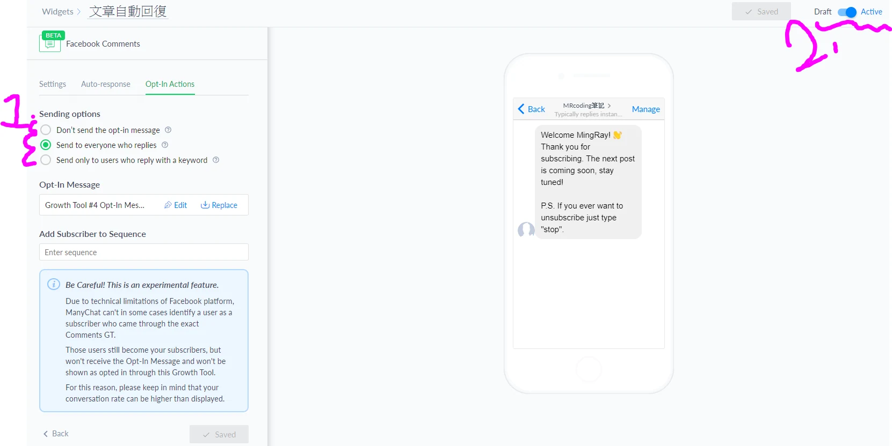

這麼一來就大功告成拉！  
大家可以自己設定一個看看唷

裡面功能還有非常多，歡迎留言補充好用或我寫錯的步驟喔！
