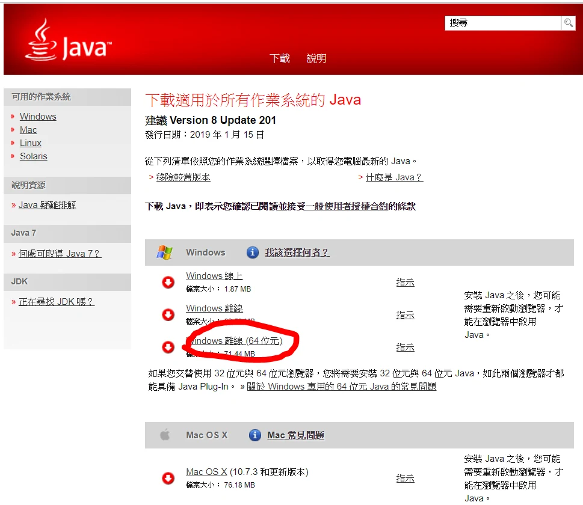
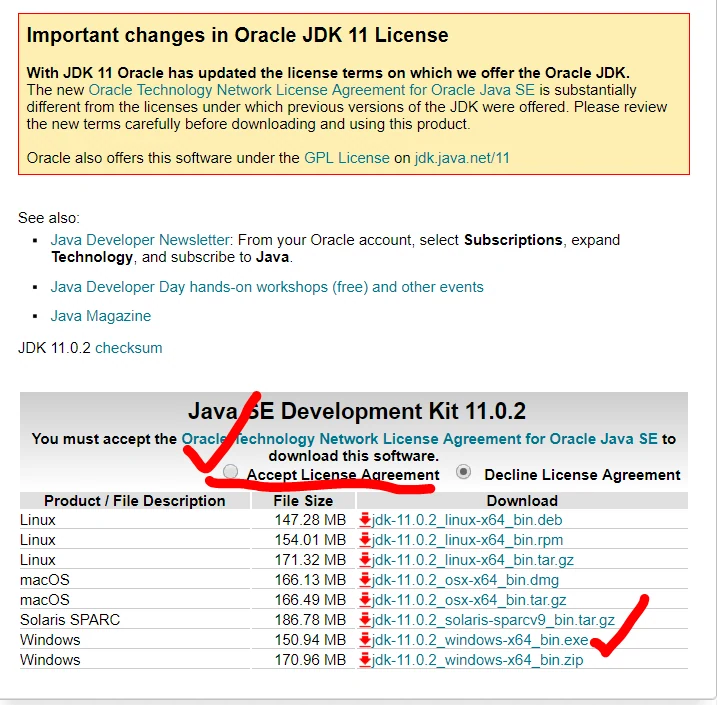
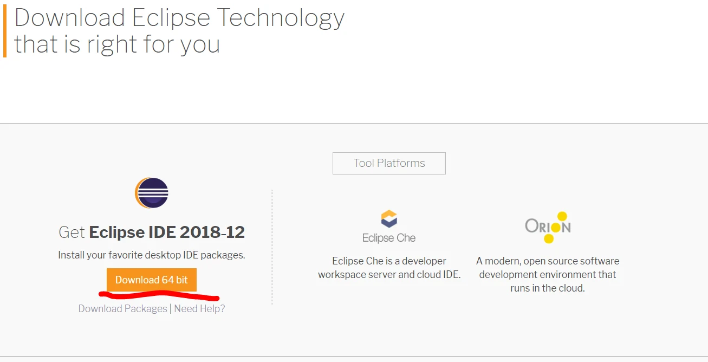
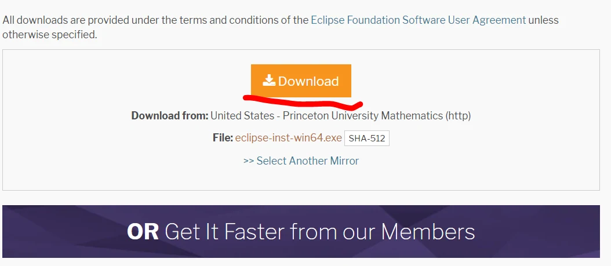
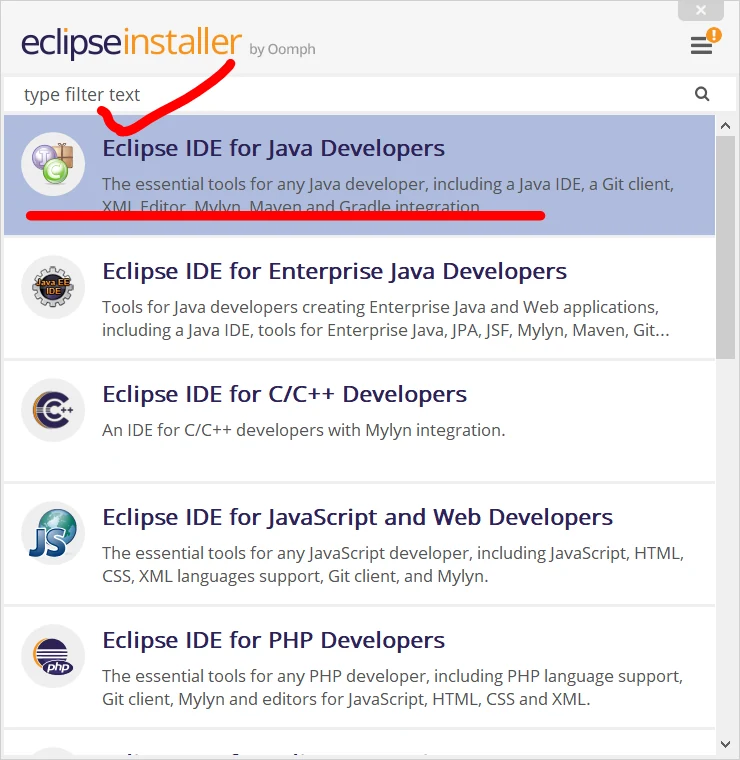
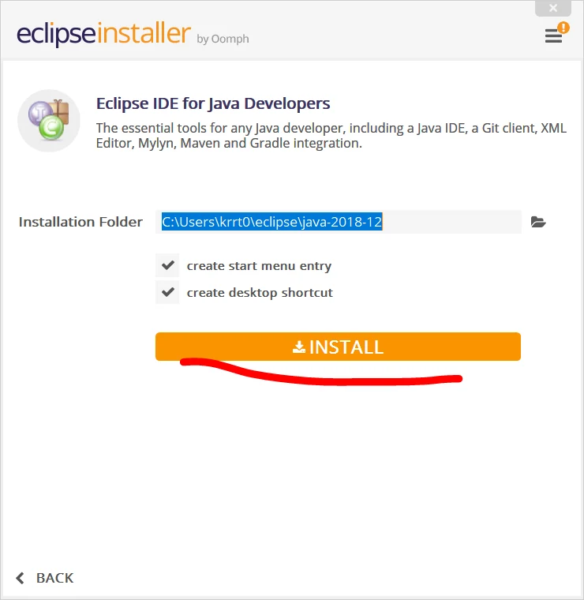

1. 下載並安裝 [JDK](https://www.oracle.com/java/technologies/downloads/)；JDK 已含開發及執行 Java 所需工具，一般不必再另裝一份 JRE。
2. 下載並安裝 [Eclipse](https://www.eclipse.org/downloads/)，選擇 Java 開發套件。
3. 在 Eclipse 的 Installed JREs 設定已安裝的 JDK；JDK 版本需符合該版 Eclipse 的需求。

就可以開始執行我們的Java的撰寫程式之路  
備註: 此教學用windows 10 64位元為主

本文截圖是 2019 年 Windows 10 的安裝過程。請讓 Eclipse 與啟動它的 Java 架構相符（例如皆為 64 位元）；不能一概說 Java 下載預設都是 32 位元。

2. 下載安裝JDK

再來就是安裝在C槽，下一步下一步就完成了。  
3. 安裝eclipse

完成這些就大功告成拉

勘誤參考：[Eclipse 安裝與 JVM 需求](https://wiki.eclipse.org/Eclipse/Installation)。
