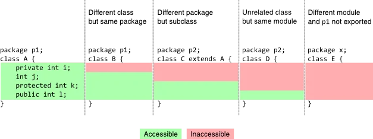

> 各 package／public class 片段需分別存檔，例如 player/player1.java 與 monster/monster1.java。跨 package 的 protected 存取還受接收物件型別限制，不是任意父類別實體都能直接使用。

筆記：  
[參考此](https://stackoverflow.com/questions/215497/what-is-the-difference-between-public-protected-package-private-and-private-in)

今天筆記一下，package用法跟import 還有修飾詞  
若要省略類別名稱直接使用其他類別的 static 成員，可用 `import static`；也可以先 import 類別，再用 `類別名.成員`，並非一定要 static import。

protected屬性，如果繼承了可以直接使用

或同一個package，new出實體也可以直接使用  
若非繼承類型在不同的package，建立出新的實體也無法呼叫protected類別



```java
package player;

public class player1 {

	public static int HP = 100;

	private int MP = 50;
	protected int skill = 1;
	int steps = 2;

	public void talk() {
		System.out.println("hello HH");
		steps = 5;
	}

}
package player;

public class player2 {

	static int HP = 100;

	public void talk() {
		System.out.println("hello");
	}

	public static void main(String[] args) {

		player1 p1 = new player1();
		p1.skill = 8; // 同一個package 建立出實體用 protected就可以用
		p1.steps = 5; // 未加修飾詞，同個package都可以用
		p1.talk();
		// p1.MP; private 只用同一個類別才能用

	}

}

package monster;


import player.player1;
import player.player2;
import player.*;
import static player.player1.HP;
//要實作出 player1 , player2 不同package所以要import
// import player.* 匯入該套件可存取的頂層型別；static 成員可用 player1.HP，或另加 static import。
public class monster1 {

	public static void main(String[] args) {
		// TODO Auto-generated method stub
		
		player1 p1 = new player1();
	
		p1.talk();
		
		monster2 m2 = new monster2();
		
		System.out.println("怪物2的skill: "+m2.M2skill);

	}

}
package monster;

import player.*;

public class monster2 extends player1{
	

	int M2skill = skill; // player1 protected skill 要用必須先import 再繼承就可以直接拿來用


}
```

勘誤參考：[Java：import 與 static import](https://docs.oracle.com/javase/specs/jls/se25/html/jls-7.html#jls-7.5)。
