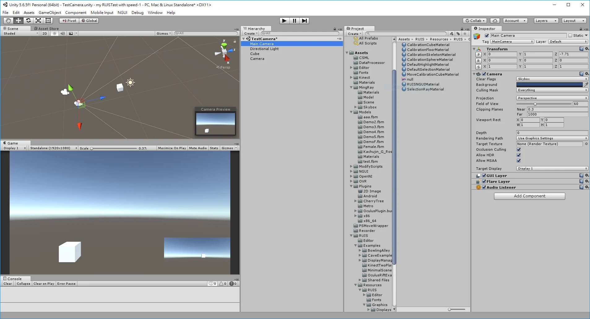
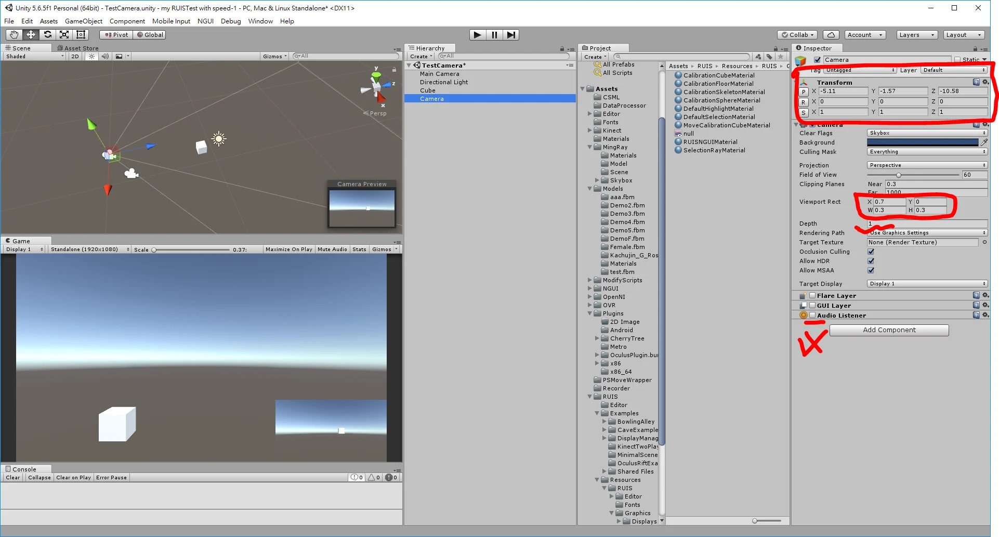

> 本文是 Built-in Render Pipeline 的 Camera Depth 操作；URP／HDRP 的相機合成設定不同，不能直接照搬。

筆記：  
 0程式，只需要新增兩個camera。  
 今天來做右下角小畫面，類似玩遊戲常看到的小地圖畫面的概念。

### 1. Main Camera 不調整 其他的Camer 才調整大小

#### 2. 放在右下角：在 Camera 元件調整 Viewport Rect 的 X、Y、W、H

畫面示範比例為：  
X:0.7 是從左向右的 70% 處開始，Y:0 是從底部開始；座標原點在左下角。  
H: 高0.3 W: 寬0.3 整體畫面的 長寬0.3的大小

### 3. Depth屬性 要跟主camera不同

我是習慣多新增一個就+1，**Audio Listener** 要取消掉，不然會一直跳警告  
這麼一來簡單的雙畫面就完成了

勘誤參考：[Unity Camera.rect](https://docs.unity3d.com/ScriptReference/Camera-rect.html)。
