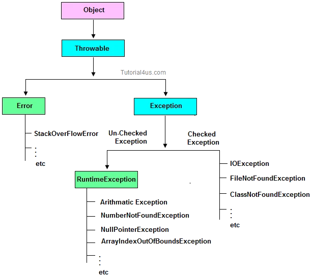

筆記：

- Runtime Exception

屬於 unchecked exception，編譯器不強制要求捕捉或宣告；例外仍是在執行時拋出。

- Checked Exception

編譯器會要求捕捉可能發生的 checked exception，或在方法上以 `throws` 宣告；不是例外在編譯時就已經發生。

拋出例外語法：`throw new Exception("訊息");`  
若 checked exception 沒有在方法內捕捉，需在方法宣告上列出 `throws` 類型。  
`RuntimeException`、`Error` 及其子類別屬於 unchecked，不強制加 `throws`。  
例如：`void testFunction() throws IOException`。

可以宣告方法時拋出多個例外，可用父子例外類別包含處理。  
同一個方法可以在不同分支拋出不同例外；每次執行單一 `throw` 敘述會拋出一個例外物件。

throw vs throws

一個是方法裡面用來拋例外，一個是方法宣告使用



```java
package test;

import java.io.*;

public class Exceptionclass {

	public static void main(String[] args) {
		// TODO Auto-generated method stub

		int a = 0, b = 10;

		exclass ex = new exclass();

		try {
			ex.throwsManyRuntimeExceptio();
		} catch (ArithmeticException e) {
			System.out.println("捕捉 runtime exception，繼續下一個範例");
		}

		// inclass.MorethanfiveWillError(90); //若方法宣告 checked exception，呼叫端要捕捉或宣告
		try {

			ex.throwsManyCheckedException();
		} catch (Exception ee) {
			// Exception包含 IOException和 FileNotFoundException 就不用再多抓
		}

		try {
			ex.throwsManyCheckedException(); 
			//要有兩個Exception類型 若只用 IOException也可以 因為FileNotFoundException為他的子類別
		} catch (FileNotFoundException IE) {

		} catch (IOException e) {

			e.printStackTrace();
		}

	}

}

class exclass {

	void throwsRuntimeException() {
		throw new RuntimeException();
	}

	void throwsManyCheckedException() throws IOException, FileNotFoundException { // 非runtimeException要加throws
		throw new IOException("示範 checked exception");
	}

	void throwsManyRuntimeExceptio() throws ArithmeticException, ArrayStoreException { // runtime exception 的 throws 宣告可省略
		throw new ArithmeticException();
	}

}
```

勘誤核對來源：[1](https://docs.oracle.com/javase/specs/jls/se8/html/jls-11.html)。
