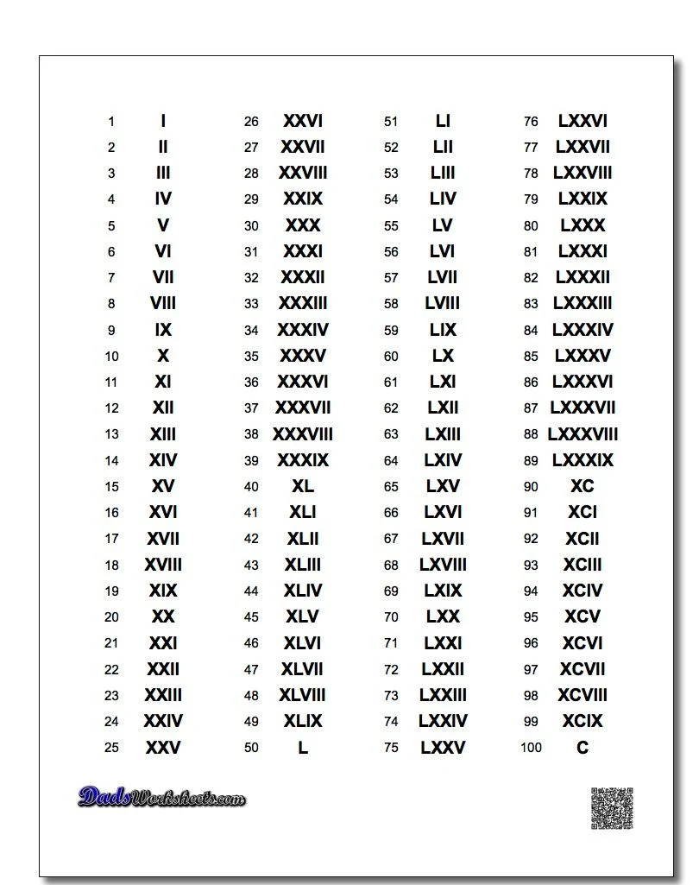

此題難度為 EASY

先說羅馬數字表還滿複雜的，一定要有個對應表  
會比較好理解。

這題我解題是用權重值，而權重值也等於羅馬數字轉換成阿拉伯數字的值。  
如果 這個字的權重 \< 下一個字的權重，代表此數字將為負值  
例如：\[代表權重值\]  
IV= \[1\]\<\[5\] 故1為負值所以算式為 (-1) + 5 = 4

原始題目為下

Roman numerals are represented by seven different symbols: `I`, `V`, `X`, `L`, `C`, `D` and `M`.

```
Symbol       Value
I             1
V             5
X             10
L             50
C             100
D             500
M             1000
```

For example, two is written as `II` in Roman numeral, just two one's added together. Twelve is written as, `XII`, which is simply `X` + `II`. The number twenty seven is written as `XXVII`, which is `XX` + `V` + `II`.

Roman numerals are usually written largest to smallest from left to right. However, the numeral for four is not `IIII`. Instead, the number four is written as `IV`. Because the one is before the five we subtract it making four. The same principle applies to the number nine, which is written as `IX`. There are six instances where subtraction is used:

- `I` can be placed before `V` (5) and `X` (10) to make 4 and 9.
- `X` can be placed before `L` (50) and `C` (100) to make 40 and 90.
- `C` can be placed before `D` (500) and `M` (1000) to make 400 and 900.

Given a roman numeral, convert it to an integer. Input is guaranteed to be within the range from 1 to 3999.



羅馬數字對應表

```java
package leetCode;

import java.util.*;

public class RomanToInteger {

	public static void main(String[] args) {
		
		Solution13 sol = new Solution13();
		System.out.println(sol.romanToInt("V")); 

	}

}
class Solution13 {
	
    public int romanToInt(String s) {
    	
    	int sum=0;
    	
    	HashMap<Character,Integer> romanNumTable = new HashMap<Character,Integer>();
    	List<Integer> intList = new ArrayList<Integer>(); //用來存權重
    	//HashMap 羅馬數字對印表建立
    	romanNumTable.put('I',1); 
    	romanNumTable.put('V',5);
    	romanNumTable.put('X',10);
    	romanNumTable.put('L',50);
    	romanNumTable.put('C',100);
    	romanNumTable.put('D',500);
    	romanNumTable.put('M',1000);
 
    	char[] arrayString = s.toCharArray();
    	for(char i:arrayString) {
    		for(HashMap.Entry<Character,Integer> m:romanNumTable.entrySet()) {
    			if(i==m.getKey())
    				intList.add(m.getValue());//用對應的值，存成權重intList 裡面的值也等於對應數值		
    		}
    	}
    	for(int i=0;i<=intList.size()-1;i++) {
    		
    		if(i==intList.size()-1) //只有一個字 會到最後一個字的情況下
    			sum += intList.get(i);
    		else if(intList.get(i)>=intList.get(i+1)) //這個羅馬署自權重已定要比後大 才家
    			sum += intList.get(i);
    		else //權重若變小 則是+負的  例如 IV 等於 -1 +5 = 4  
    			sum -= intList.get(i);
    		
    	}
        
    	return sum;
    	
    }
}
```
