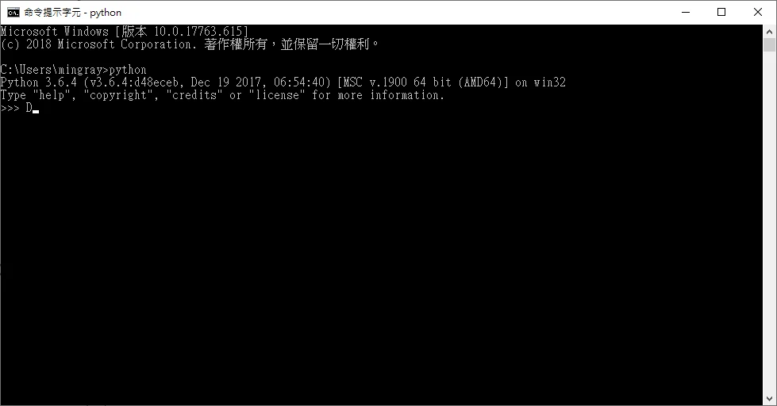

前提是python.exe要用輸入進你的環境參數  
在安裝python那篇有教學過

[相關文章](../mrcoding-2019-01-20-308/)

要檢查有沒有成功調整環境參數，就使用CMD 來查詢 python就可以囉  
以下就可以成功的調用了



```csharp
using System;
using System.Collections;
using System.Collections.Generic;
using System.Diagnostics;
using UnityEngine;

public class Record : MonoBehaviour {

	System.Diagnostics.Process process = new System.Diagnostics.Process ();
	System.Diagnostics.ProcessStartInfo startInfo = new System.Diagnostics.ProcessStartInfo ();

	Process proc = new Process ();

	Boolean run = false;

	// Use this for initialization
	void Start () {
                if (run == false) {
			string progToRun = @"E:\screenshot.py"; //調用py的位置

			proc.StartInfo.FileName = @"python.exe"; //執行的程式
			proc.StartInfo.UseShellExecute = false; //是否使用操作系统shell啟動
			proc.StartInfo.RedirectStandardInput = false; //接受來自調用程序的輸入訊息
			proc.StartInfo.RedirectStandardOutput = false; //由調用程序獲取輸出訊息
			proc.StartInfo.RedirectStandardError = false; //重定向標準錯誤輸出
			proc.StartInfo.WindowStyle = ProcessWindowStyle.Normal;
			//不創建窗口
			proc.StartInfo.CreateNoWindow = true;
			proc.StartInfo.Arguments = "\"" + progToRun + "\"";
			proc.Start ();

			run = true;

		}


	}

	// Update is called once per frame
	void Update () {

		if (Input.GetKeyDown (KeyCode.A)) {  //按A強迫停止
			if (run && !proc.HasExited) {
                proc.Kill(); // 僅停止這個 script 啟動的 process
                proc.WaitForExit();
            }
            run = false;
			UnityEngine.Debug.Log ("close");
		}
	}
}
```

這份範例以 Windows 桌面上的 Unity 為前提。`Kill()` 是強制終止，Python 的 `finally` 或影片收尾不保證能執行；需要完整收尾時應設計正常停止訊號。

勘誤核對來源：[1](https://learn.microsoft.com/en-us/dotnet/api/system.diagnostics.processstartinfo.redirectstandardoutput)、[2](https://learn.microsoft.com/en-us/dotnet/api/system.diagnostics.process.kill)。
