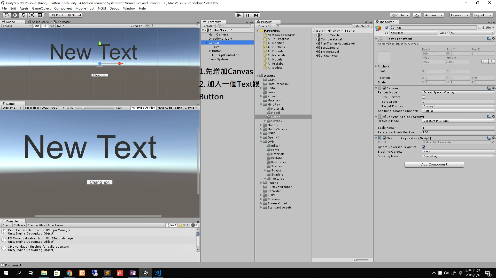
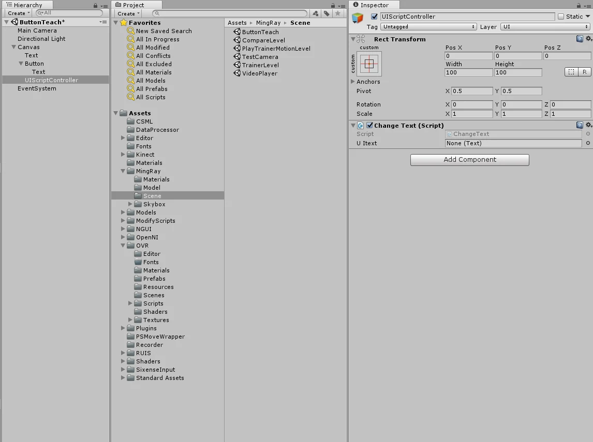
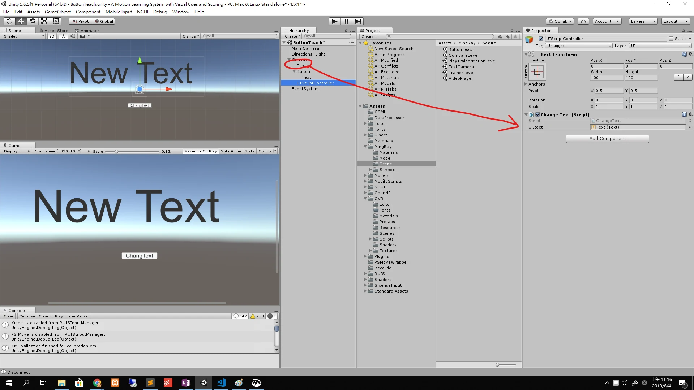
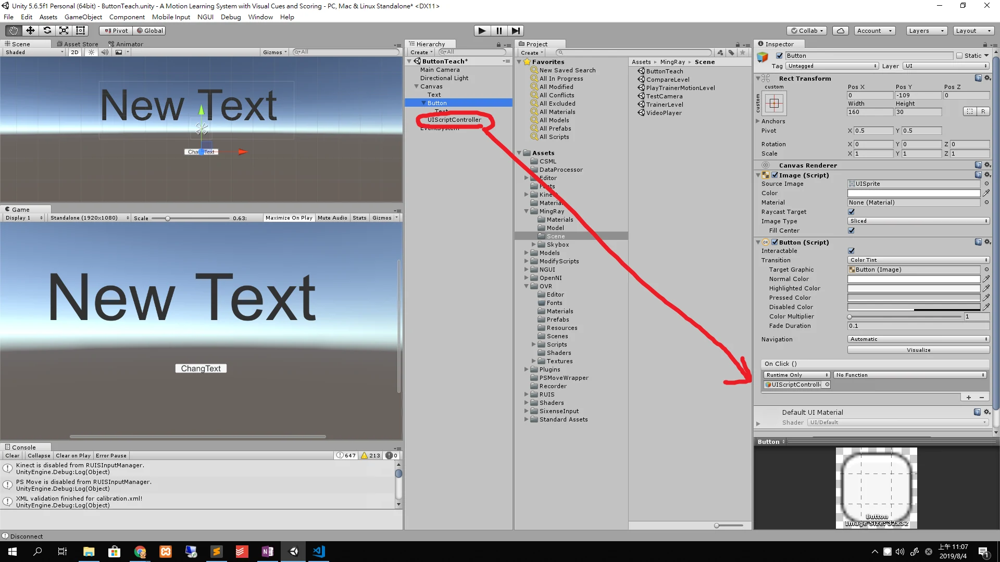
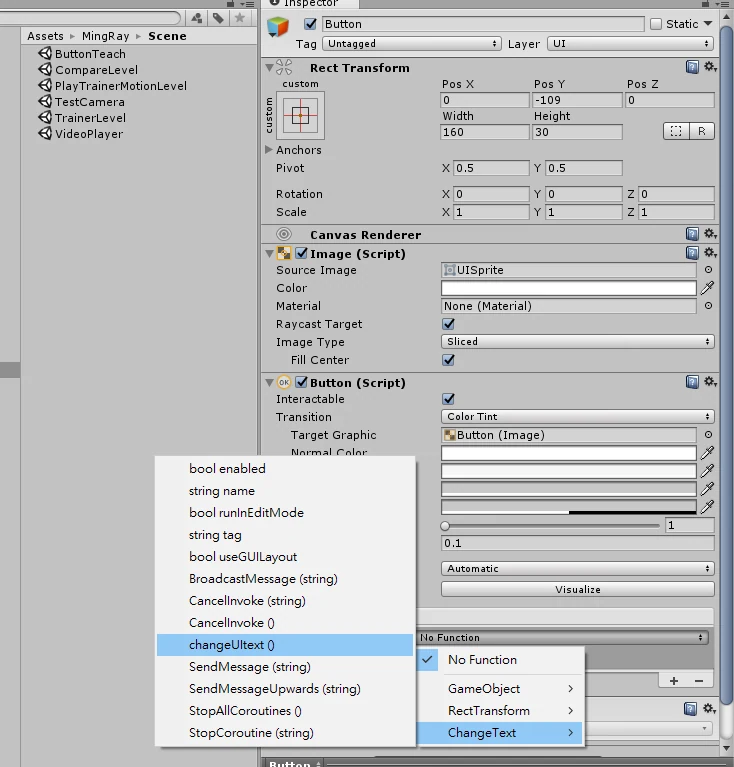
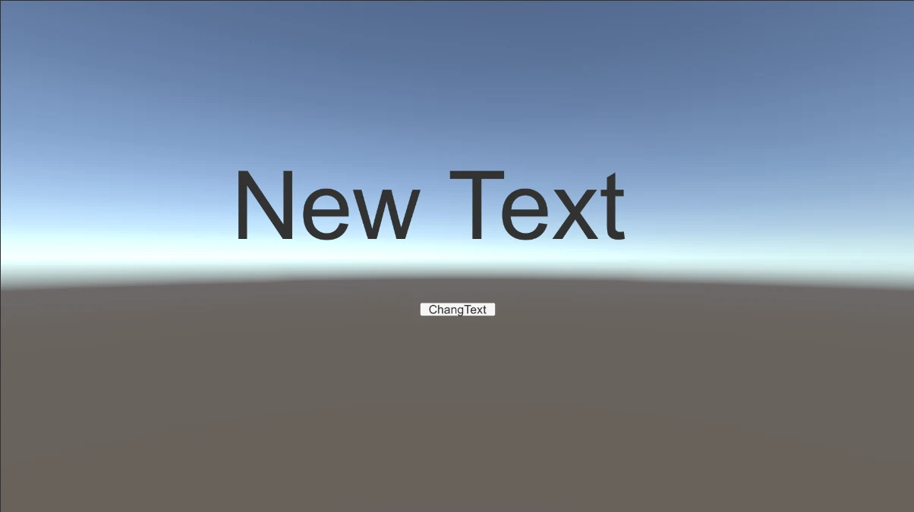
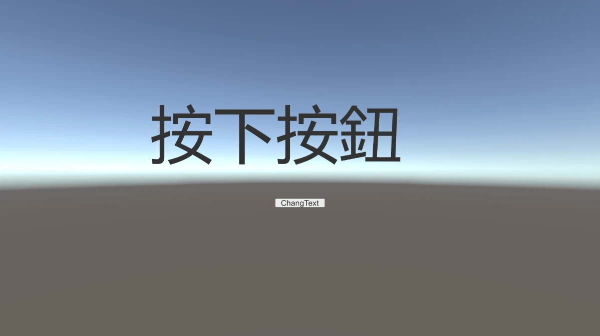

可以在Canvas中建立一個空物件 右鍵 Create Empty 取名為UI程式的控制器  
就可以統一相關類似UI的程式放在這裡  
選擇Empty，改名後再下放的Add Component 打上你要取名的程式碼 ChangeText後  
按下new script並選擇 C#的版本，新版的好像已經不支援JS了



以下為程式碼

```csharp
using System.Collections;
using System.Collections.Generic;
using UnityEngine;
using UnityEngine.UI; //UI物件需要增加此行

public class ChangeText : MonoBehaviour {

	public Text UItext; //要設公開的才能從外部加入UItext

	// Use this for initialization
	void Start () {
		
	}
	
	// Update is called once per frame
	void Update () {
		
	}

	public void changeUItext(){ //設公開的才能利用Unity內建Button觸發方式來喚出
		UItext.text = "按下按鈕了";
	}
}
```



把想更改的text放進 public 的UItext中





在No Function裡面選擇我們要的按下後執行的程式，還有一些內建屬性可以自己去嘗試。

結果如下





明天再新增直接用程式碼觸發按，各有優缺，但程式碼裡面寫好處的自由度可控性更高。

文字步驟補充：選取 Button，在 Inspector 的 On Click() 按「＋」，把掛有 `ChangeText` 的控制物件拖到目標欄位，再選 `ChangeText → changeUItext()`；控制物件上的 `UItext` 欄位也要先指定場景中的 Text 元件。這份範例使用舊版 uGUI 的 `UnityEngine.UI.Text`，不是 TextMeshPro。

勘誤核對來源：[1](https://docs.unity3d.com/2019.4/Documentation/ScriptReference/UI.Button-onClick.html)。
