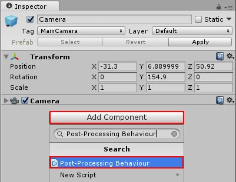

這份寫法用 `GetComponent<Button>()`，所以 script 必須和 Button 元件掛在同一個 GameObject 上；如果改成公開欄位指定 Button，也能把 script 放在其他控制物件。  
上篇介紹內建方法，這次則是須掛上程式碼即可。

[相關文章](../mrcoding-2019-08-04-2555/)

1. 新增一個 UI component Button
2. 新增一個 C# script
3. 在 物件 Add component 那邊搜尋 剛剛新增的 script 並添加上去

```csharp
using System.Collections;
using System.Collections.Generic;
using UnityEngine;
using UnityEngine.UI;

public class clickHandler : MonoBehaviour {

    public Text UItext;

    void Start () {
        Button btn = this.GetComponent<Button> ();//限定UI Button
        btn.onClick.AddListener (OnClick);
    }

    private void OnClick(){
	UItext.text = "按下按鈕了";
    }

}
```



此為新增Script在物件上的示意圖

勘誤核對來源：[1](https://docs.unity3d.com/2019.4/Documentation/ScriptReference/Component.GetComponent.html)。
