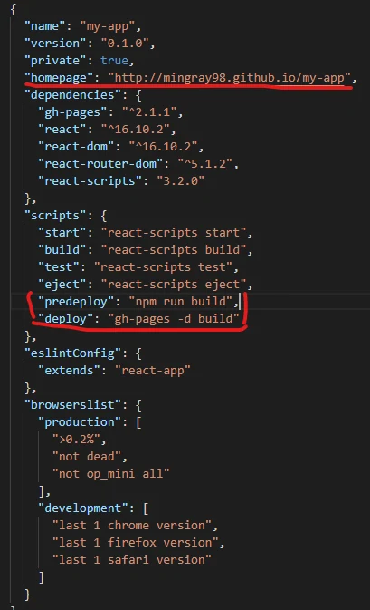
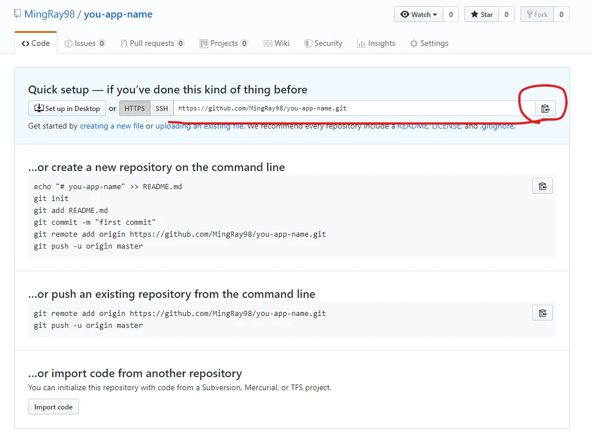
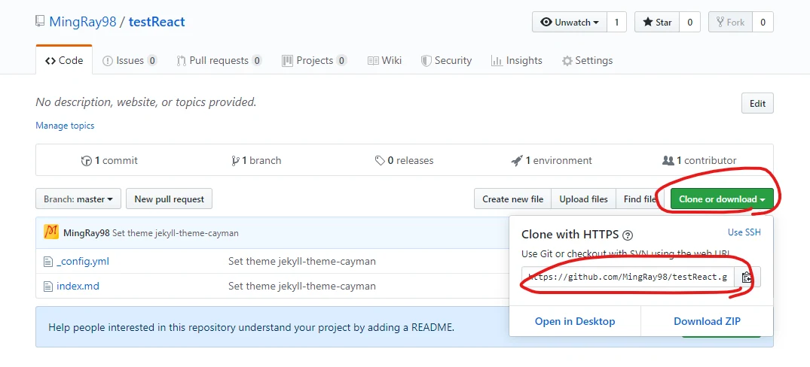

1. 安裝 [Node.js](https://nodejs.org/en/)
2. 安裝[git](https://git-scm.com/downloads)
3. 打開Node.js Command
4. 打上 `npx create-react-app your-app-name`（以下保留 Create React App 舊專案流程）
5. 輸入 cd your-app-name
6. 在專案資料夾執行 `npm install --save-dev gh-pages`，再打開 `./your-app-name/package.json`
    1. 在裡面加入 

       在 JSON 頂層加入 `"homepage": "https://youraccount.github.io/your-app-name"`，並在既有的 `"scripts"` 物件增加以下兩個項目（保留原本的 start/build/test 等項目，注意 JSON 逗號）：

       ```json
       "predeploy": "npm run build",
       "deploy": "gh-pages -d build"
       ```

       如下圖



6. 去github網站，創建你的repository；本篇示範名稱和 your-app-name 相同，若用其他名稱，homepage 與 remote URL 也要對應調整

7. 複製你的repository的 git 如下圖 找不到也可以用打的 https://github.com/youraccount/your-app-name.git





8. 在command line上打

git init  
git remote add origin https://github.com/youraccount/your-app-name.git  
 （GitHub 的 HTTPS Git 操作已不接受帳號密碼，請使用認證管理員、GitHub CLI 登入、token 或 SSH）  
git add .  
git commit -m "Your awesome message"  
git push -u origin HEAD  
npm run deploy

9. 在 GitHub repository 的 Settings → Pages 選擇從 `gh-pages` 分支根目錄發布，完成後開啟 https://youraccount.github.io/your-app-name   
看你的第一個在github上React程式吧

版本補充：Create React App 已於 2025 年 2 月被 React 官方棄用於新專案；本文供維護既有 CRA 專案參考，新專案請依 React 官方現行建置指引選擇工具。

勘誤核對來源：[1](https://react.dev/blog/2025/02/14/sunsetting-create-react-app)、[2](https://create-react-app.dev/docs/deployment/#github-pages)、[3](https://github.blog/changelog/2021-08-12-git-password-authentication-is-shutting-down/)。
