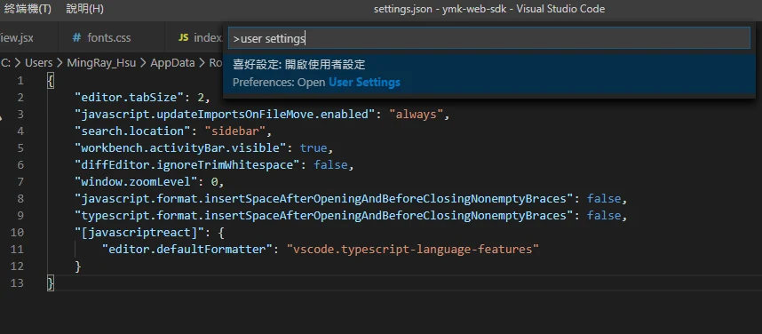
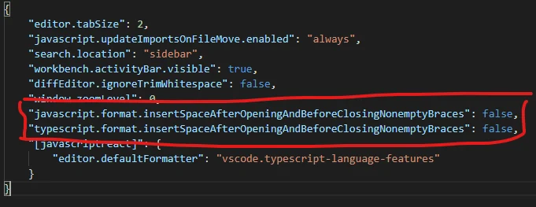

Only need to add two lines:

"javascript.format.insertSpaceAfterOpeningAndBeforeClosingNonemptyBraces": false,

"typescript.format.insertSpaceAfterOpeningAndBeforeClosingNonemptyBraces": false,

And put it in user settings

1. First ctrl +shift + p   
 type user settings (json)

2. Add these.

These settings apply to VS Code’s built-in JavaScript/TypeScript formatter. If Prettier is your selected formatter, configure its `bracketSpacing` option instead; the built-in formatter settings will not control Prettier.

勘誤核對來源：[1](https://code.visualstudio.com/docs/languages/javascript#_formatting)、[2](https://prettier.io/docs/options#bracket-spacing)。
