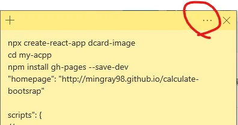
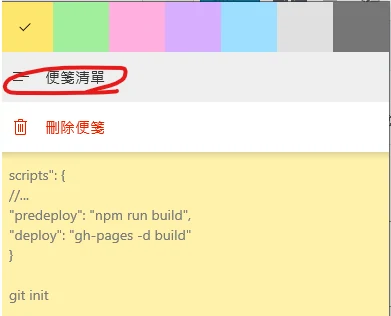
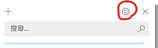
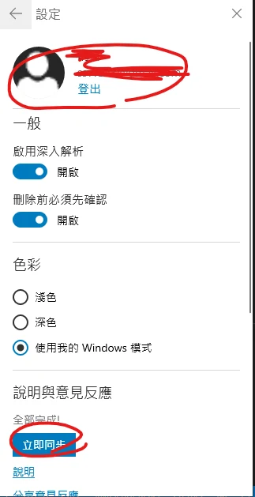
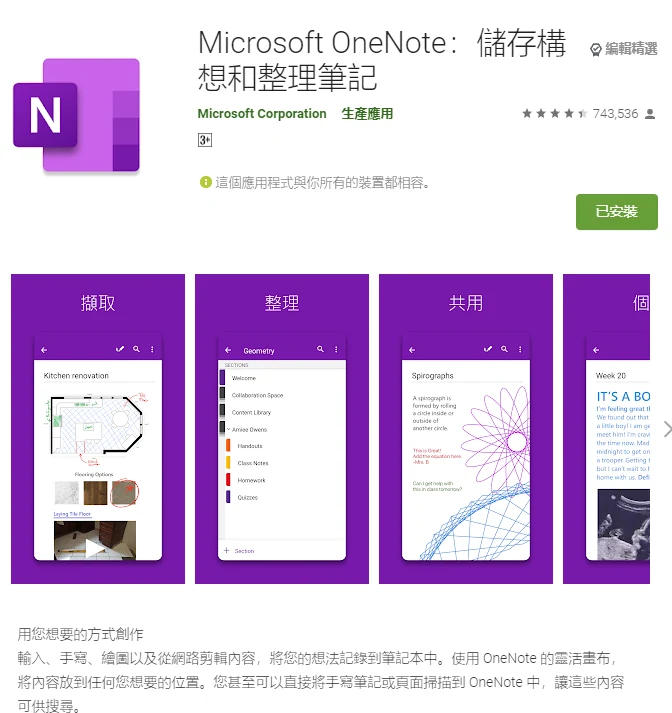
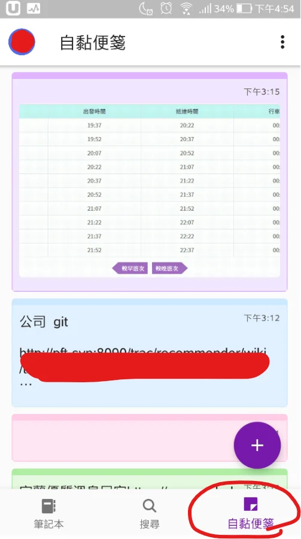

1. 在 PC 版登入自黏便箋

2. 同步

3. 下載 OneNote，並登入與 PC 自黏便箋相同的 Microsoft 帳號

4. 打開手機 OneNote 的 Sticky Notes／自黏便箋入口即可查看；本文畫面是 2019～2020 年版本，入口位置可能隨平台與版本不同

勘誤核對來源：[1](https://support.microsoft.com/en-us/office/where-did-my-sticky-notes-go-60781b7d-03a5-4cd6-830b-1b9eab263bce)。
