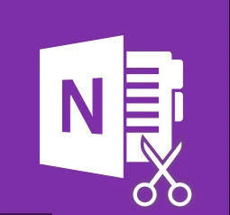

先來講一下三個我使用的範圍心得跟優缺點好了

 

OneNote:

 

強大的複製貼上功能，微軟自家的東西都可以貼，也可以直接貼PDF  
內建繪畫功能，強大的文字編輯器，缺點就是貼code會跑版 顏色會亂跳  
我當時搭配 Office 使用；OneNote 本身也有免費桌面版，部分功能依版本、帳號與訂閱方案不同。

最常拿來東貼西貼，第一直接筆記就想到他，有APP可以跟手機同步  
因為不用管格式的優點，所以非常適合第一手做筆記，隨手拈來一筆  
最大缺點就是貼code了，我後來都改用截圖的方式做筆記 .. 但要用的時候不能直接複製慘

 

HackMD:

 

簡單簡潔，可以跟github同步，用MarkDown寫  
共享筆記要注意讀寫權限；預設值會依個人／團隊工作區與設定不同，不能一概認定所有新筆記都允許所有人編輯。發送連結前應確認分享權限。

MarkDown雖然寫的方式跟打code差不多，格式非常標準  
但想記一些神來之筆亂貼圖片畫圖，就比較沒那麼自由  
還有結構性跟分類搜尋性沒那麼好

 

WordPress:

 

優點是一邊寫可以一邊賺流量，但我不夠大不能賺錢QQ  
可以用強大編輯器，也可以用MarkDown但  
要用表格或特規化的文字超不方便  
有時候要寫不是程式相關的文章MarkDown無法天馬行空  
此時還是可以換回原生強大的編輯器  
但強不過OneNote，但有一堆外掛跟調整美觀的設定  
看起來很爽快

缺點：不能亂寫一些奇怪的東西就直接發上來，肥  
整體就是肥滋滋的，blog用wordPress架就是肥  
還有外掛程式讓他更肥

|  | OneNote | HackMD | WordPress |
| --- | --- | --- | --- |
| 自由度 | ★★★ | ★ | ★★ |
| 分類性 | ★★★ | ★★ | ★★ |
| 搜尋度 | ★★★ | ★★ | ★★★ |
| 備份度 | ★★ | ★★ | ★ |

 

個人三者都用 使用類別方式各有不同

 

程式筆記會經過三手  
OneNote →HackMD→WordPress

心得類:

 

WordPress、OneNote

純記程式碼

 

HackMD

旅遊類:

 

WordPress

勘誤核對來源：[1](https://support.microsoft.com/en-us/onenote/what-s-the-difference-between-the-onenote-versions)、[2](https://hackmd.io/c/tutorials/%2Fs%2Fhow-to-share-note)。
