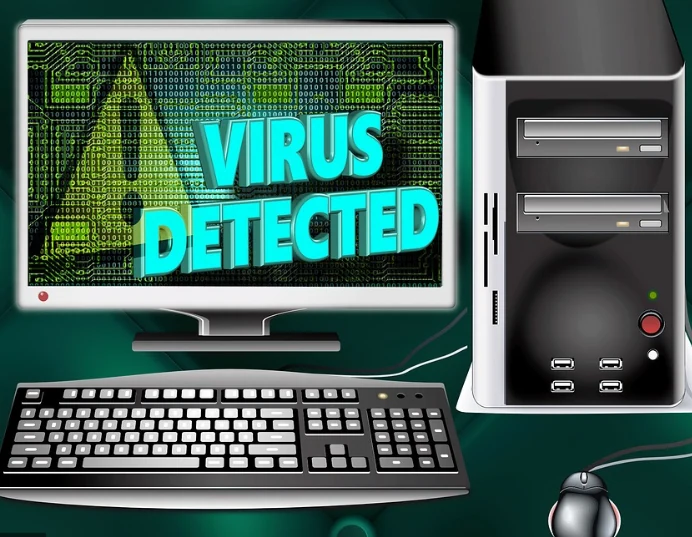

本文整理當時看到的資安事件與使用者回報。供應鏈入侵、廣告搭載、潛在不受歡迎程式（PUP）與病毒並不相同，不能由軟體名稱判定目前版本已感染。以下也會區分可核對的研究報告與尚未獨立證實的舊討論。

- oCam \[1\].
- Garena(GGC)\[2\]
- Kmplayer \[3\]
- Potplayer \[4\]
- 夜神\[5\]
- 網頁挖礦 \[6\]
- 掃描全能王 \[7\]
- 伊莉論壇 \[8\]

---

## oCam

oCam 是 ohsoft 推出的錄影軟體。原文引用的 2018 年使用者文章回報，某些安裝流程曾出現 BRTSvc 挖礦元件與 CPU 資源異常占用。這份回報不能推論所有版本都含挖礦程式，也不足以判定廠商動機或「合法安裝」。安裝時應留意附加元件，並以實際檔案與安全工具檢查結果判斷。

#### 危險因子:偷挖礦佔盡CPU資源、耗流量，有機會被學校資安中心鎖網

替代方案： 自己的螢幕錄影程式自己寫起來

[相關文章](../mrcoding-2019-07-25-2539/)

---

## Garena

由可以幫助魔獸爭霸及世紀帝國進行區域連網服務而聞名的軟體  
早期在玩即時戰略遊戲，如*世紀帝國* *魔獸爭霸* *星海爭霸* 等  
都推出相當方便讓玩家尋找對戰的路徑，  
且不用使用正版遊戲軟體，也可以現在跟玩家對戰  
當LOL於S2爆紅時期，引進台灣當成代理商，原先MOBA遊戲玩家幾乎全部大轉移  
讓當初打信長、三國等玩家湧入LOL，且該賽季台灣拿下世界冠軍  
頓時間為青少年最多人遊玩的遊戲之一，  
網咖空前盛況更勝 CS、暗黑破壞神2和魔獸爭霸  
原文蒐集的 Garena 事件包括 2015 年遊戲安裝檔遭植入 PlugX 的歷史通報。這是特定時間與安裝檔的事件，不能據此認定所有玩家都曾被盜，也不能把供應鏈入侵、DDoS 與帳號外洩混成同一件事。原先涉及員工行為與大量玩家損失的敘述缺少可核對的一手依據，這裡不再當作已證實事實陳述。

#### 危險因子：歷史受污染安裝檔的風險；目前狀態須依版本、來源與事件通報個別判定

替代方案：建議直接換遊戲

---

## KMPlayer、PotPlayer

- 
- 

兩款都是經典免費得播放軟體，  
以前下載謎片和電影時，少不了這兩個優秀軟體  
原文將 KMPlayer 的舊版安裝包討論與 PotPlayer 的廣告／附加元件討論放在一起，但兩者不是相同的事件，也不能把廣告行為直接等同木馬。原引用以舊新聞與論壇為主，尚不足以判定目前官方版本的感染狀態。

#### KMPlayer：若引用特定惡意安裝檔事件，須核對版本、檔案來源與雜湊；不能據此認定所有安裝都會竊資

#### PotPlayer：原文反映的是當時廣告及附加元件的使用者討論，不是所有版本均為病毒的證據

替代方案：用微軟內建或付費版的播放器，OR[開源播放器VLC](https://www.videolan.org/vlc/index.zh-TW.html)

---

## 夜神模擬器

知名手機遊戲模擬器，在台灣與BS齊名。  
原文記錄使用者對夜神安裝流程搭載 Segurazo／SAnitvirus 的討論。Malwarebytes 將 Segurazo 分類為潛在不受歡迎程式（PUP）；PUP 與病毒並不是同一分類。這無法證明夜神所有版本都搭載該軟體，也不足以推斷廠商搭載的動機或目前是否仍搭載。

附上巴哈網友討論:  
[https://forum.gamer.com.tw/C.php?bsn=60030&snA=559588](https://forum.gamer.com.tw/C.php?bsn=60030&snA=559588)  
跟其他BLOG 遇到此狀況解決方式   
[https://chunju.pixnet.net/blog/post/47200570-%E6%B5%81%E6%B0%93%E8%BB%9F%E9%AB%94segurazo%E5%88%AA%E9%99%A4%E6%96%B9%E5%BC%8](https://chunju.pixnet.net/blog/post/47200570-%E6%B5%81%E6%B0%93%E8%BB%9F%E9%AB%94segurazo%E5%88%AA%E9%99%A4%E6%96%B9%E5%BC%8)F

#### 危險因子:不明，但非常吃電腦資源，不知道真正目的為何?

替代方案：其他遊戲模擬器

---

## 網頁挖礦

在虛擬貨幣盛行一陣子後，挖礦不再是需要本機端才能，只要你手機或電腦打開也可以幫你偷挖  
的程式終於出現拉!  
但目前該貨幣公司Coinhive停止營運  
有些網頁仍殘留載入 Coinhive 的程式碼，但服務停止後，僅殘留這段程式碼不代表還能成功挖礦。其他瀏覽器挖礦服務仍可能存在，應依實際執行行為判斷。

#### 危險因子:非常難發現，異常吃效能。

處理方式：關閉可疑分頁，查看瀏覽器工作管理員的 CPU 使用量，並以可信任的安全工具檢查。

---

## 掃描全能王

2019 年 Kaspersky 研究人員在 Android 版 CamScanner 當時的版本中，發現第三方廣告模組含有惡意下載元件。報告針對該次受影響版本，不能以累積下載量或開發商所在地推論所有使用者已受害，也不代表後續版本必然含相同元件。

#### 危險因子：當時受影響的廣告模組可能下載其他惡意元件；實際影響需依安裝版本與裝置檢查結果確認

替代方案：可評估手機內建的文件掃描功能；原文推薦的 U Scanner 舊商店連結已失效，不再當作目前可下載的選項。

---

## 伊莉論壇

早期紅片大街小巷的資源分享室論壇，  
經歷過網路色情掃黃事件，音樂著作權抬頭時的危機  
一一撐過來，但前幾年終於爆發更大的危機，  
原文引用的舊報導稱首頁曾出現散布**勒索軟體**的惡意內容。勒索軟體可能加密可存取的檔案再索取贖金，但不是每次都會加密所有資料，付款也不保證可解鎖  
十分霸道。

#### 危險因子:損失重要資料，公司行號會面臨重大危機，除了加密不確定會不會竊資

替代方案：購買正版資源

---

1. [小心!免費的oCam螢幕錄影軟體含有吃光你CPU的挖礦程式 (BRTSvc)](https://0800happy.com/7992/)
2. [LOL安裝檔木馬事件(PlugX資安事件)說明公告](https://lic.tumt.edu.tw/files/14-1025-9540,r14-1.php?Lang=zh-tw)
3. [https://briian.com/12890/](https://briian.com/12890/)
4. [Potplayer巳變成病毒](https://www.hkepc.com/forum/viewthread.php?fid=9&tid=2546092&extra=page%3D1&page=2)
5. [segurazo 這軟體怎麼刪](https://forum.gamer.com.tw/C.php?bsn=60030&snA=528637)
6. [**探討挖礦資安事件**](http://www.cc.ntu.edu.tw/chinese/epaper/0048/20190320_4802.html)
7. [你可能也有安裝！下載破億次、超紅 Android 手機 App 被爆是木馬](https://3c.ltn.com.tw/news/37810)
8. [伊莉論壇首頁遭植 勒索病毒 網友誤觸電腦檔案毀於一旦](https://www.kocpc.com.tw/archives/145414)

2021 年另有 ESET 對夜神更新機制遭供應鏈入侵的獨立研究（Operation NightScout）；這與前面 Segurazo 附加程式討論是不同事件，研究發現的是少數被選定的目標，不代表全部使用者感染。

勘誤核對來源：[1](https://www.malwarebytes.com/blog/detections/pup-optional-segurazo)、[2](https://www.malwarebytes.com/blog/news/2019/05/cryptojacking-in-the-post-coinhive-era)、[3](https://www.kaspersky.co.uk/blog/camscanner-malicious-android-app/16598/)、[4](https://www.welivesecurity.com/2021/02/01/operation-nightscout-supply-chain-attack-online-gaming-asia/)。
