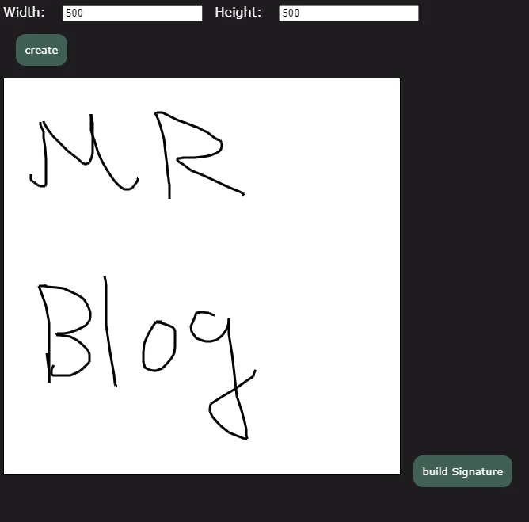

示意圖

https://codesandbox.io/s/github/MingRay98/singatureBoard-original-JS

Github: [https://github.com/MingRay98/singatureBoard-original-JS](https://github.com/MingRay98/singatureBoard-original-JS)

說明：  
使用原生 JS 、ES6 、Parcel、CodeSandBox 的小專案  
不使用vue、react、Angular 框架，且不使用html標籤語法建立元件。

主要用到元件:

\<button\>、 \<canvas\> 、 \<input\>、\<a\>

主要用到方法為:

```javascript
let globalCanvas;
let globalCtx;
let drawing = false;
let x = 0;
let y = 0;

//建立Canvas
export const createCanvas = (width, height) => {
  let canvas = document.createElement("canvas");
  canvas.id = "signatureCanvas";
  canvas.width = width;
  canvas.height = height;
  canvas.style.zIndex = 8;
  canvas.style.border = "1px solid";
  return canvas;
};

//幫canvas增加事件
export const getGlobalCanvas = () => {
  globalCanvas = document.getElementById("signatureCanvas");
  globalCtx = globalCanvas.getContext("2d");

  globalCanvas.addEventListener("mousedown", addDrawPoint, false);
  globalCanvas.addEventListener("mousemove", drawLine, false);
  globalCanvas.addEventListener("mouseup", stopDrawing, false);
  globalCanvas.addEventListener("mouseout", stopDrawing, false);

  globalCanvas.addEventListener("touchstart", tAddDrawPoint, { passive: false });
  globalCanvas.addEventListener("touchmove", tDrawLine, { passive: false });
  globalCanvas.addEventListener("touchend", tStopDrawing, false);
  globalCanvas.addEventListener("touchcancel", tStopDrawing, false);
};

const addDrawPoint = event => {
  drawing = true;
  x = event.offsetX;
  y = event.offsetY;
};

const drawLine = event => {
  if (drawing) {
    globalCtx.lineWidth = 3;
    globalCtx.beginPath();
    globalCtx.moveTo(x, y);
    globalCtx.lineTo(event.offsetX, event.offsetY);
    globalCtx.stroke();
    x = event.offsetX;
    y = event.offsetY;
  }
};

const stopDrawing = event => {
  drawing = false;
};

//t = touch  觸控事件需要扣除 canvas的偏移
const touchPoint = event => {
  const rect = globalCanvas.getBoundingClientRect();
  const touch = event.targetTouches[0];
  return {
    x: (touch.clientX - rect.left) * globalCanvas.width / rect.width,
    y: (touch.clientY - rect.top) * globalCanvas.height / rect.height
  };
};

const tAddDrawPoint = event => {
  event.preventDefault();
  drawing = true;
  console.log(event.targetTouches[0]);
  const point = touchPoint(event);
  x = point.x;
  y = point.y;
};

const tDrawLine = event => {
  event.preventDefault();
  if (drawing) {
    const point = touchPoint(event);
    globalCtx.lineWidth = 3;
    globalCtx.beginPath();
    globalCtx.moveTo(x, y);
    globalCtx.lineTo(point.x, point.y);
    globalCtx.stroke();
    x = point.x;
    y = point.y;
  }
};

const tStopDrawing = event => {
  drawing = false;
};
```

```javascript
//下載的方法

const download = () => {
  const link = document.createElement("a");
  link.download = "signature.png";
  link.href = document.getElementById("signatureCanvas").toDataURL();
  link.click();
};
```

這裡仍是專案的主要方法摘錄：先把 `createCanvas()` 回傳的元素加入頁面，再呼叫 `getGlobalCanvas()` 綁定事件。範例以單點觸控及未旋轉的 canvas 為前提。

勘誤核對來源：[1](https://developer.mozilla.org/en-US/docs/Web/API/Element/getBoundingClientRect)、[2](https://developer.mozilla.org/en-US/docs/Web/API/Touch/clientX)。
