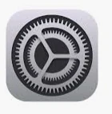
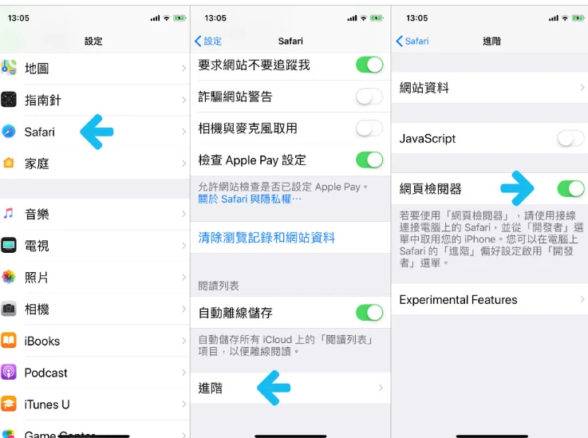
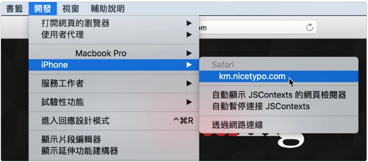
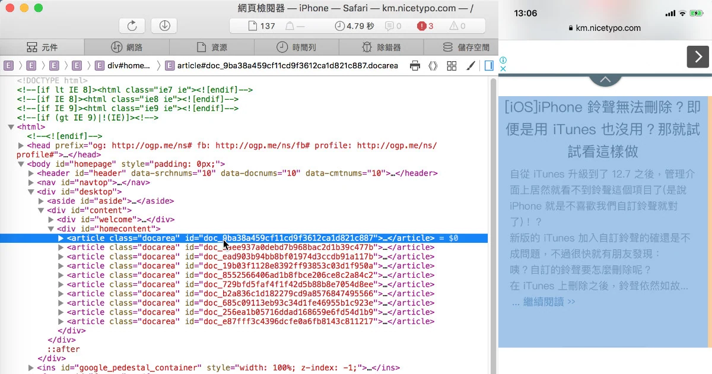

iphone + MAC 網頁 debug方式教學：

---

1. 進入設定



2. 找到Safari 打開進階設定

3. 開啟網頁檢閱器



源自:  
[https://km.nicetypo.com/doc/6d502ee2251fd167498c16c20d0bc5d4](https://km.nicetypo.com/doc/6d502ee2251fd167498c16c20d0bc5d4)

將iphone 接上傳輸線 插在MAC上

1. 打開Safari
2. 若看不到「開發」選單，先到 Safari 設定的進階選項啟用開發者功能；再選擇「開發」→ iPhone → 要檢查的網址。首次連接也要在 iPhone 確認信任電腦。
3. 就可以開始 Debug囉!



源自:  
[https://km.nicetypo.com/doc/6d502ee2251fd167498c16c20d0bc5d4](https://km.nicetypo.com/doc/6d502ee2251fd167498c16c20d0bc5d4)



源自:  
[https://km.nicetypo.com/doc/6d502ee2251fd167498c16c20d0bc5d4](https://km.nicetypo.com/doc/6d502ee2251fd167498c16c20d0bc5d4)

***MAC Debug方式參考自:  
[https://km.nicetypo.com/doc/6d502ee2251fd167498c16c20d0bc5d4](https://km.nicetypo.com/doc/6d502ee2251fd167498c16c20d0bc5d4)  
圖片版權源於此blog***

---

以下為在 Windows 上Debug

***教學源自於 :***  
***[https://github.com/RemoteDebug/remotedebug-ios-webkit-adapter](https://github.com/RemoteDebug/remotedebug-ios-webkit-adapter)***

使用 [remotedebug-ios-webkit-adapter](https://github.com/RemoteDebug/remotedebug-ios-webkit-adapter) 套件  
點選即可到 官方github查看內容及教學.

***注意 IOS 13 在2019年的套件版本尚未支援，***  
***這是 2020 年的第三方工具流程；當時未測試 iOS 13 / 14，也不能保證現在的 iOS 或 Chrome 仍能使用。請先核對專案 README 的支援狀態。***

1. 打開CMD =\> window 搜尋 CMD 並打開
2. 安裝 NPM
3. 安裝套件

```
scoop bucket add extras
scoop install ios-webkit-debug-proxy

npm install remotedebug-ios-webkit-adapter -g
```

4. 依照上述的iphone連接MAC的方式設定一次iphone  
 設定 \> safari \> 進階設定 \> 網頁檢閱器 \> 打開

5. 接上電腦

6. CMD 打指令

```
remotedebug_ios_webkit_adapter --port=9000
```

7. 打開chrome 輸入網址： *[chrome://inspect](chrome://inspect)*

8. 在紅色圈圈 會顯示開啟的 iphone 頁面，按下inspect 即可完成debug Mode


堪誤參考：[官方文件](https://webkit.org/web-inspector/enabling-web-inspector/)、[官方文件](https://github.com/RemoteDebug/remotedebug-ios-webkit-adapter)。
