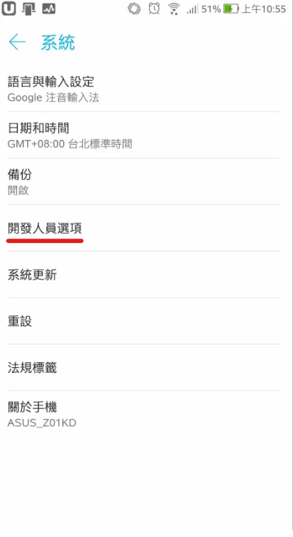
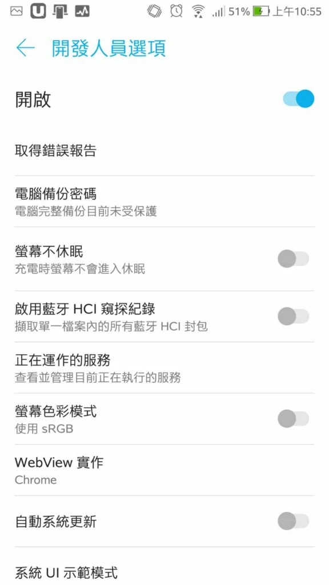
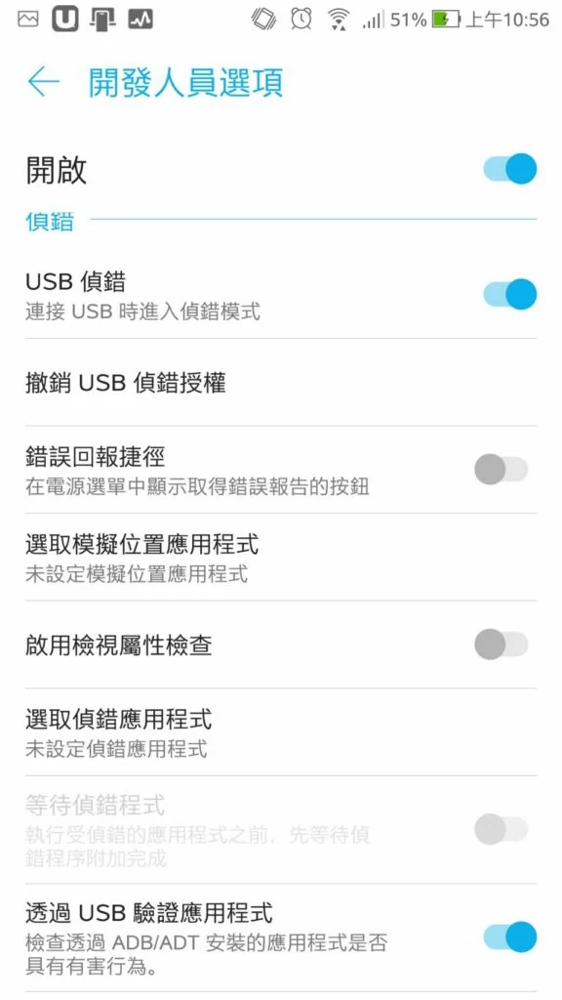
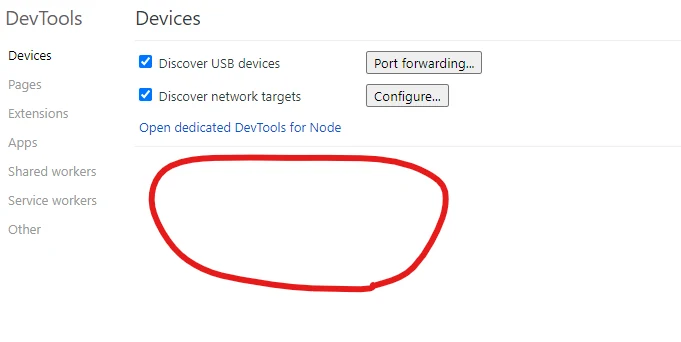

教你快速在Windows上，Debug Android手機

1.將你的手機 ***開啟開發人員模式*** 以ASUS為例

手機點選 "設定" \> 關於 \> 軟體資訊 \> 版本號碼 （通常需連按 7 次；選單位置依機型而異）

2. 進入開發人員模式設定

設定 \> 系統 \> 開發人員選項 \> 開啟 \> 開啟USB 偵錯模式

- 
- 
- 

3. 開始Debug

將手機以可傳輸資料的 USB 線接上電腦，保持解鎖；在手機允許這台電腦的 USB 偵錯授權。電腦及手機都要開啟 Chrome，並在手機開啟要檢查的網頁。

[chrome://inspect/#devices](chrome://inspect/#devices) 在電腦 Chrome 開啟這個網址，確認已勾選 Discover USB devices。若裝置未出現，再檢查資料線、USB 模式或 Windows USB 驅動程式。

裝置就會在畫紅色圈圈處，並點選inspect

堪誤參考：[官方文件](https://developer.chrome.com/docs/devtools/remote-debugging/)。
