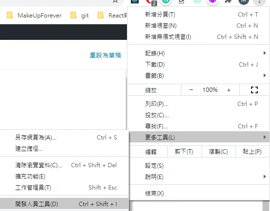
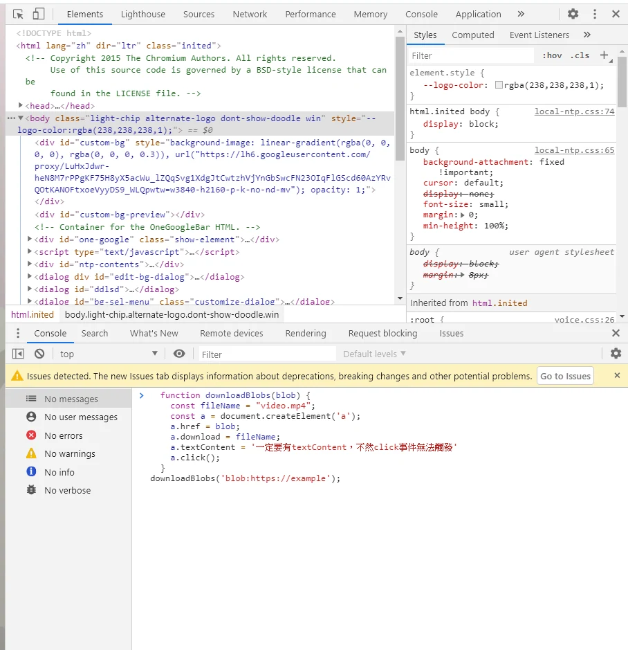

`blob:` 是瀏覽器建立的物件 URL，不是影片加密方式。下面只適用於目前頁面仍可存取、且實際指向完整 `Blob` 的 URL；不能用來破解加密，也不能直接下載 `MediaSource` 串流或 DRM 影片。不同瀏覽器的下載行為可能不同。

教學：

1. 打開 開發人員模式

F12 \> Ctrl + Shift + I 或 更多工具 \> 開發人員工具



2. 下指令



```javascript
  function downloadBlobs(blob) {
	const fileName = "video.mp4";
	const a = document.createElement('a');
	a.href = blob;
    a.download = fileName;
    a.textContent = '文字敘述，可有可無'
    a.click(); 
  }
// 換成目前頁面實際產生、仍有效的完整 Blob URL；下面只是格式示意
downloadBlobs("blob:https://example.com/實際的物件識別碼");
```

堪誤參考：[MDN 文件](https://developer.mozilla.org/en-US/docs/Web/URI/Reference/Schemes/blob)。
