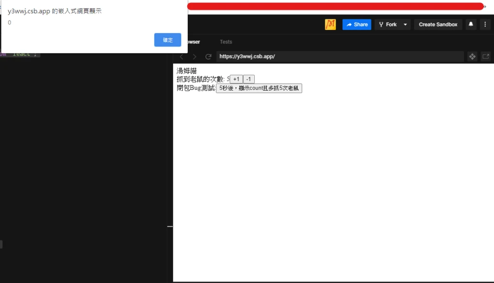

先圖，在上code



```javascript
import React, { useState, useEffect } from "react";
import ReactDOM from "react-dom";

class App extends React.Component {
  constructor(props) {
    super(props);
    this.state = {
      name: "湯姆貓"
    };
    this.action = null;
  }

  render() {
    return (
      <div>
        {this.state.name}
        <UseStateHook />
      </div>
    );
  }
}

const UseStateHook = () => {
  const [count, setCount] = useState(0);
  let tempCount = count;
  const delayShow = () => {
    setTimeout(() => {
      alert(tempCount);
    }, 5000);
    setCount(count + 5);
  };
  return (
    <div>
      抓到老鼠的次數: {count}
      <button onClick={() => setCount(count + 1)}>+1</button>
      <button onClick={() => setCount(count - 1)}>-1</button>
      <br />
      閉包Bug測試:
      <button onClick={delayShow}>5秒後，顯示count且多抓5次老鼠</button>
    </div>
  );
};

ReactDOM.render(<App />, document.getElementById("app"));
```

第一次 count 為 0 時按下按鈕，5 秒後仍顯示 0，因為 timeout 回呼保留按下當次 render 的 `tempCount`。這是 JavaScript 閉包與 React state 快照的正常行為；只有當需求是「顯示 5 秒後的最新值」時，才需要另外調整。

若要讀取最新值，可以用 useRef；若只要依前一個值更新計數，可用 `setCount(previous => previous + 5)`。兩者用途不同。useRef 範例請參考這一篇:

[相關文章](../mrcoding-2020-08-27-3134/)

堪誤參考：[官方文件](https://react.dev/learn/state-as-a-snapshot)、[官方文件](https://react.dev/reference/react/useState)。
