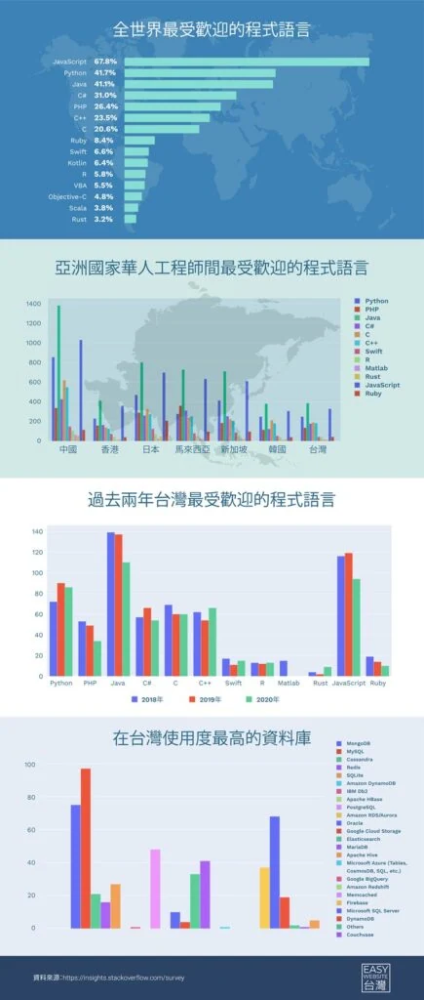

科技技術當今主導著眾多不同的產業，5G、AI人工智慧、機器學習、大數據和區塊鏈等熱門議題在過去幾年已蔓延至我們日常生活的片刻，這也直接使得「學程式」這件事情從以前是對「宅男」的刻板印象，反而變成高薪、好工作的代名詞。許多國家政府包括台灣，看準未來科技趨勢發展，陸陸續續也將編程教育放入課綱當中，希望讓學生從小就能接觸並培養此一技能。

維京集團創辦人兼總裁理查·布蘭森（Richard Branson）曾說：「無論你是要對抗氣候變遷還是要進入太空，每件事情都將由電腦推動，而世界上缺乏會寫程式的人。教導年輕人越早學習編程越可以幫助他們建立技能和自信心，並可以通過邊做邊學的機會為課堂注入點生氣。」

以下我們來看一下編程技術對於在這世代生存究竟為何如此重要的三大關鍵：

1. **編程能力=解決問題能力**

其實編程最基本的出發點，就是為了解決問題。一個程式實際上只是根據你概述的邏輯準則為電腦分配該要執行的任務，即便再高度複雜的任務（或應用程式/軟體）的本質都只是由一層一層操作/指令集合而成。

世界上最偉大科技公司之一Google，它的產生也是為了解決搜尋品質的問題。創辦人Larry Page和 Sergey Brin還在史丹佛當學生時發現當時的搜尋引擎給予搜尋者的資料不夠精準，因此開始著手進行解決這個問題，開發了一個名為BackRub的程式，核心構想之一是利用網頁連結分析來評估網頁的重要性，再用於搜尋結果排名。BackRub後來改名為「Google」。

解決問題的能力在各行各業中都無比重要，而編程絕對能夠培養你解決問題的這項技能。

2. **化想法為產品**

如果你總是被稱為鬼點王或是想法很多的人，那麼編程對你來說將會是一項很棒的技能。怎麼說？因為會寫程式能夠將一個單純的想法化為數碼再化為實體的應用程式。

許多當今的科技大品牌都是由一個想法開始。[Instagram創辦人Kevin Systrom](https://www.bnext.com.tw/article/22797/BN-ARTICLE-22797)曾未接受過電腦科學方面的正式培訓，但他利用業餘時間自學程式，學習過程中湧現許多的想法，而其一就是允許用戶發布和分享照片的應用程式Instagram。

Kevin Systrom說過一句耐人尋味的話：「如果你有一個點子，那就從今天開始實現它。沒有比現在更適合的時間。這不代表你要辭去工作或從第一天開始就100%全心全意地投入，但總有往前跨進一點點的空間，来啟動這個改變。」

你是一位有想法的人嗎？不如現在就開始學習寫程式，把想法轉換成應用程式，也許你會是下一個Instagram創辦人！

3. **最實際的：不缺工作＋薪資高**

我們的日常，無論食、衣、住、行、育、樂都和科技與各式各樣的[網站](https://easywebsitetw.com/%e7%b6%b2%e9%a0%81%e8%a8%ad%e8%a8%88%e6%95%99%e5%ad%b8/)/應用程式App脫離不了關係。隨便講幾個Uber Eats、Line、Airbnb、Facebook都是我們每天在使用的應用程式，這也難怪工程師這個職缺的數量在全球不斷成長，而薪資也在各行各業中一支獨秀。

根據台灣[104人力銀行](https://www.104.com.tw/jb/wage/list?type=2&jobcat=2007001000&cat=jobmake)，軟體專案主管平均月薪為新台幣 79,800 元／月，公立碩士月薪新台幣 49,335 元（均為本文當時引用的數字），而根據美國勞工局的2019年的調查顯示，該軟體開發與品質保證／測試職類的年薪中位數為 107,510 美元（以本文當時匯率換算約新台幣 320 萬元；不是平均薪資）。國外的月亮好像比較圓，單純從薪資上看來....這點是真的，但編程已另類的成為了世界的共通語言，因此它可以幫助你開啟世界之門，不用侷限自己在台灣工作。若不喜歡朝九晚五的工作，當今也有許多工程師改為自己接案。總之有了編程的基礎，你走到哪裡很吃香。

**自學該從哪裡學起？哪些程式最受歡迎？**

[Stack Overflow](https://insights.stackoverflow.com/survey/2020)這一個「開發工程人員界的批踢踢」在2020年初曾針對全世界186個國家中6.5萬名軟體工程人員進行最常使用的程式語言調查。結果指出JavaScript已經連8年在全球和華人地區保持領頭羊的地位。

JavaScript之所以成為熱門，是因為它將Web瀏覽器變成了應用程序平台，加上它提供的彈性度（不需要任何環境設置。只需打開瀏覽器，如Chrome，接者點選「開發人員工具」，即可開始編碼），成為第一名的地位實在當之無愧。

Stack Overflow 的全球調查不能直接推論成台灣市場排名。原文提到台灣 Java 與 MySQL 的使用情況，但沒有附上台灣樣本與來源，因此這裡不把它當成已驗證的排名。

Java受歡迎的原因在於其編程較為簡易且靈活，因此對於許多應用程式（Web或Android）開發人員而言，它顯然是首選的編程語言。而MySQL成為人氣資料庫的原因在於其開源性、可靠性，並與所有主要的託管服務提供商兼容，具有成本效益，還易於管理。Uber、Twitter、Amazon這些知名科技龍頭皆使用MySQL資料庫。

**程式自學究竟該怎麼開始？**

就像我們先前提到的Instagram創辦人Kevin Systrom，就連Tesla 共同創辦人 Elon Musk都是自學編程。多虧了無邊無際的網路，現在市面上有五花八門的教學課程，只要依據你想達成的目標選擇一個你適合學習的程式，然後從那裡開始，一步一腳印的打好基礎，說不定哪一天你的所撰寫的程式也能成為世界上最偉大的公司之一！

對網站架設有興趣嗎？前往[**Easy Website台灣**](https://easywebsitetw.com/)了解實用網站架設資訊。

資料註記：本文引用的薪資與熱門技術調查屬 2019～2020 年資料，不能代表現在的就業需求、薪資或個人的求職結果。

堪誤參考：[官方文件](https://www.bls.gov/oes/2019/may/oes151256.htm)、[官方文件](https://survey.stackoverflow.co/2020/)、[官方文件](https://about.google/company-info/our-story/)。
