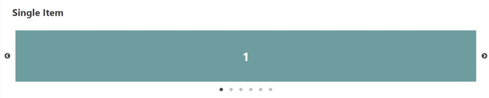
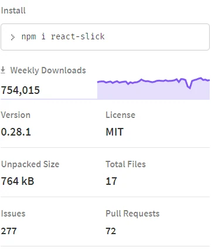

## React-Slick

## 介紹

今天要介紹的是一個React圖片輪播的套件，其實他也可以做到其他的事情，如自動輪播，產生list的功能，非常的易用。只要 \<Slider\>內容\</Slider\>包住就解決了。



基本樣式



npm周下載量

## 安裝

[https://react-slick.neostack.com/docs/get-started/](https://react-slick.neostack.com/docs/get-started/)

```
yarn add react-slick slick-carousel
# 或使用 npm（二選一）
npm install react-slick slick-carousel
```

## 教學

### 程式碼

```jsx
import React, { Component } from "react";
import Slider from "react-slick";
import "slick-carousel/slick/slick.css";
import "slick-carousel/slick/slick-theme.css";

export default class SimpleSlider extends Component {
  render() {
    const settings = {
      dots: true,
      infinite: true,
      speed: 500,
      slidesToShow: 1,
      slidesToScroll: 1
    };
    return (
      <div>
        <h2> Single Item</h2>
        <Slider {...settings}>
          <div>
            <h3>1</h3>
          </div>
          <div>
            <h3>2</h3>
          </div>
          <div>
            <h3>3</h3>
          </div>
          <div>
            <h3>4</h3>
          </div>
          <div>
            <h3>5</h3>
          </div>
          <div>
            <h3>6</h3>
          </div>
        </Slider>
      </div>
    );
  }
}
```

### 範例

[https://react-slick.neostack.com/docs/example/simple-slider](https://react-slick.neostack.com/docs/example/simple-slider)

## 文檔

[https://react-slick.neostack.com/docs/](https://react-slick.neostack.com/docs/get-started)

堪誤參考：[官方文件](https://react-slick.neostack.com/docs/get-started)。
