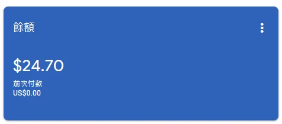
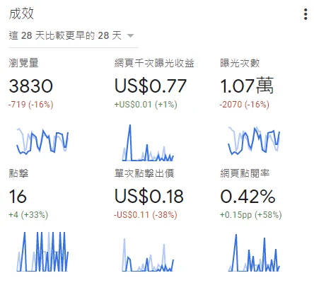

## 究竟筆記程式部落格到底能不能賺錢呢?

## 簡介

其實每個部落格賺的錢應該都是大秘密，但今天我不藏了，直接給大家看我Google AdSense的總收益，跟每個月的點擊率跟預估收益。

## Google AdSense

### 利潤2年總收益

對，沒錯~ 24.70 美元，是我現在所賺的錢，依照台幣現在的匯率1:28，大概就是賺了**約 692 台幣**

### 每個月預估收益跟瀏覽量

每個月瀏覽量分長旺期，跟淡期  
旺期: 期末考月，通常瀏覽率最高，廣告點擊率最好。  
淡期: 寒暑假，年假，慘慘淡淡慘，學生是我主要客群。

單次點擊、千次曝光，似乎都跟有效廣告點閱率有關，  
之前有朋友友情狂點，當時看到次數增加、出價變低，但不能只憑這個觀察推斷因果。刻意幫忙點廣告屬無效流量風險，也違反 AdSense 規則，請不要請朋友點擊或自己點擊網站廣告。

## 總結

其實筆記型要賺錢真的難度很高，現在最大的難題就是  
我一個月大概就賺20~30元，但我要升級我的服務到更快的   
cloud service，每個月至少150元台幣起跳，  
就陷入了窮輪迴，沒更好更快的服務，點擊率衝不上去，  
升了又怕只是再燒錢，更何況我是拿來當筆記而已。  
但一邊做筆記，一邊賺錢也是好事，雖然幾乎等於不足掛齒的金額就是了

真的要經營部落格賺錢的，比較能衝點閱率的，還是頻繁更新的美食部落客  
只要能跟上最火紅的店家，拍的照片技術好，比較有點擊率，  
且在手機上點閱率也高，誰沒事會想在手機上看密密麻麻的code  
我看目前最火紅的一天點閱率就可以到1萬5   
一周又超車  

但程式型BLOG好處就是時效性較長一點，美食的3~4年後點閱率就會衰退很多

##### 總結就是**"筆記型BLOG 要賺錢 難如登天，還是乖乖做筆記就好**"

歡迎使用我的會員推薦碼，來註冊 **CloudAccess** 方便簡單的 虛擬主機喔  
[https://ccp.cloudaccess.net/aff.php?aff=12577](https://ccp.cloudaccess.net/aff.php?aff=12577)

本文金額、匯率、主機價格與流量觀察均屬發文當時的個人紀錄。

堪誤參考：[官方文件](https://support.google.com/adsense/answer/2660562)。
