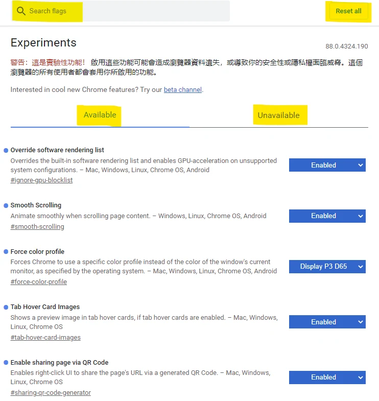
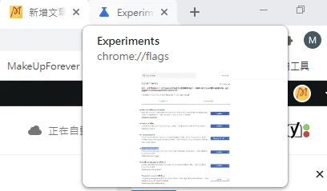
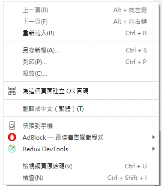

## Chrome Experiments

## 簡介

這裡介紹的是 `chrome://flags`（Chrome flags）實驗設定，在還沒上正式版本前，會先開出來給開發者或進階使用者測試的功能，實驗不保證會正式推出；可能在後續版本調整，反之亦然，不實用的功能也可能會被漸漸拔除。

## 如何開啟

在網址輸入:  
chrome://flags/  
或[點此](chrome://flags/)

## 說明

Search flags: 快速搜尋你想要開啟或關閉的功能

Reset all: 當你照著網路上給的建議，就亂開亂關功能時，你會很常使用到的全部重置

Available：目前瀏覽器版本／平台可使用的 flags，包含仍為 Default 或 Disabled 的項目。

Unavailable：目前版本／平台無法使用的 flags，不等於使用者已關閉的項目。

## 好用的功能

***在這邊先提醒，所有功能都有可能設定到安全或順暢度的疑慮，請勿亂開起不熟悉，或不知道功能的設定***

### 1. Tab Hover Card Images

現在內建預設，懸浮只會看到網址和名稱，把這項功能設 Enabled，就可以看到網址跟圖片

### 2. Override software rendering list

這會略過 GPU 的軟體渲染封鎖清單，不保證讓所有網頁變快；被封鎖可能是驅動或相容性問題，不宜只因顯示卡效能好就開啟。

### 3. Smooth Scrolling

讓滑鼠滾輪跟右邊滾輪每一個滾動 pixel，再更細緻一點跟滑順，原本可能本個捲動都會滑動都有 step by step的感覺，滑面比較容易跳動，開啟之後會更偏向手機滑動的感覺，看**漫畫**或**小說滑FB**的可能會比較有感

### 4. Enable sharing page via QR Code (新版chrome已內建)

老是想把找到的網頁傳到手機上，卻又要把網址輸入通訊軟體很麻煩?  
只要對你想分享的頁面點右鍵 選擇"為這個網址建立QR圖碼"，快速解決~

### 5. Tab Group (新版chrome已內建)

覺得網址分頁開一對密密麻麻很噁心? 覺得每次開啟都要固定開一堆網頁很麻煩?  
使用分群組功能，可以點選展開或縮起來，然後幫你的網頁分類，輕鬆簡單。

## 幾個其他推薦的實用功能

### 1. Overlay Scrollbars

把滾輪自動收起來

### 2. Flash Overlay Scrollbars When Mouse Enter

滾輪自動收起來，滑鼠移過去才顯示

### 3. Parallel downloading

嘗試平行下載；是否變快仍受伺服器、網路與實際版本行為影響。

### 4. Experimental QUIC protocol

開啟QUIC協議，詳細內容請自尋GOOGLE

### 5. Force Dark Mode for Web Contents

強制開啟Dark Mode

> 版本註記：本文記錄 2021 年的實驗名稱與介面；flags 會因版本、作業系統、正式推出或移除而改變。若找不到項目，不代表瀏覽器故障；正式開發與測試仍應以未改動 flags 的穩定版為基準。

堪誤參考：[官方文件](https://developer.chrome.com/docs/web-platform/chrome-flags/)。
