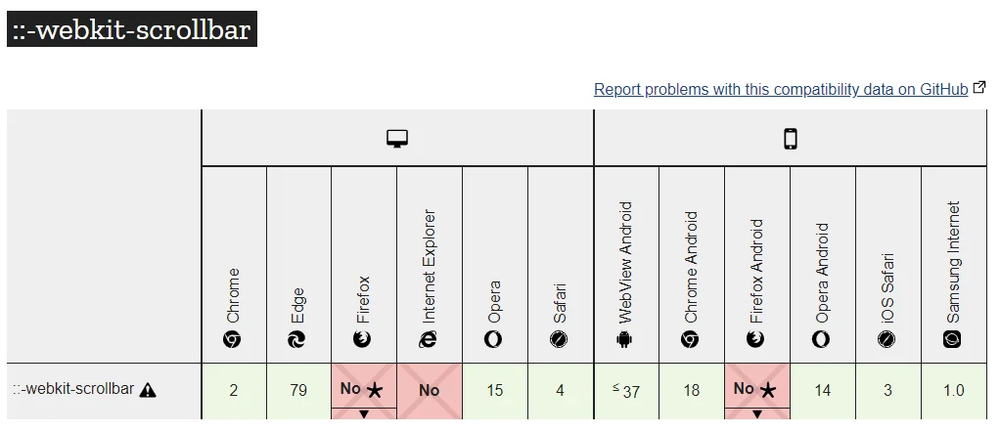

下列 `::-webkit-scrollbar` 是非標準相容寫法，主要適用 WebKit／Blink 瀏覽器；不能把它的支援表當成所有 CSS 隱藏捲軸方法的支援度。



```css
body::-webkit-scrollbar {
    display: none;
}
```

`-ms-overflow-style` 是舊版 IE／EdgeHTML 的專用屬性：

```css
body {
    -ms-overflow-style: none;
}
```

Firefox 可使用標準的 `scrollbar-width: none`，不必把捲軸擠出容器：

```css
html {
    scrollbar-width: none;
}
```

若目標是其他可捲動容器，請將選擇器改成該容器。隱藏捲軸後，仍需保留鍵盤、觸控等操作及可捲動的提示。

堪誤參考：[MDN 文件](https://developer.mozilla.org/en-US/docs/Web/CSS/Reference/Properties/scrollbar-width)。
