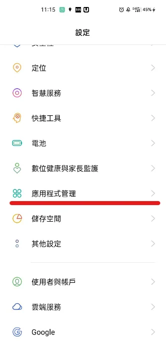
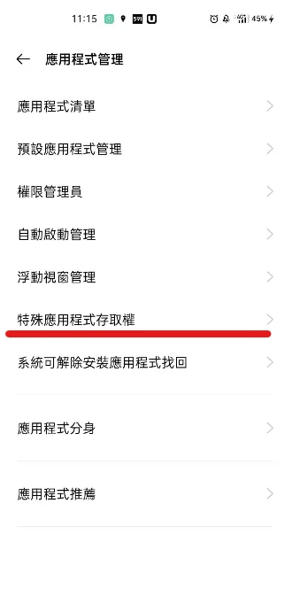
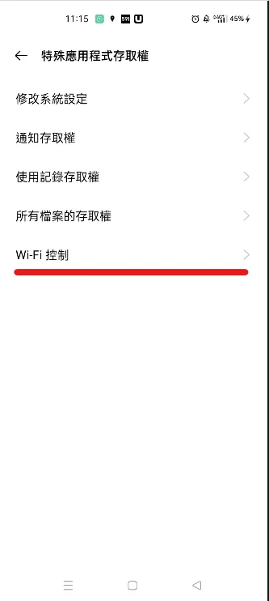
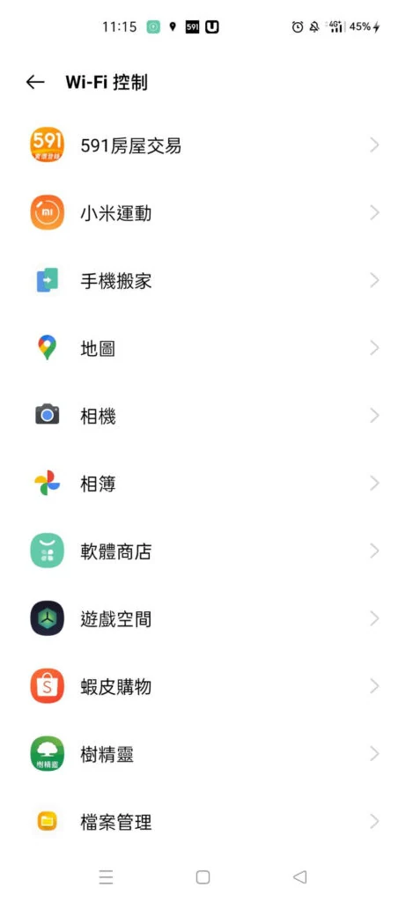

這是當時 Realme 手機介面的排查筆記，選單名稱與可用權限依品牌及 Android 版本不同，不能保證 Android 通用。

1. 進入設定 ▶ 應用程式管理。

2. 應用程式管理 ▶ 特殊應用程式存取權

3. 在特殊應用程式存取權中尋找 Wi-Fi 控制相關項目；實際名稱依系統版本而異。不要把所有不相關的特殊權限一併關閉。

4. 僅關閉可疑或不需要的 App Wi-Fi 控制權，再測試是否仍會自動開啟。系統「自動開啟 Wi-Fi」等網路設定是另一個來源，也要另外檢查。

Android 10 起，一般以 Android 10 以上為目標的 App 已不能任意透過 `setWifiEnabled` 切換 Wi-Fi；系統或管理用途例外，不能只憑 App 權限就保證完全關閉所有自動行為。

堪誤參考：[官方文件](https://developer.android.com/reference/android/net/wifi/WifiManager#setWifiEnabled(boolean))。
