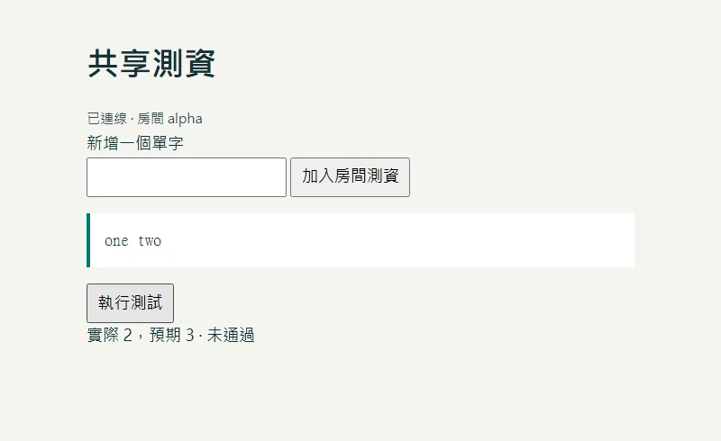

A 加入房間，輸入 `one two`。B 晚一分鐘進來，他應該立刻看見兩個字；A 再補上 `three`，B 手動執行測試，結果就該從 2 變成 3。光是這個小情境，就足夠決定第一版的資料該放哪裡。

## 把房間拆成三個可驗證的部分

| 元件 | 收到什麼 | 做什麼 |
| --- | --- | --- |
| 瀏覽器表單 | 一個新單字 | 透過 WebSocket 傳給目前房間。 |
| Bun 伺服器 | 房間 ID 和單字 | 把字加進該房間的陣列，把更新後的快照傳給房內每個連線。 |
| 分頁的測試按鈕 | 最近收到的快照 | 跑固定的單字計數，顯示實際與預期輸出。 |

如果只把新字傳給同時在線的人，B 會漏掉加入前的兩個字。因此連線打開時，伺服器得先把既有資料傳給 B。等 B 追上後，每次收到更新才交給畫面重畫。

這三篇以 Pair Practice 的結對解題需求設計獨立練習。刻意把編輯操作縮成「新增一個字」，所以單一 Bun 程序就能依收到的順序套用操作，也不用建立資料庫。若要讓兩人同時修改同一行的任意字元、離線後再合併，就要另外設計位置與衝突處理；Yjs 的文件更新是下一個可以研究的題目。

[第二篇建立 WebSocket 路由與網頁，實際測試晚加入、廣播和房間隔離。](../pair-practice-02-local-collaboration/)
