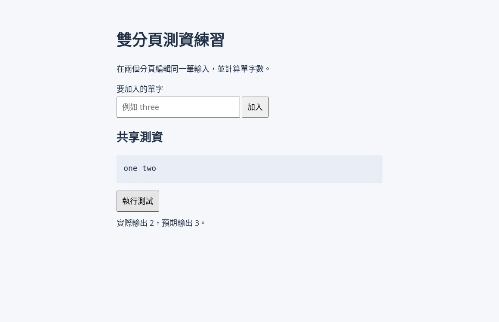
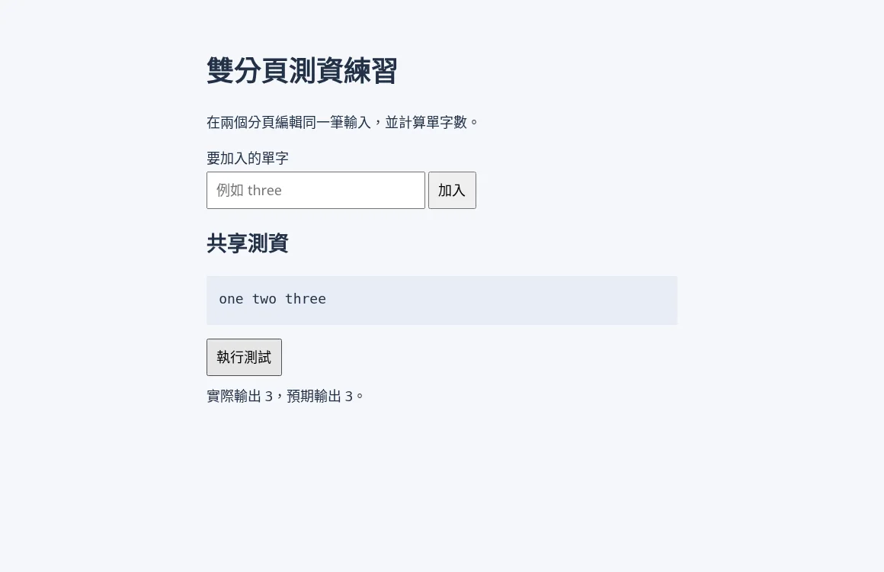

用 Vite、Yjs 和瀏覽器的 BroadcastChannel，做一個兩個分頁可以一起改測資的畫面。這組獨立教學範例在同一個瀏覽器執行，計數用固定函式。

## 1. 建立本機專案

準備 Node.js 22.12+ 或 24，開終端機執行。

```bash
mkdir pair-practice-demo
cd pair-practice-demo
npm init -y
npm install vite@8.3.8 yjs@13.6.33
```

在專案根目錄新增 `index.html`。它放一個輸入框、共享測資和測試輸出的區域。

```html title="index.html"
<!doctype html>
<html lang="zh-Hant">
  <meta charset="utf-8">
  <meta name="viewport" content="width=device-width, initial-scale=1">
  <title>Pair Practice 教學範例</title>
  <style>
    body { max-width: 60ch; margin: 4rem auto; padding: 0 1.2rem; font: 18px/1.6 system-ui; color: #223147; background: #f5f7fa; }
    label { display: block; margin: 1rem 0 .25rem; }
    input, button { padding: .5rem .7rem; font: inherit; }
    pre { padding: 1rem; background: #e7edf6; white-space: pre-wrap; min-height: 2rem; }
    output { display: block; margin-top: .75rem; }
  </style>
  <h1>雙分頁測資練習</h1>
  <p>在兩個分頁編輯同一筆輸入，並計算單字數。</p>
  <label for="word">要加入的單字</label>
  <input id="word" placeholder="例如 three">
  <button id="add" type="button">加入</button>
  <h2>共享測資</h2>
  <pre id="fixture"></pre>
  <button id="run" type="button">執行測試</button>
  <output id="result" aria-live="polite"></output>
  <script type="module" src="/main.ts"></script>
</html>
```

## 2. 讓兩個分頁接到同一份文字

同一層新增 `main.ts`。新分頁發出 `sync` 時，已經開啟的分頁把目前狀態送回去。後續每次加入單字，只需送這次 Yjs 產生的 update。收到對方的 update 時標記來源，可避免再把同一筆 update 送回去。

```ts title="main.ts"
import * as Y from 'yjs';

type RoomMessage =
  | { kind: 'sync' }
  | { kind: 'update'; update: Uint8Array };

const doc = new Y.Doc();
const fixture = doc.getText('fixture');
const room = new BroadcastChannel('pair-practice-demo');
const fromRoom = 'broadcast-channel';

const input = document.querySelector<HTMLInputElement>('#word')!;
const preview = document.querySelector('#fixture')!;
const result = document.querySelector('#result')!;

fixture.observe(() => {
  preview.textContent = fixture.toString();
  result.textContent = '';
});

doc.on('update', (update, origin) => {
  if (origin !== fromRoom) room.postMessage({ kind: 'update', update });
});

room.onmessage = ({ data }: MessageEvent<RoomMessage>) => {
  if (data.kind === 'sync') {
    room.postMessage({ kind: 'update', update: Y.encodeStateAsUpdate(doc) });
    return;
  }
  Y.applyUpdate(doc, data.update, fromRoom);
};

room.postMessage({ kind: 'sync' });

document.querySelector('#add')!.addEventListener('click', () => {
  const word = input.value.trim();
  if (!word || /\s/.test(word)) return;
  fixture.insert(fixture.length, `${fixture.length ? ' ' : ''}${word}`);
  input.value = '';
});

document.querySelector('#run')!.addEventListener('click', () => {
  const count = fixture.toString().match(/\S+/g)?.length ?? 0;
  result.textContent = `實際輸出 ${count}，預期輸出 3。`;
});
```

## 3. 先看到測試失敗，再讓第二個分頁收到新資料

1. 執行 `npx vite --host 127.0.0.1`。在第一個分頁開終端機顯示的網址，把 `one`、`two` 分兩次加入。
2. 同一個瀏覽器再開一個分頁，貼上相同網址。確認後開的分頁直接顯示 `one two`。按「執行測試」，應顯示實際 2、預期 3。



3. 回第一個分頁加入 `three`。在第二個分頁確認共享測資變成 `one two three`，再按一次「執行測試」。這次實際和預期同為 3。第二個分頁也可以加入 `four`，回第一個分頁驗證更新的方向可以反過來。



分頁要使用同一個 origin 和同一個瀏覽器設定檔。若一個網址是 `localhost`、另一個是 `127.0.0.1`，兩邊會進到不同的 BroadcastChannel。關閉所有分頁後，這個範例的記憶體資料會清掉。
