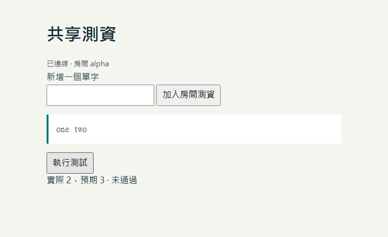

這一課會寫出兩個檔案：`server.ts` 處理房間，`index.html` 提供表單和測試按鈕。B 加入時會拿到 A 先前的輸入，之後不必重新整理。這是獨立教學程式，運算只跑固定的單字計數。


[下載可直接執行的雙人房間（ZIP）](../../downloads/series-labs/pair-practice.zip)。解壓後在 `server.ts` 旁執行 `bun run server.ts`，即可照第三步開兩個分頁。要自己實作，從第一步建立同樣兩個檔案。

## 1. 寫一個會補發快照的服務

準備 Bun 1.4.x，執行 `mkdir pair-room`、`cd pair-room`。新增以下兩個檔案，無須安裝第三方套件。在 `server.ts` 中，`rooms` 的 key 是房間 ID。加入房間時先回傳整份陣列；有人新增單字時，`server.publish` 把新快照送給該房間所有訂閱者，包括送出操作的人。

```ts title="server.ts"
import page from './index.html' with { type: 'text' };

type SocketData = { room: string };
const rooms = new Map<string, string[]>();

const server = Bun.serve<SocketData>({
  hostname: '127.0.0.1',
  port: 4178,
  fetch(req, server) {
    const url = new URL(req.url);
    if (url.pathname === '/') return new Response(page, {
      headers: { 'Content-Type': 'text/html; charset=utf-8' },
    });
    if (url.pathname !== '/room') return new Response('Not found', { status: 404 });
    const room = url.searchParams.get('id') ?? '';
    if (!/^[a-z0-9-]{1,32}$/.test(room)) return new Response('Invalid room', { status: 400 });
    if (req.headers.get('origin') !== url.origin) return new Response('Invalid origin', { status: 403 });
    if (server.upgrade(req, { data: { room } })) return;
    return new Response('WebSocket required', { status: 426 });
  },
  websocket: {
    maxPayloadLength: 256,
    open(ws) {
      ws.subscribe(ws.data.room);
      ws.send(JSON.stringify(rooms.get(ws.data.room) ?? []));
    },
    message(ws, data) {
      if (typeof data !== 'string') return;
      const word = data.trim();
      if (!word || word.length > 32 || /\s/.test(word)) return;
      const room = ws.data.room;
      const words = rooms.get(room) ?? [];
      if (words.length >= 50) return;
      words.push(word);
      rooms.set(room, words);
      server.publish(room, JSON.stringify(words));
    },
  },
});
console.log(server.url.href);
```

## 2. 寫網頁，讓每次顯示都來自同一份快照

在同一層新增 `index.html`。注意 `onsubmit` 只送新單字。畫面由 `onmessage` 統一更新；如果提交後也直接把字加到畫面，自己的廣播回來時就容易多算一次。

```html title="index.html"
<!doctype html>
<html lang="zh-Hant">
<meta charset="utf-8">
<meta name="viewport" content="width=device-width,initial-scale=1">
<title>Pair Practice｜共享測資</title>
<style>
  body {max-width:38rem;margin:3rem auto;padding:0 1.2rem;background:#f4f5f1;color:#182f33;font:18px/1.6 system-ui}
  h1 {line-height:1.25} label,output {display:block} input,button {font:inherit;padding:.35rem .65rem}
  pre {background:#fff;padding:1rem;border-left:4px solid #00796f;white-space:pre-wrap} small {color:#3a5155}
</style>
<h1>共享測資</h1><small id="state">連線中</small>
<form><label for="word">新增一個單字</label><input id="word" maxlength="32" required>
<button id="add" disabled>加入房間測資</button></form>
<pre id="fixture">（空白）</pre><button id="run" type="button">執行測試</button>
<output id="result" aria-live="polite"></output>
<script type="module">
  const $ = (id) => document.getElementById(id);
  const room = new URL(location.href).searchParams.get('room') ?? 'lesson';
  const endpoint = new URL('/room', location.href);
  endpoint.protocol = location.protocol === 'https:' ? 'wss:' : 'ws:';
  endpoint.searchParams.set('id', room);
  const ws = new WebSocket(endpoint);
  let words = [];
  ws.onopen = () => {
    $('state').textContent = '已連線 · 房間 ' + room;
    $('add').disabled = false;
  };
  ws.onclose = () => {
    $('state').textContent = '已斷線，請重新整理';
    $('add').disabled = true;
  };
  ws.onmessage = ({ data }) => {
    words = JSON.parse(data);
    $('fixture').textContent = words.join(' ') || '（空白）';
    $('result').textContent = '';
  };
  document.querySelector('form').onsubmit = (event) => {
    event.preventDefault();
    const word = $('word').value.trim();
    if (!word || /\s/.test(word) || ws.readyState !== WebSocket.OPEN) return;
    ws.send(word);
    $('word').value = '';
  };
  $('run').onclick = () => {
    const count = words.join(' ').match(/\S+/g)?.length ?? 0;
    $('result').textContent = '實際 ' + count + '，預期 3 · ' + (count === 3 ? '通過' : '未通過');
  };
</script>
</html>
```

## 3. 讓 B 晚一點進場

1. 在這兩個檔案旁執行 `bun run server.ts`，開 `http://127.0.0.1:4178/?room=alpha`。
2. 在 A 分頁分兩次加入 `one` 和 `two`。開另一分頁 B，貼上同一網址。B 不需輸入，就應顯示 `one two`。
3. B 按「執行測試」，確認「實際 2，預期 3」。回 A 加入 `three`。B 收到新快照時舊輸出會清空，重跑應顯示通過。



## 4. 開第三個房間，檢查廣播的界線

開第三個分頁，到 `http://127.0.0.1:4178/?room=beta`。beta 應是空白，執行測試得到 0。重新整理 alpha，應恢復三個字。最後關掉 Bun 再啟動，alpha 也會變空，因為本課把資料放在伺服器記憶體。


如果 A 有內容而 B 是空白，先逐字核對兩邊的 `room`，再看 DevTools 的 Network → WS 有沒有收到 JSON 陣列。服務只綁本機，本課也沒有帳號或房間權限。截圖由上述頁面及相同的房間處理函式產生；截圖測試透過 Playwright 攔截 WebSocket，把訊息交給這些函式。照步驟跑本機服務時，兩個分頁會走實際 WebSocket。
