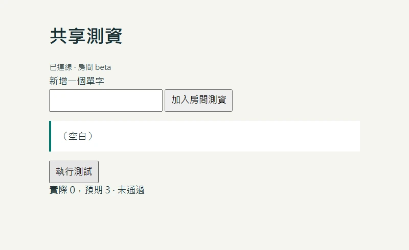

上一課最容易忽略的是 B 進房前的兩個字。伺服器只靠廣播，B 永遠收不到已經送過的訊息。加入時先讀 `rooms.get(room)`，再接收後續更新，才讓晚加入者也能從同一筆測資開始。

| 現在能驗什麼 | 再往產品走一步會遇到什麼 |
| --- | --- |
| 晚加入與重新整理後都能拿到快照 | 停掉 Bun 後快照會消失。要能恢復，寫入持久化儲存，連線時讀回最後版本。 |
| 同一個程序內的訂閱者都收到廣播 | 若有兩個服務實例，記憶體與訂閱名單各自獨立。需要跨實例的更新傳遞或明確分派房間。 |
| alpha、beta 拿到各自的測資 | 房間名稱只是索引。私人房間應由伺服器驗證身份與成員資格，再允許加入。 |
| 固定計數函式對相同輸入產生相同結果 | 要支援多種語言及執行器，需另外記錄程式版本、輸入與執行環境。 |

本機練習傳送的是「新增一個字」的操作。兩人同時送出時，伺服器依收到的順序把兩個字都留下；若改成兩邊都回傳整份 textarea 來覆寫，同一個時刻的兩次改動便可能互相蓋掉。要練自由文字共編，可下一次單獨研究 Yjs 如何把兩個更新合併，再沿用這次的晚加入案例驗證結果。

若只需要兩個人在同一台電腦做練習，單程序房間已夠用。什麼時候值得接資料庫？一個直接的判斷是：重啟服務之後，讀者是否仍需要回來看上一次的題目和測資。

想接著試 Yjs，可以照[兩個分頁的 Yjs 練習（含完整程式）](https://github.com/ntustRay/mr-blog/blob/080b3b4ecf22ff759273bc284333dac2a8acf952/src/content/blog/pair-practice-02-local-collaboration.md)建立 `Y.Doc`。先在 A 分頁輸入 `one`、`two`，再開 B；B 透過 `BroadcastChannel` 請求快照，A 用 `Y.encodeStateAsUpdate(doc)` 回覆。接著在 B 加入 `three`，回到 A 確認兩邊都有三個字。這個練習可以觀察 Yjs 如何合併更新，兩個分頁要開在同一個瀏覽器設定檔和相同的 origin。
