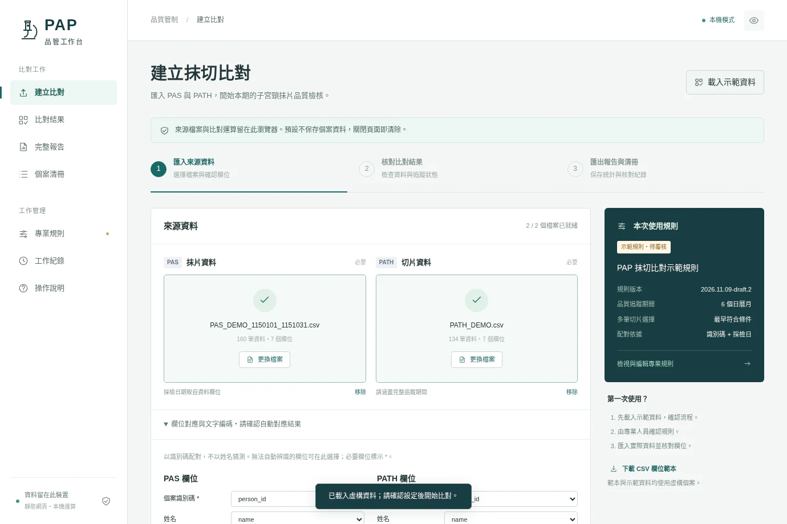
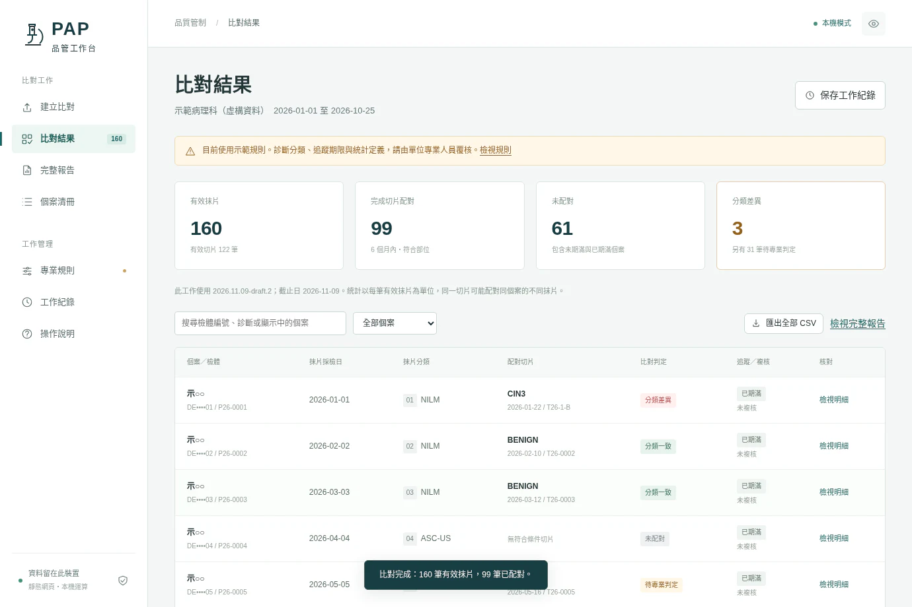
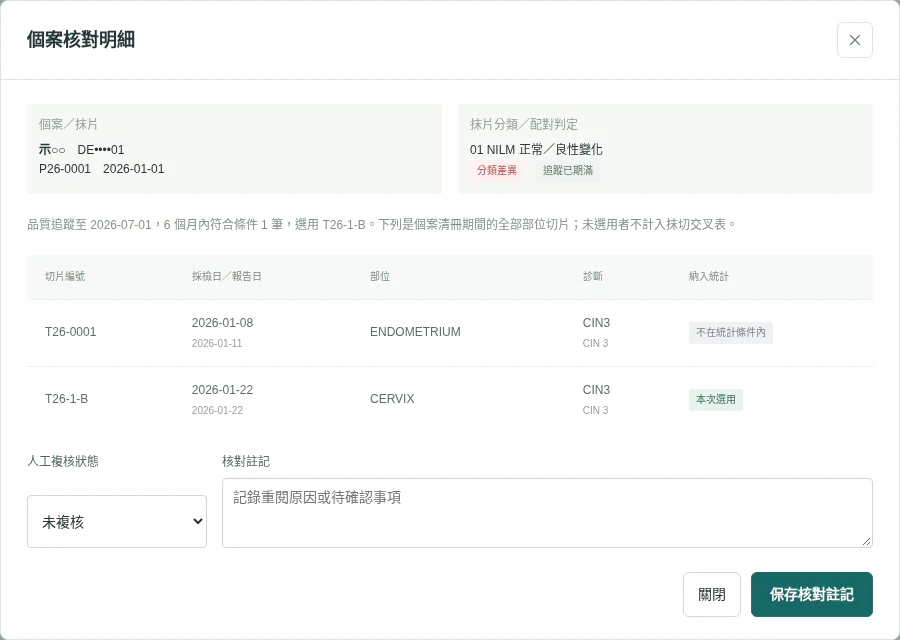
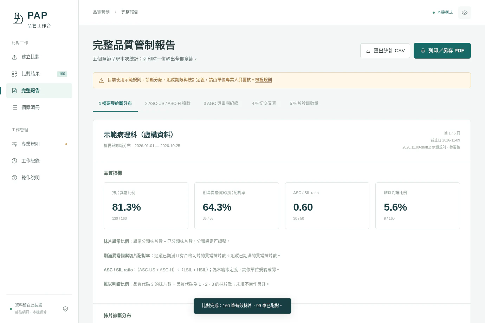

這次用內建的兩份虛構 CSV 跑一次比對，完成後用檢體編號在畫面和匯出檔找同一筆資料。準備一個桌面瀏覽器即可。截圖來自公開原始碼 `5c1ef82` 的本機版，規則版本為 `2026.11.09-draft.2`。

## 1. 載入示範資料

開啟 [PAP 品管工作台](https://ntustray.github.io/pap-qc-workbench/)，在左側選「建立比對」，再按「載入示範資料」。來源資料區會顯示 **2 / 2 個檔案已就緒**。PAS 是 `PAS_DEMO_1150101_1151031.csv`，PATH 是 `PATH_DEMO.csv`。兩份檔都由網站載入，這次無須上傳檔案。

## 2. 核對欄位和本次設定

往下找到「欄位對應與文字編碼」，需要時展開，確認左、右兩份資料各自對到正確欄位：

- 個案識別碼都是 `person_id`。
- 採檢日期是 `sample_date`，診斷代碼是 `diagnosis`。
- PATH 的切片部位是 `site`。

保留示範設定的資料完整截止日 `2026-11-09`。勾選保存會把比對結果留在瀏覽器，這次練習可維持預設未勾。按「開始本機比對」。

## 3. 從結果回查到一筆資料

畫面會切到「比對結果」。同一版示範輸入下，摘要顯示 160 筆有效抹片、99 筆完成配對，表格以檢體資料逐列列出。先滑到頁尾展開「資料檢查紀錄」，看哪些來源資料被標示提醒或排除。回到表格上方，在「搜尋個案」輸入 `P26-0001`，在該列點「檢視明細」。核對畫面中的抹片編號與所選切片編號 `T26-1-B`，然後關閉明細。

## 4. 下載 CSV 並核對版本

1. 在「比對結果」按「匯出全部 CSV」，開啟下載的 `PAP_比對結果.csv`。
2. 搜尋 `P26-0001`。核對抹片與切片編號，往右查看「規則版本」與「資料完整截止日」。
3. 在側欄切到「完整報告」。用報告章節的頁籤切換統計與明細，需要 PDF 時按「列印／另存 PDF」，在瀏覽器列印視窗選擇儲存成 PDF。

在本次 CSV 裡，第一筆識別碼和姓名顯示為 `DE••••01`、`示○○`，日期與檢體編號仍在。遮蔽取決於匯出當時的顯示設定，可用這筆虛構資料練習核對匯出內容。

[下一篇｜用規則快照解釋報表差異](../pap-qc-03-audit-trail/)
