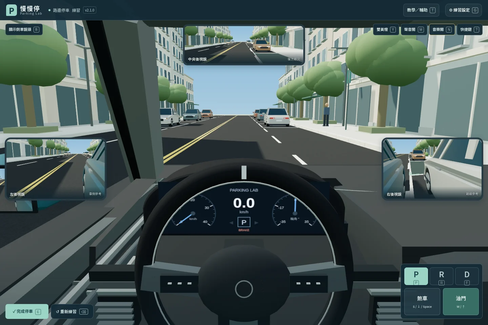
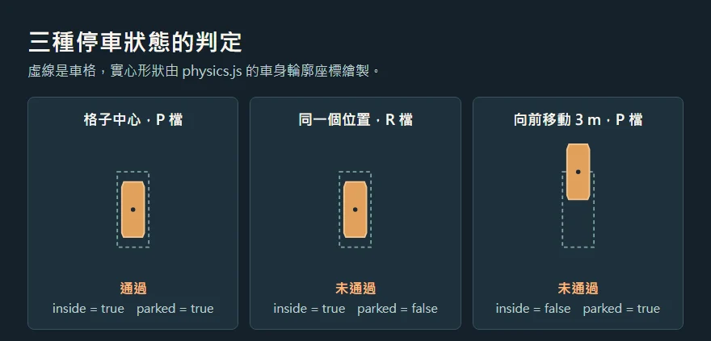

從駕駛座往右看，後輪快貼到格線了。切到俯視時位置應該一樣，按下提交也應該按照這個位置評分。三個地方若各自移動一輛車，畫面看似停好了，評分卻可能說車身還在格子外。

## 車輛位置由誰決定

公開專案用 JavaScript ES modules，Three.js 隨 repository 一起提供。`physics.js` 接收車身狀態、油門／煞車／轉向與時間差，回傳新狀態；`vehicle-spec.js` 提供車長、軸距等尺寸。鏡頭、模型與評分讀取這些資料，你能在沒有瀏覽器的 Node.js 程式裡重跑同一段行駛。

練習會從程式取得真實座標，產出兩份可以打開的圖，不需建立 3D 模型。第一份記下 D 與 R 檔在相同時間的蠕行距離；第二份把車放入格子、換檔或往前移，標出哪個條件改變判定。最後會把原專案建置成可由 GitHub Pages 託管的靜態站。

先做[固定時間步的蠕行練習](../parking-02-parallel-parking-practice/)。這是遊戲模擬資料，車輛參數、鏡面和駕駛座的視野適合用來解釋程式行為。
