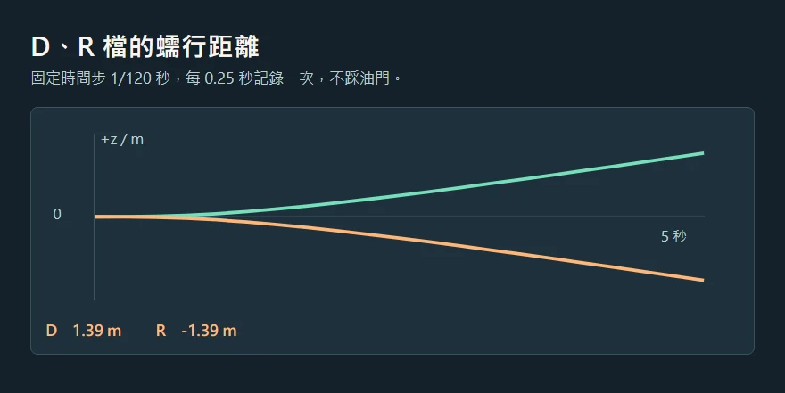
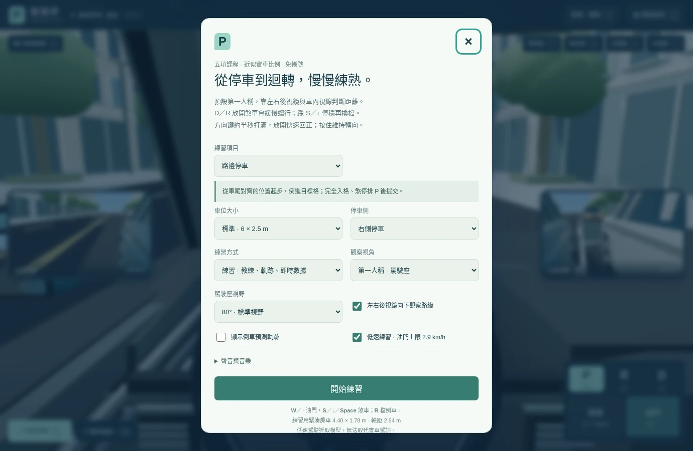

圖中兩條線是同一台車，只換排檔，沒有踩油門。先自己寫出資料，再用附件畫出和上圖相同的結果。

## 1. 讓遊戲與終端機共用物理模組

準備 Git、Node.js 22 以上，在新的工作目錄執行：

```sh
git clone https://github.com/ntustRay/parallel-parking-lab.git
cd parallel-parking-lab
npm start
```

打開 `http://127.0.0.1:4173`，這是 Three.js 練習場。保持伺服器開著，另開終端機進同一個資料夾。專案的 `physics.js` 不依賴 DOM，下面的迴圈直接載入同一份程式。



## 2. 新增自己的五秒模擬

在 `physics.js` 旁建立 `creep.mjs`。將初始狀態留在 scene，每次更新自己的 state，第二個檔位才能回到同一個起點。

```js
import { scenario, step } from "./physics.js";

const scene = scenario("normal", 1, "parallel");
for (const gear of ["D", "R"]) {
  let state = { ...scene.start, gear };
  for (let tick = 0; tick < 600; tick++) {
    state = step(state, { slow: true }, 1 / 120);
    if ((tick + 1) % 120 === 0) {
      const meters = state.z - scene.start.z;
      console.log(gear, (tick + 1) / 120, meters.toFixed(2));
    }
  }
}
```

執行 `node creep.mjs`。每個檔位各印五行，三欄依序是檔位、秒數、相對距離。核對最後一行各為 1.39 與 -1.39（m）。此練習使用 slow 模式，D 與 R 的精準蠕行目標相同；若移除 slow，兩種檔位使用各自的目標速度。

## 3. 在圖上找出早一秒踩煞車的差別

先把[繪圖程式 parking-report.mjs](../../downloads/series-labs/parking-report.mjs)另存到 `physics.js` 旁，執行 `node parking-report.mjs`。打開新產生的 `creep-report.html` 對照頁首。這個檔讀取 step 的回傳值，每 30 步記錄一次，用這些點連成線。

在 `parking-report.mjs` 把 `step(state, {slow:true}, 1/120)` 的 input 換成 `{slow:true, brake: tick >= 480}`，存檔、重跑、重新整理 HTML。兩條線應在第 4 秒後逐漸水平。這時看的是距離；煞停後距離保持，速度才會歸零。若曲線一直貼著零，先確認起點的 P 已被替換成 D 或 R，再檢查每次 step 是否接回 state。

下一篇接著在同一套資料上[實作入格的通過與失敗案例](../parking-03-test-vehicle-state/)。
