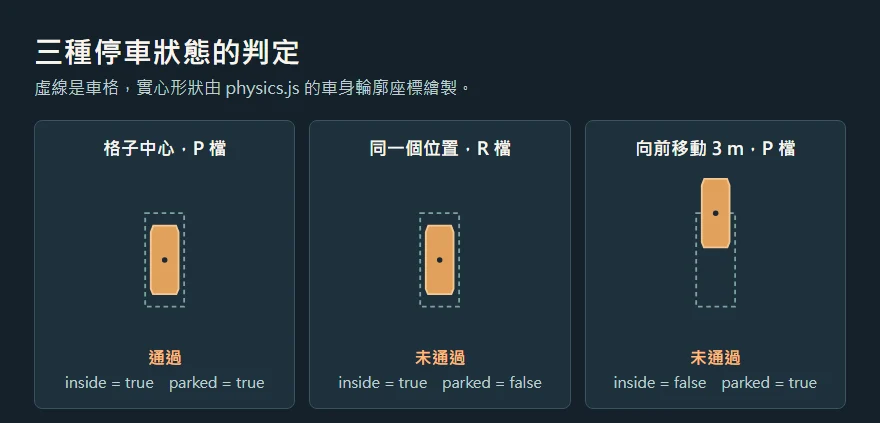
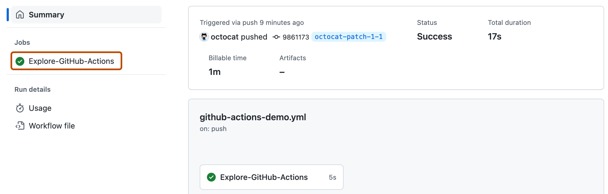

## 1. 寫一個通過案例，再一次只改一個欄位

在[上一課](../parking-02-parallel-parking-practice/)的 repo 根目錄新增 `bay.test.mjs`。目標格的中心、方向都取自 scenario，車身尺寸則由 physics 模組沿用遊戲設定。

```js
import assert from "node:assert/strict";
import { test } from "node:test";
import { result, scenario } from "./physics.js";

const scene = scenario("normal", 1, "parallel");
const parked = {
  ...scene.start,
  x: scene.target.x, z: scene.target.z, angle: scene.target.angle,
  speed: 0, gear: "P",
};
const stats = { hits: 0, corrections: 0 };
for (const [name, state, passed] of [
  ["置中並排 P", parked, true],
  ["位置相同、留在 R 檔", { ...parked, gear: "R" }, false],
  ["向前越界三公尺", { ...parked, z: parked.z + 3 }, false],
]) {
  test(name, () => assert.equal(result(state, scene, stats).passed, passed));
}
```

執行 `node --test bay.test.mjs`。應有三個案例通過。把第三個案例的 3 改為 0，保留「預期 false」，再跑一次；只應這一個案例失敗。接著改回 3，確定測試恢復。

## 2. 用實際車身輪廓解釋測試

執行 [parking-report.mjs](../../downloads/series-labs/parking-report.mjs)（放在 repo 根目錄，執行 `node parking-report.mjs`），打開 `bay-report.html`。圖中的車殼來自 `corners(state)`，輪廓由多個頂點描述；虛線格使用 target 的長寬。置中與 R 檔案例的 inside 均為 true，差別是 parked。越線案例仍是 P 檔，但 inside 已是 false。

回 `physics.js` 找 `result()`。一般練習要求車身入格、角度在容許範圍、車停好且排 P；考試還額外檢查碰撞次數。要新增驗收條件時，把測試放在物理層。鏡面與相機留給畫面對照，換視角就能使用同一套判定。

## 3. 用原專案的靜態建置與 Actions 發布

1. 在 GitHub Fork 原 repository 到自己的帳號。在自己的 Fork 進 **Settings → Pages → Build and deployment → Source → GitHub Actions**。若 Fork 的 Actions 尚未啟用，到 Actions 頁啟用。
2. 本機在 repo 根目錄執行 `npm test` 和 `npm run build`。輸出位於 `_site/`；`build.js` 處理模組路徑、模型與快取檔名。只驗收正式 build 可執行 `node server.js --built`；先關掉原本佔用 4173 的 dev 伺服器。
3. 將測試放入 `tests/bay-regression.test.js`，把 import 改成 `../physics.js`，讓預設 `npm test` 一起跑。從自己的 Fork clone 或將它加為 remote，提交這項變更並推到該 Fork 的 main。
4. 到 Fork 的 Actions 打開 `.github/workflows/ci.yml` 這次執行的 run。查看測試、建置及 Pages deployment 的結果，從 Pages 設定頁開已發布的網址。若首頁有畫面但車模沒有載入，Network 中檢查模型及模組的實際網址和回應狀態。



[官方介面截圖來源](https://github.com/github/docs/blob/02c25d16369fe27f9bdb28d1201f6b452f0d21dd/assets/images/help/repository/actions-quickstart-job.png)

部署的是由 build 產生的遊戲站。兩張用來除錯的練習報告留在本機。最後回到[駕駛座、物理與評分的架構總結](../parking-04-review-a-parking-attempt/)。
