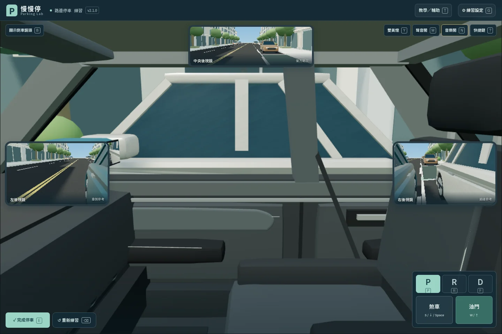

送出後只知道車身沒入格，通常還不知道該重做哪一段。下一輪把起點、停車側和低速模式都固定住，只調整一次回正的時機。斜退後先停下，從正上方看車尾是不是已過線，再切回駕駛座找右鏡裡對應的格線。能在第一人稱認出同一個位置，這輪才多練到一個下次用得上的線索。

## 各種視角各有工作

| 看到的結果 | 回到哪個地方檢查 |
| --- | --- |
| 車尾太靠近路緣 | 停在斜退轉直退的分界，用俯視看角度，再核對右鏡。 |
| 車身入格但仍未通過 | 看車是否完全煞停、方向是否對齊，以及是否已排 P。 |
| 練習能進格，關掉引導後常停歪 | 回到同一格，先把示範停在固定位置，找出可重複辨認的鏡面線索。 |

三面鏡與主視角從同一次更新後的車身位置繪製，才有辦法在同一瞬間比對。切鏡頭只改觀看位置，評分讀同一套狀態。用 Node.js 跑的車身測試適合找規則變動，瀏覽器中切換鏡頭則能檢查車模、格線與視野有沒有呈現出同一件事。

## 練到哪裡就可以切測驗

能在同一格重複靠後視鏡辨認入格位置，再切測驗模式。測驗收起教練和軌跡，評分也更嚴格。若只需要離線複習，可以在 [Releases](https://github.com/ntustRay/parallel-parking-lab/releases) 下載單一 HTML，先開啟確認瀏覽器支援 WebGL 2。

這套練習的範圍是模擬場景中的觀察順序、低速操作與路徑回放。實車座椅高度、鏡子位置、車身尺度都會改變畫面，視覺參考點需在實車課程重新建立。
