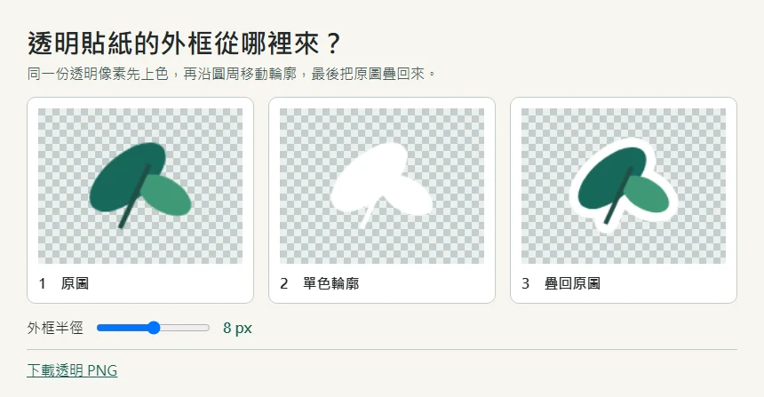

替透明圖片畫一圈白邊，再輸出兩種大小，看起來只要畫一個圓角框。遇到透明的葉子就知道差在哪裡：框得貼著葉子的外緣，原圖的四個角仍要透明。這件事可以全部在瀏覽器做，再把同一套處理函式拿去跑一整批圖。

## 一張圖在程式裡經過哪些地方

| 階段 | 公開專案的入口 | 在這一層學什麼 |
| --- | --- | --- |
| 選檔與預覽 | src/ui/App.tsx、src/core/files.ts | 保留來源 File 與預覽 URL，工具可換，原圖可重跑 |
| 送工作 | src/core/client.ts、src/workers/image.worker.ts | React 管畫面，處理器接收檔案與這次設定 |
| 效果 | src/core/pipeline.ts、src/features/sticker.ts | 從圖形 alpha 做輪廓、重新合成，依格式處理透明度 |
| 輸出 | src/core/files.ts 的 archiveResults | 每張依序編碼，交給 fflate 寫 ZIP |
| 部署 | vite.config.ts、vercel.json | Vite 產出 dist，Vercel 提供網站與模型檔案 |

本系列挑兩條可重現的路徑。第一條用三個 Canvas 看清楚圖是怎麼畫出來的；第二條用兩張來源產生 WebP，查驗實際尺寸，再回公開專案實作 ZIP 命名與部署。這兩個操作沿用透明區域，不靠人像模型，也用不到 API key。

[開啟下一課，親手實作透明外框](../pixel-02-transparent-sticker/)。完整專案可對照[原始碼與架構](https://github.com/ntustRay/pixel-workbench)。
